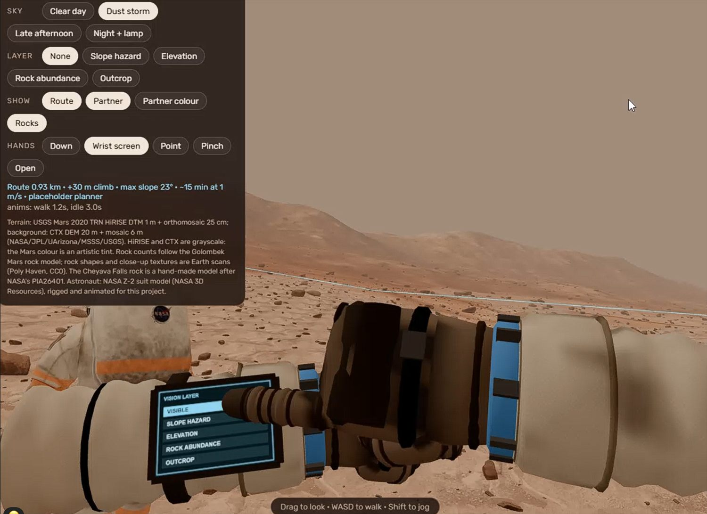
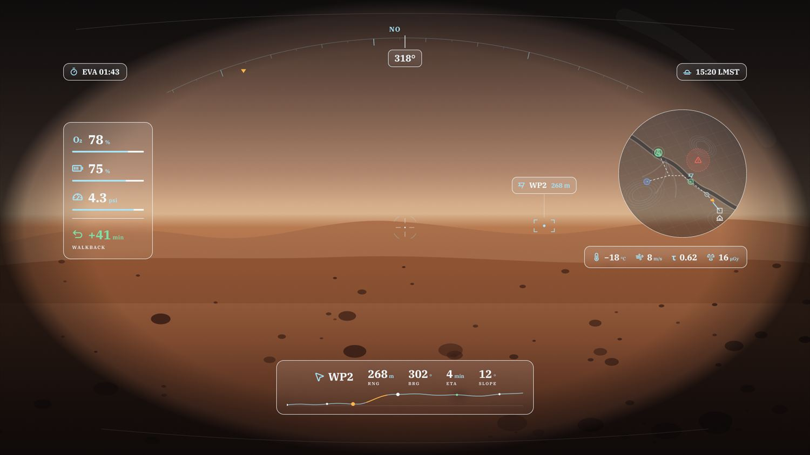
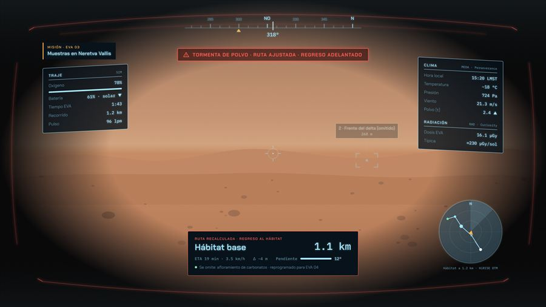
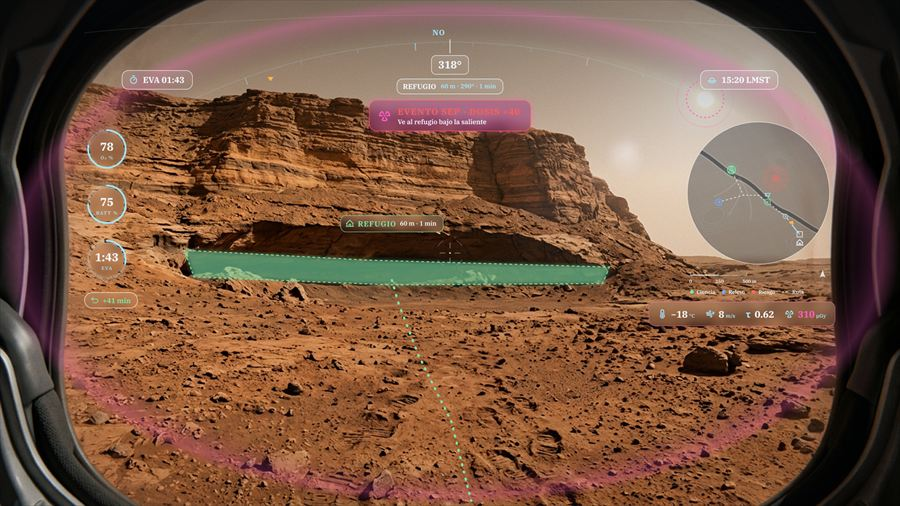
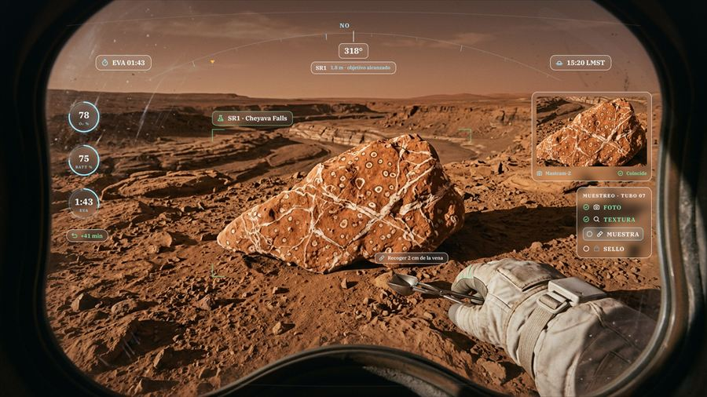
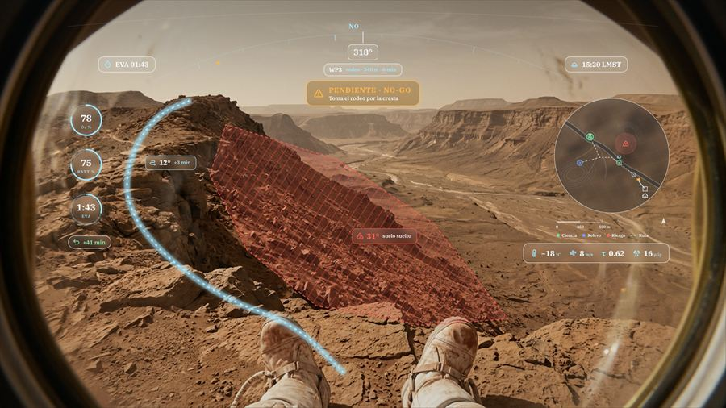

# Marswalk: implementation plan

**A first-person EVA simulator and layered map for Jezero crater**

NASA Space Apps Challenge 2026  ·  Version 1.0  ·  14 November 2026  ·  Product owner plan for the MartianMap team

> **Plan at a glance**
>
> - **Product.** The player is an astronaut on a marswalk from the habitat to the Cheyava Falls rock in Neretva Vallis, Jezero crater, on real HiRISE terrain. The map is the product: one layered navigation and safety picture in two modes. Plan is a top-down map for choosing the route. Walk is the helmet visor and the wrist screen. The simulator is how we show that map in use.
> - **Starting point.** The Marswalk engine already renders the site, the sky, two astronauts, the habitat and the sampling animations. The team's task list (Marswalk - Pendientes) names the remaining work. This plan orders that list, sizes it, adds acceptance tests and fills the gaps.
> - **MVP.** Plan mode and Walk mode, a route planner on the real height map, and three events (dust storm, radiation, low oxygen) that raise an alert and re-plan to the nearest shelter. At least four kinds of NASA data from three missions, with a source on every number. About 15 person-days.
> - **Stack.** Vite and React for the app and HUD, and three.js for the 3D scene, with the map and every model exported from Blender. A small state store sits between them. Static data files, no backend for the MVP.
> - **Stretch.** Two to four players online, one Cloudflare Durable Object per room on the Worker that already serves the app, started only when the MVP demo runs end to end.
> - **No GPS.** Mars has no satellite navigation and no usable compass. The map shows an estimated position with an error ring, fixed by matching what the helmet cameras see to the orbital map, the method Perseverance uses.

## Contents

- [1. Where we are today](#1-where-we-are-today)
- [2. Why this idea fits the track](#2-why-this-idea-fits-the-track)
- [3. Product definition](#3-product-definition)
- [4. Realism rules](#4-realism-rules)
- [5. Data plan](#5-data-plan)
- [6. Architecture](#6-architecture)
- [7. Delivery plan](#7-delivery-plan)
- [8. Demo script](#8-demo-script)
- [9. Stretch: players online](#9-stretch-players-online)
- [10. Risks](#10-risks)
- [11. Open questions](#11-open-questions)
- [Appendix: sources](#appendix-sources)

## 1. Where we are today

Four things exist: a working 3D engine (the Marswalk artifact you shared, with its assets in `public/marswalk/` and its test bench in `docs/marswalk-assets/`), HUD designs in `imgs/` and Figma, the data research note, and the team's task list. The app itself, in `src/`, is still the Vite and React template.



*Figure 1. The engine today: real terrain, sky presets, data layers and first-person arms with a wrist screen. A debug panel sits where the HUD should be.*

| What exists | Detail | Gap to close |
| --- | --- | --- |
| **Terrain** | Tile of about 1.4 × 1.5 km centred on Cheyava Falls, from the USGS Mars 2020 TRN HiRISE elevation model (source 1 m; the artifact's mesh is about 2 m) and 25 cm orthomosaic. A 12 km CTX ring gives the horizon. | None for the MVP. The tile origin is recorded in `docs/marswalk-assets/README.md` (Cheyava Falls, 18.4975 N, 77.3053 E), so real coordinates, local time and Sun position can be computed. |
| **Rocks** | Density map following the Golombek rock model, five rock meshes with three levels of detail, instanced. | None for the MVP. |
| **Sky** | Four presets: clear day, dust storm, late afternoon with the blue sunset glow, night with helmet lamp. | Drive from mission time and dust opacity instead of buttons. |
| **Data layers** | Slope hazard (limits at 15° and 20°), elevation, rock abundance, outcrop. | Legends and units. New layers: no-go zones, radio shadow. |
| **Astronaut** | NASA Z-2 suit with walk, idle and stoop. First-person arms with five hand poses, first-person legs, and sampling clips: rock, ground, stow, pour. | The wrist screen shows only a layer menu. It needs the full wrist app. |
| **Partner** | Scripted second astronaut who carries the tool case, hands it over and enters the habitat. Four player colours are already defined. | A partner driven by a remote player (stretch). |
| **Habitat** | NASA Habitat Demonstration Unit shell with airlock and interior: planning table, tablet, sample glovebox, suit rack. Five wall screens show placeholder content. | Real screen content: planner, EVA status, weather. |
| **Route** | Five placeholder waypoints from the habitat through the channel floor, the dune field edge and the Bright Angel outcrop to Cheyava Falls. Built-in planner marked placeholder: 0.93 km, +30 m climb, max slope 23°, about 15 min. | Real cost function, route options, re-planning on events. |
| **HUD designs** | Visor bezel; normal walk in two styles; walk in a dust storm; scenarios 1, 3, 4, 5, 7 and 8. A Figma file with a nine-frame mood board. | Figma to finish and measurements to hand over. One visual style to choose. |
| **Data research** | Resource note listing sources, priorities and limits (PDS, Mars Trek, USGS, MMGIS). | MEDA, RAD and surface images not yet downloaded. Hazard numbers not yet sourced. |
| **Task list** | Marswalk - Pendientes: 32 tasks in six areas (App, Route, Data, Graphics, UX and video, Delivery) at three priority levels. | Only the Graphics tasks have an owner. No sizes, order or acceptance tests. Section 7 adds them. |
| **Repository** | Vite 8, React 19 and oxlint template, plus the assets in `public/marswalk/` and the test bench in `docs/marswalk-assets/`. | The test bench (`docs/marswalk-assets/testbench-reference/main.js`) is a reference, not the final app. The Blender files are not in the repository yet. Blender and model files need Git LFS: one `.blend` is 151 MB. |

## 2. Why this idea fits the track

The track asks for “a layered, integrated view of a location or route on the Martian surface that pulls together data from multiple NASA science missions and could help a human explorer plan and carry out a successful Marswalk.” It asks for a map, a tool or an interface. It does not ask for a game, so a simulator has to justify itself.

Our reasoning is that a map for an astronaut can only be judged in use. A flat web map of Jezero would repeat what Mars Trek already does, and the track says those tools “are built for regional and global views rather than the hyperlocalized areas astronauts will target.” A person in a suit reads a map in short glances, while walking, with limited oxygen, on ground that can hurt them. Putting the judge inside the helmet, on 1.4 by 1.5 km of real terrain at 25 cm image resolution, is the most direct way to show that our layers answer the questions that matter at that scale: where do I step next, how far is home, what changed. So the deliverable is the map and its three displays. The simulator is the test bench that proves the map works.

The rest of the design follows the track line by line. It says to start from a science goal and a well-studied location, so we go to the rock where Perseverance reported a potential biosignature, a site the rover studied closely enough that surface images and measurements exist for it. It says safety comes first and names radiation and suit mobility, so the must-have events are a dust storm, a radiation alert and low oxygen, each ending in a new route to the nearest shelter, on top of a planner that will not send a suit up a slope it cannot climb. It says “plan and carry out,” so there is a Plan mode as well as a Walk mode. And it values the human in the loop, astronauts who “make connections” and “solve problems quickly,” so the map never decides for the player: it shows the cost of a detour and lets them choose.

### 2.1 Requirement by requirement

| The track asks for | Our answer | Status |
| --- | --- | --- |
| A map, tool or interface an astronaut could use during a surface mission | One map in two modes: Plan for the planning display, Walk for the visor HUD and the wrist screen. All three are formats the track suggests. | Build |
| A science goal and a location | Sample the Cheyava Falls rock and the Bright Angel outcrop in Neretva Vallis, where Perseverance reported a potential biosignature. | Have: site built |
| A hyperlocal view, not a regional one | A 1.4 × 1.5 km site with a 2 m terrain mesh and 25 cm imagery. | Have |
| Data from multiple NASA missions | Mars Reconnaissance Orbiter (HiRISE, CTX), Mars 2020 Perseverance (MEDA, Mastcam-Z, PIXL, SHERLOC) and Curiosity (RAD). | Have 1, build 2 |
| At least three kinds of data, layered | Optical, topographic, atmospheric, radiation and chemical, plus derived rock-abundance and outcrop layers. | Have 2 kinds, build 3 |
| Astronaut safety first, including radiation and space weather | Dust storm, radiation and low-oxygen events that raise an alert and re-plan to the nearest shelter. A walkback margin that is always visible. Slope limits inside the planner. | Build |
| Effect of the suit and carried equipment on mobility | Walking speed and effort depend on slope and rock cover. Oxygen and battery limit range. The partner carries the tool case. | Build |
| A route that avoids significant obstacles | Planner over a cost grid built from slope and rock abundance. It re-plans when conditions change and says what it avoided. | Upgrade placeholder |
| Point-of-view images so the astronaut knows what to expect | Perseverance images on each waypoint card, and a reference-image match on arrival at the rock. | Build |
| Rovers, or astronauts working in pairs | A partner astronaut on every EVA. A support rover is a later scenario. | Have partner |
| A chosen time frame for the data | Terrain is stable. Weather replays a real Perseverance sol and is labelled with its sol number, never shown as live. | Build |

### 2.2 Where we could drift off the track

- **Game over map.** Every feature must put information on the map or act on it. Animations and effects that do neither wait until the P0 list is done.
- **Invented data.** The track says “using NASA data.” Anything we simulate is tagged as simulated (section 4.1), and the demo ends on the sources screen.
- **A dot that needs GPS.** A position marker with no stated source would be wrong on Mars. Section 4.2 gives it one.

## 3. Product definition

### 3.1 Science objective

Cheyava Falls is a rock about 1 m by 0.6 m that Perseverance examined in July 2024 in the Bright Angel area of Neretva Vallis, the old river channel that fed Jezero's lake. Its instruments found organic compounds, white calcium sulfate veins and small “leopard spots” rich in iron and phosphate. In 2025 the science team reported these as a potential biosignature. The rover took one core. A geologist on foot can do what it could not: break fresh faces, follow the veins across the outcrop and choose samples in context. That is the mission.

The scope is Jezero crater only (site code JEZ in the USGS products): the tile around Cheyava Falls and its 12 km horizon ring. No other Mars location is in the plan.

### 3.2 The mission loop

1. **Plan.** In Plan mode, which in the story is the habitat's planning table, the crew picks science targets, sees the route the planner proposes and checks the weather and radiation outlook. The result is a go or no-go and a route.
2. **Egress.** Suit check on the wall screen, out through the airlock, first position fix.
3. **Traverse.** The visor guides to the next waypoint. The wrist screen switches map layers. Oxygen, battery and walkback margin run in the background.
4. **React.** Something changes: a slope is steeper than planned, dust rises, a solar particle event begins, an interesting rock appears off the route. The map re-plans and says why.
5. **Science.** At Cheyava Falls the visor matches the rock to Perseverance's image and steps through the sampling checklist.
6. **Return and debrief.** Back in the habitat: distance, time, samples, radiation dose and margins used.

### 3.3 One map, two modes, three displays

| Mode and display | When | Shows | What we have |
| --- | --- | --- | --- |
| **Plan: planning display** | Before and after the EVA | Top-down terrain map with every layer, the route and its waypoints, cost per leg, hazard outlook, go or no-go, debrief | Overview and drone cameras, four layers, Figma design. Planning table and wall screens for showing it inside the habitat later. |
| **Walk: visor HUD** | Always, while moving | Heading, next waypoint, oxygen, battery, radiation, time, distance, alerts, walkback | Mockups; visor frame and alert rings planned as a graphics effect |
| **Walk: wrist screen** | Stopped, a deliberate look | Layer switch, larger map, sampling checklist, suit detail | Arm, wrist quad with a layer menu, point and pinch poses |

Design rule: the visor carries only what is needed while walking. Anything that takes reading goes to the wrist or to Plan mode.



*Figure 2. Target visor for a normal walk: heading tape, suit panel, next waypoint with elevation profile, minimap and environment strip.*

### 3.4 Scenarios

| Scenario | Trigger | What the map does | Priority |
| --- | --- | --- | :--: |
| **Walk, normal** | Default state | Waypoint guidance, route glow, minimap, environment strip | **P0** |
| **Walk, dust storm** | Dust opacity passes a threshold | Alert, route shortened, later waypoints dropped, early return to the habitat | **P0** |
| **5 · Radiation alert** | Scripted solar particle event | Alert rings, dose rate on the strip, nearest shelter in green and the route to it | **P0** |
| **Low oxygen** | Walkback plus reserve exceeds the oxygen left | Alert and a direct route home | **P0** |
| **1 · Arrival at Cheyava Falls** | Within 2 m of the target | Reference image match, then the checklist: photo, texture, sample, seal | **P1** |
| **4 · Dangerous slope** | Path ahead exceeds the slope limit | No-go zone drawn on the ground, detour offered with its added time | **P1** |
| **3 · Unexpected find** | Player points at a rock for 2 s | Marker on the map, detour cost in time and walkback, go or no-go | **P2** |
| **7 · Walk in pair** | Always, with the partner | Partner range and bearing, both suits' status, separation limit | **P2** |
| **8 · Support rover** | Scripted rendezvous | Rover arrival time, meeting point, recharge | Later |

Priorities follow the task list, where the three events are called the heart of the challenge. Section 7.2 recommends pulling a minimal version of scenario 1 into the must-have set.

|  |  |
| :--: | :--: |
| *Dust storm. Route recalculated, early return.* | *Scenario 5. Particle event and shelter.* |
|  |  |
| *Scenario 1. Arrival and sampling checklist.* | *Scenario 4. Slope no-go and detour.* |

*Figure 3. Four of the team's scenario mockups. The mockup numbering skips 2 and 6 (see section 11).*

## 4. Realism rules

### 4.1 Measured, derived or simulated: always say which

The simulator mixes measured data with our own models. Every value on screen carries one of three tags. The dust-storm mockup already does this with “MEDA · Perseverance”, “RAD · Curiosity” and “SIM”.

| Tag | Meaning | Examples |
| --- | --- | --- |
| **DATA** | Measured by a NASA mission. Shown with mission, site and date or sol. | Terrain height, orbital image, MEDA pressure, RAD dose rate |
| **DERIVED** | Computed by us from measured data. | Slope, rock abundance, route, line of sight |
| **SIM** | Our model or a scripted event. | Oxygen and battery use, position drift, the dust storm timing |

Three limits from the research note apply everywhere. Published observations are historical, not live. RAD measured radiation in Gale crater, not Jezero. A 1 m elevation model does not see small rocks, so a route is advice, not a safety certificate.

### 4.2 Navigation without GPS

You raised this, and it changes the design. Mars has no navigation satellites. It also has no global magnetic field, so a compass does not work. The orbiters relay data during passes and do not give continuous positions. The minimap in the mockups is still valid, but its position marker needs a stated source.

The map itself is not the problem. It comes from orbit and is stored in the suit. The terrain products we use were made for Mars 2020's Terrain Relative Navigation, the system that let the lander find itself by matching camera images to an orbital map. Since February 2026 Perseverance does the same on the ground: its Mars Global Localization software matches the rover's panoramas to orbital maps and fixes its position to about 25 cm in about two minutes, with no help from Earth. Between fixes it counts wheel turns and tracks features with its cameras. We give the astronaut the same method and we show its limits.

| Position source | What it gives | Limit the HUD shows |
| --- | --- | --- |
| Dead reckoning: inertial unit, step count, helmet-camera odometry | A continuous position | Error grows with distance walked. Starting value 1 to 2 % of distance (SIM). |
| Terrain fix: helmet cameras matched to the HiRISE map | Resets the error to under 1 m | The astronaut must stand still for a few seconds and see the horizon. Not available in a dust storm or at night. |
| Radio ranging to the habitat mast, the partner and the rover | Bounds the error | Line of sight only, computed on the real terrain. |
| Heading from gyro and Sun sensor | The heading tape | No magnetic north. Degrades when the Sun is hidden. |

What changes on screen:

- The position marker has an uncertainty ring that grows while walking and shrinks after a fix.
- A small navigation line states mode, error and age, for example “NAV · terrain fix · ±0.4 m · 3 min ago”.
- When the error passes a limit, the visor asks the astronaut to stop for a fix.
- In the dust storm, fixes stop and the ring grows. That is one more reason the planner sends the crew home early, and it ties the atmospheric data to navigation.
- Voice and data follow the same logic. The link to the habitat is line of sight, and “CAPCOM” is a crew member in the habitat, because a signal to Earth takes roughly 3 to 22 minutes each way.

Implementation is small. The simulation knows the true position. A navigation module produces the estimate (truth plus drift, reset by fixes) and the HUD reads only the estimate. Under one person-day; the marker with ring and the navigation line are P0, the full drift model is P1.

### 4.3 Other realism parameters

| Aspect | Basis | In the simulator | Tag |
| --- | --- | --- | :--: |
| **Gravity** | 3.71 m/s², 38 % of Earth's | Gait, jump and fall, dust kicked up by boots | SIM |
| **Time** | A sol lasts 24 h 39 min 35 s | Mission clock in local mean solar time; Sun position from time and latitude 18.5° N | DERIVED |
| **Sky** | Tan daytime sky, blue glow around the setting Sun, dust opacity (tau) | The four existing presets, blended by time and tau | SIM |
| **Weather** | MEDA on Perseverance: pressure of roughly 650 to 800 Pa, air temperature, wind | Replay of one real sol, labelled with its sol number | DATA |
| **Radiation** | RAD on Curiosity: about 0.2 mGy per sol on the surface in Gale crater | Background dose counter; scripted particle event scaled from RAD records | DATA + SIM |
| **Terrain hazard** | Slope from the HiRISE elevation model; Golombek rock abundance | Under 15° normal, 15 to 20° caution, over 20° no-go. 20° is NASA's suited walking limit (xEVA concept of operations, EVA-EXP-0042 Rev B). The slope layer and the route planner both read these limits from `src/sim/costGrid.js`, which matches `public/data/hazards.json`. | DERIVED |
| **Mobility** | Suited walking at 1.0 m/s on flat ground, jogging at 1.5 m/s, just under the fastest suited pace tested at Mars gravity (1.52 m/s) | Speed and effort scale with slope and rock cover | SIM |
| **Suit** | Oxygen, battery, suit pressure of 4.3 psi as in the mockups | Consumption follows effort; walkback time comes from the route home | SIM |
| **Light** | A helmet work lamp reaches 15 to 20 m | Existing night preset | SIM |
| **Sound** | Thin CO2 air at under 1 % of Earth's pressure | Mostly suit sounds: breathing, fans, radio. Outside sound is faint and dull. | SIM |

## 5. Data plan

| Kind | Source | Used for | Pri | Status |
| --- | --- | --- | :--: | --- |
| **Optical, from orbit** | HiRISE orthomosaic at 25 cm (USGS, Mars 2020 TRN); CTX mosaic at 6 m | Ground texture, minimap base | **P0** | Have |
| **Topographic** | HiRISE elevation model at 1 m; CTX elevation model at 20 m | Terrain mesh, slope, elevation profile, line of sight, route cost | **P0** | Have |
| **Derived geology** | Rock abundance after the Golombek model; outcrop mask from HiRISE | Route cost, science targeting | **P0** | Have |
| **Atmospheric** | MEDA, in the Mars 2020 archive on PDS | Environment strip, dust storm numbers and trigger | **P0** | Extract one or two sols |
| **Radiation** | RAD, in the Curiosity archive on PDS | Dose on the HUD, radiation event numbers | **P0** | Constants and one event curve |
| **Optical, from the surface** | Perseverance Mastcam-Z images of Bright Angel, sols 1187 to 1217; Navcam and WATSON images of Cheyava Falls | Science stop cards, reference match at the rock, colour matching of terrain and sky | **P1** | Colour matching done (see `docs/marswalk-assets/README.md`). Curate 10 to 15 images for the stops |
| **Chemical and spectral** | PIXL, SHERLOC and SuperCam results for Cheyava Falls; CRISM for regional minerals | Science card at the rock; optional mineral view | **P1** | Write the card; a mineral view is P2 |
| **Geologic map** | USGS map SIM 3464 of Jezero (349 MB database) | Geology layer | **P2** | Coarse at this scale: few units cross our site |
| **Rover track** | Perseverance localisation data (PLACES) | “Perseverance drove here” line as ground truth on the map | **P2** | Optional |
| **Thermal** | THEMIS on Mars Odyssey | Thermal view. Recommendation: drop it. 100 m pixels are too coarse for a site this small. | – | Team to decide |

Handling rules:

- **Process offline, ship small files.** The 6.9 GB orthomosaic and 1.8 GB elevation model never reach the browser. This is already done for the terrain tile.
- **No new pipeline for the planner.** Slope and route cost are computed in the browser at load from the 751 × 751 height grid.
- **Provenance travels with the data.** Each data file has a block with mission, instrument, product ID, site, date or sol, licence and tag. The HUD reads its labels from that block.
- **Nothing live in the demo.** No API calls at run time. Everything is bundled.
- **One coordinate frame.** Keep the engine's local frame (x east, z south, metres from Cheyava Falls). The origin's latitude and longitude are recorded once, in `docs/marswalk-assets/README.md`: 18.4975 N, 77.3053 E.

## 6. Architecture

### 6.1 MVP stack

| Layer | Choice | Notes |
| --- | --- | --- |
| **App shell** | Vite 8 and React 19, JavaScript with JSDoc types, oxlint | Already in the repository. No framework change. TypeScript only if the team already works in it. |
| **3D engine** | three.js with the engine's own shaders, WebGL2 | Kept as a plain module with its own render loop. React never renders per frame. |
| **Map and models** | Built in Blender, exported as `.glb`, loaded with the three.js glTF loader | One Blender scene is the source for the terrain, habitat, astronauts, rocks and props (section 6.4). |
| **State** | Zustand store | The simulation writes a snapshot a few times per second. HUD and Plan mode subscribe to the parts they show. |
| **Visor HUD and Plan mode** | React components in HTML, CSS and SVG over the canvas | Sharp text at any resolution, built from the Figma measurements. |
| **In-world screens** | Canvas 2D drawn into textures | The wrist quad and the five habitat wall screens already accept a texture. |
| **Route planner** | A* search in a Web Worker | Re-plans without dropping frames. |
| **Data** | Static JSON and images under `/public`; models as binary `.glb` | A provenance block in every data file. |
| **Hosting** | Cloudflare Workers static assets, deployed by Workers Builds with a preview per pull request | See `docs/deploy.md`. Plus a local build on the demo laptop. |

### 6.2 Modules

Five layers, each depending only on the ones below it:

| Layer | Contains | Rule |
| --- | --- | --- |
| **Interface (React)** | Plan mode, visor HUD, wrist app, menus, debrief | Reads the store. Sends player intents. No simulation logic. |
| **State store** | One snapshot: mode, mission, suit, navigation, route, environment, alerts, crew | The only thing the interface reads. |
| **Simulation core** | Clock, suit, navigation, hazards, planner, event engine | Plain JavaScript. No React and no three.js imports. |
| **Engine (three.js)** | Terrain, sky, rocks, astronauts, habitat, layers, effects | Answers queries: height, slope and line of sight at a point. |
| **Data** | Terrain and rock grids, sky presets, hazard numbers, MEDA and RAD series, science stops, provenance | Static files, loaded once. |

The simulation core has no rendering imports for two reasons. It can be tested without a browser, and it stays independent of how other players are connected (section 9).

### 6.3 Repository layout

```text
src/
  engine/     from docs/marswalk-assets/testbench-reference: terrain, sky, rocks,
              astronauts, habitat, shaders.js
              (main.js stays there as the reference test bench, not the app)
  sim/        clock, suit, nav, hazards, planner (worker), events
  state/      store.js
  plan/       PlanMap, LayerPanel, RoutePanel
  hud/        Visor, HeadingTape, SuitPanel, WaypointPanel, Minimap, EnvStrip, Alerts
  screens/    WristApp, Debrief, Sources
  data/       loaders, provenance registry
  net/        (stretch) room, pose sync, partner source
public/
  marswalk/   assets/ assets_astronaut/ assets_habitat/ assets_props/    served as .glb
  data/       hazards.json, meda_sol.json, rad.json, stops.json, images/
blender/      .blend sources, Git LFS (not .blend1, not the old terrain test)
docs/         this plan, demo script, credits
  marswalk-assets/   assets README and the test bench reference
```

### 6.4 From Blender to three.js

The map and every model are built in Blender and imported into three.js. These rules keep that pipeline predictable:

- **One source.** The Blender scene (`marswalk_jezero_real.blend`) is the source for the terrain, habitat, astronauts, rocks and props. Nothing is modelled in code.
- **Two exports of the terrain, from the same scene.** A `.glb` mesh for what the player sees, and the height grid (`terrain.json`) for what the simulation computes: slope, route cost, collisions and line of sight. Exporting both from one scene is what keeps them in agreement.
- **One convention.** One unit is one metre. The origin is Cheyava Falls. Blender's +X east, +Y north, +Z up becomes three.js x east, z south, y up, which is what the glTF exporter's “+Y up” option produces.
- **A check.** A script samples 100 points and compares the mesh height with the grid height. It fails above 0.2 m.
- **Size.** Terrain mesh at about 2 m spacing, as today (about 560,000 vertices), split into tiles so the camera skips what it does not see. Draco or Meshopt compression. The orthomosaic as one large texture plus tiled detail textures near the camera, as the engine does now.
- **Names are a contract.** Code finds objects by their Blender names, such as `HabitatHatch` or `ScoopSoil`. List them in `docs/marswalk-assets/README.md` and do not rename them without telling App.
- **One command.** A Blender Python script writes every `.glb` into `public/marswalk/`, so a re-export never depends on remembering export settings.

### 6.5 Route planner

- **Grid.** The real height map from `public/marswalk/assets/terrain.json`.
- **Cost of a cell.** Distance × (1 + slope penalty + rock penalty). Cells over the slope limit or inside a hazard zone are blocked.
- **Output.** Path, distance, climb, steepest slope, and per leg: time, oxygen and battery. Written in the `path` field format that `route.json` already accepts.
- **Shelters.** The habitat plus the safe points the Route area defines. An event re-plans to the nearest one that can be reached.
- **Explanation.** The planner lists what it avoided, for example “31° loose slope, +3 min”.
- **Re-planning.** Under 100 ms when an event changes the cost grid.

### 6.6 Performance budget

- 60 frames per second on a laptop with a discrete GPU (High tier) and 30 on integrated graphics (Low tier), chosen automatically.
- The task list notes that speed has never been measured in a real Chrome with the habitat, furniture and partner. Measure in Phase 0, before building on top.
- The artifact build is 18 MB, of which about 7 MB is models stored as base64 text inside JSON. On normal hosting they are served as binary `.glb`.
- HUD numbers update 4 to 10 times per second. Heading and world-anchored markers follow the camera every frame.

## 7. Delivery plan

### 7.1 Phases

Effort is in person-days and is an estimate. I do not know the event dates or the team size yet (section 11), so the plan is ordered by dependency, not by calendar.

| Phase | Goal | Main work | Exit test | Effort |
| --- | --- | --- | --- | :--: |
| **0 · Foundation** | The engine runs from the repository | Repository with Git LFS; Blender export script; app base with the two modes; store and engine API; first deploy; first frame-rate measurement; Figma measurements; rules check | `npm run dev` and the public link show today's scene with a working mode switch | 3 |
| **1 · Plan and Walk** | Plan a route, then walk it | Plan mode map with layers; Walk mode; helmet HUD; planner on the height map; suit model and walkback; position marker; hazard numbers with sources | A new player plans a route and reaches Cheyava Falls following only the visor | 6 |
| **2 · Events** | The heart of the challenge | Event engine; dust storm, radiation, low oxygen; re-plan to the nearest shelter; main effects; data files; credits | Each event raises an alert and draws a new route within a second | 4.5 |
| **3 · Science and depth** | The “Importante” list | Sampling, science stops, collisions, shelters, per-leg numbers, navigation drift, boot prints, layered outcrop, layer check against Mars Trek, debrief | A judge uses it unaided for three minutes | 6 |
| **4 · If time** | The “Si da tiempo” list, then players online | Habitat screens, geology layer, extra effects, layer previews; section 9 | Two laptops share one EVA | 3 + 3.5 |
| **S · Submission** | Package and send | End-to-end test, demo video, presentation, Space Apps form | Submitted, with a recorded backup of the demo | 1.5 |

> **Cut line**
>
> - **Phases 0 to 2 plus Submission are the must-have set: about 15 person-days.** Phase 3 starts only when the Phase 2 exit test passes. Submission is a reserved block that starts no later than eight hours before the deadline, whatever state Phase 3 is in.
> - For scale, a team of five gets roughly 10 to 12 productive person-days from a 48-hour event. If that is the format, the must-have set does not fit inside the event alone. Two levers: do Phase 0 and the data work beforehand if the rules allow it, and apply the cut order.
> - **Cut first, in this order:** Plan mode shows one recommended route, not a comparison; the radiation event reuses the dust storm's alert and re-plan flow with different numbers; low oxygen is a threshold alert with no scripted story; storm dust uses the existing sky preset before any new shader.
> - **Never cut:** the planner on real terrain, one event with re-planning, the source tags and the public link. Without them the entry does not answer the track.

### 7.2 What this plan changes in the task list

The backlog in 7.4 is the team's Marswalk - Pendientes list, kept in its six areas. “Imprescindible” is P0, “Importante” is P1, “Si da tiempo” is P2. Tasks marked with an asterisk are additions.

| Addition | Why |
| --- | --- |
| **State store and engine API (A9)** | HUD, Plan mode, Route and Data can work in parallel against one agreed snapshot. |
| **Suit model and walkback margin (A10)** | The low-oxygen event and the per-leg oxygen numbers need a model behind them. |
| **Position marker with a stated source (A11, A15)** | There is no GPS on Mars (section 4.2). |
| **Data files with provenance (D3)** | “Using NASA data” has to be visible on screen, not only in the credits. |
| **Rules check (E3)** | Prior work, AI-made images and the NASA insignia on the suit model may each need a disclosure. |
| **Blender export script (G7)** | The map and models come from Blender. One command must reproduce every `.glb`, and the mesh must agree with the height grid the planner uses. |
| **Sizes and acceptance tests on every task** | So that “done” means the same thing to everyone. |

| Task | In the list | Recommendation | Why |
| --- | --- | --- | --- |
| **Sampling (A12)** | Importante | Pull a minimal version into the must-haves: click the rock, play the ready clip, tick the checklist. | The track asks for science along the way, and the animations exist. |
| **Science stops (D5)** | Importante | Pull two stops into the must-haves, Bright Angel and Cheyava Falls, each with one Perseverance image and one paragraph. | The track asks for a science goal and point-of-view images. |
| **Partner: automatic or real player (A14)** | Importante, undecided | Automatic for the MVP, behind one interface. Real players are the stretch. | The demo must not depend on a network. |
| **Shelters (R3)** | Importante | Define the habitat and at least one natural shelter before the events work starts. | Every event ends at the nearest shelter. |
| **Thermal view (D7, G5)** | Si da tiempo, undecided | Drop it. | THEMIS pixels are 100 m wide. There is nothing to show on a site this small. |
| **Owners** | Graphics only | Put a name on every P0 row before work starts. | Six areas, one named owner. |

### 7.3 Areas and first deliverables

| Area | Owns | Owner | First deliverable |
| --- | --- | --- | --- |
| **App** | Plan and Walk modes, HUD, events, store, deploy | To name | App base with the mode switch, running the engine from the repository |
| **Route** | Planner, re-planning, shelters, per-leg numbers | To name | A path for the five placeholder waypoints in the `path` format of `route.json` |
| **Data** | Hazard numbers, MEDA and RAD files, science stops, layer check, credits | To name | One table with value, unit, source and tag for storm, radiation and oxygen use |
| **Graphics** | Effects, outcrop, boot prints, colour matching | Andrea | Export script for the map and models; then the visor frame with alert rings and the route glow |
| **UX and video** | Figma, measurements, demo video, presentation | To name | HUD and Plan mode measurements |
| **Delivery** | End-to-end test, form, rules | To name | Deadline time confirmed; rules checked |

App, Route and Data can start at once if two contracts are agreed first: the shape of the store snapshot and the `route.json` format. Graphics has six open tasks on one person, including a must-have of size L, so the main effects come before the Blender items.

### 7.4 Backlog

Sizes are for one person: S is two to three hours, M is most of a day, L is one and a half to two days.

**App**

| ID | Task | Pri | Size | Done when |
| --- | --- | :--: | :--: | --- |
| A1 | App base with the two modes, Plan and Walk, on the `public/marswalk/` models | **P0** | M | The mode switch works; engine code lives in `src/engine`; models load as `.glb` |
| A2 | Plan mode: terrain map with the route, waypoints and layers | **P0** | L | The route shown here is the one Walk mode follows; every layer has a legend |
| A3 | Walk mode: first-person camera, walking, switching modes | **P0** | M | Mouse look with pointer lock; arms, legs, head bob and helmet lamp as in the reference |
| A4 | Helmet HUD: oxygen, battery, radiation, time, distance, alerts | **P0** | M | Built to the Figma measurements; every value comes from the store |
| A5 | Events: dust storm, radiation and low oxygen raise an alert and re-plan the route | **P0** | L | Each event is a data file; each ends with a route to the nearest shelter |
| A6 | Frame-rate test on an ordinary laptop; automatic High or Low tier | **P0** | S | Measured in Chrome with habitat, furniture and partner; 30 fps at least |
| A7 | Publish the demo with a link | **P0** | S | The public link loads in under 10 s on ordinary Wi-Fi |
| A8 | Project in the repository, Git LFS for `.blend`, `.glb`, `.npy` | **P0** | S | In progress. No file over 100 MB outside LFS |
| A9* | State store and engine API | **P0** | S | HUD and Plan mode read one snapshot; the engine imports no React |
| A10* | Suit model and walkback margin | **P0** | M | Oxygen and battery follow effort; walkback time is always on the visor |
| A11* | Position marker with uncertainty ring and navigation line | **P0** | S | The marker states its source; the ring is driven by the navigation module |
| A12 | Sampling: click ground or rock, scoop with contents, stow or hand to the partner | **P1** | M | Uses the four ready clips, the scoop and the case; the checklist ticks |
| A13 | Collisions with rocks, the partner and the habitat | **P1** | M | Uses the habitat walk zones, furniture circles and `rocks.collide` |
| A14 | Partner: automatic character or real second player | **P1** | S | Decision recorded; partner driven through one interface |
| A15* | Navigation drift: dead reckoning, terrain fix, radio ranging | **P1** | M | The ring grows while walking and resets after a 5 s stop in clear air |
| A16* | Debrief screen | **P1** | S | Distance, time, samples, dose and margins used |
| A17 | Habitat screens with real data | **P2** | M | Uses the five screen cells in `habitat.json` |

**Route**

| ID | Task | Pri | Size | Done when |
| --- | --- | :--: | :--: | --- |
| R1 | A* on the real height map, with cost from slope, rocks and distance | **P0** | L | Never crosses a blocked cell; result in the `path` field of `route.json` |
| R2 | Re-plan when something changes, and lead to the nearest shelter | **P0** | M | Under 100 ms, in a worker |
| R3 | Define shelters and safe points | **P1** | S | The habitat and at least one natural shelter, with coordinates |
| R4 | Time, oxygen and battery per leg | **P1** | M | Shown in Plan mode; uses the Data numbers |

**Data**

| ID | Task | Pri | Size | Done when |
| --- | --- | :--: | :--: | --- |
| D1 | Real hazard numbers with a source: dust storm, radiation, suit oxygen use | **P0** | M | One table with value, unit, source and tag, used by events, HUD and route |
| D2 | Credits and list of NASA sources used | **P0** | S | Extends the list in `docs/marswalk-assets/README.md`; shown on the sources screen |
| D3* | MEDA sol and RAD curve as data files with provenance | **P0** | S | Each number on the HUD resolves to a mission and a sol |
| D4 | Check slope, elevation and rock layers against NASA Mars Trek | **P1** | S | Three spot checks recorded with screenshots |
| D5 | Science stops with short texts: Bright Angel, Cheyava Falls | **P1** | M | Each stop has a text, an image and a credit |
| D6 | Geology layer from USGS map SIM 3464 of Jezero | **P2** | M | The layer aligns with the terrain |
| D7 | Thermal or mineral data for the thermal view, or drop it | **P2** | S | Decision recorded |

**Graphics (owner: Andrea)**

| ID | Task | Pri | Size | Done when |
| --- | --- | :--: | :--: | --- |
| G1 | Main effects: storm dust, visor frame with alert rings, route glow, shelter in green | **P0** | L | Each effect has an on and off call the events can use |
| G7* | Blender export script: map and models as `.glb` with agreed axes, scale, origin and names | **P0** | S | One command re-exports everything into `public/marswalk/`; mesh and height grid agree within 0.2 m |
| G2 | Layered outcrop rock | **P1** | M | Placed at the Bright Angel waypoint |
| G3 | Boot prints on the ground | **P1** | S | Prints stay for the whole EVA and show the way back |
| G4 | Match terrain and sky colours to Perseverance photos | **P1** | M | Done on 14 November 2026: matched to twelve Perseverance colour frames from sols 1211 to 1217. See the “Colour” section of `docs/marswalk-assets/README.md` |
| G5 | Extra effects: thermal view, slope grid, dust when sampling | **P2** | M | Slope grid first; thermal view only if D7 keeps it |
| G6 | Preview images for each layer | **P2** | S | One image per layer in Plan mode |

**UX and video**

| ID | Task | Pri | Size | Done when |
| --- | --- | :--: | :--: | --- |
| U1 | Finish Figma; hand over the HUD and Plan mode measurements | **P0** | M | One visual style chosen; sizes and colours listed |
| U2 | Demo video and presentation: script and recording | **P0** | M | A recorded backup exists six hours before the deadline |

**Delivery**

| ID | Task | Pri | Size | Done when |
| --- | --- | :--: | :--: | --- |
| E1 | Full end-to-end test before submitting | **P0** | S | The demo script runs twice in a row on the public link |
| E2 | Space Apps form: description, NASA resources used, demo link, video, repository | **P0** | S | Deadline time checked; form sent |
| E3* | Rules check: prior work, AI disclosure, NASA insignia | **P0** | S | A written answer from the organisers or the rules page |

**Players online (stretch)**

| ID | Task | Pri | Size | Done when |
| --- | --- | :--: | :--: | --- |
| M1* | Room on a Durable Object: join by code, crew list, shared mission clock | **P3** | M | Two browsers see each other in the list and show the same mission clock |
| M2* | Pose broadcast and remote astronaut with interpolation | **P3** | M | The remote suit walks smoothly at 5 updates per second |
| M3* | Shared markers and sample log in the room's storage | **P3** | S | A marker placed by one player appears for all and survives a reload |
| M4* | Plan-mode seat for a player in the habitat | **P3** | M | That player follows the EVA on the map and sends a new route |

## 8. Demo script

Three minutes, one take. Each beat exists to prove one thing the track asks for.

| Time | What the audience sees | What it proves |
| --- | --- | --- |
| **0:00** | Plan mode. The site from above, slope and rock layers switched on, the planner draws the route to Cheyava Falls with time and oxygen per leg. | Plan, with layered data; a route that avoids obstacles |
| **0:30** | Switch to Walk. The visor starts. The navigation line reads “terrain fix · ±0.4 m”. | An interface for the surface; no GPS assumed |
| **0:50** | Walking along the glowing route. Layer switched from the wrist. Walkback margin on the visor. | Hyperlocal layers in use; suit limits |
| **1:20** | Cheyava Falls. Perseverance's image beside the rock, science card, one sample taken. | The science goal and point-of-view imagery |
| **1:50** | Radiation alert. Rings on the visor, dose rate jumps, the nearest shelter turns green and a route leads to it. | Radiation and space weather; safety first |
| **2:20** | Dust storm. The sky closes in, the position ring grows, the route is recalculated to the habitat. | Atmospheric data driving a safety decision |
| **2:45** | Debrief and the sources screen. | Every number has a mission and a date |

The beat at 1:20 depends on the two recommendations in 7.2. If the stretch is ready, a second player joins at 0:50 and takes the sample.

## 9. Stretch: players online

The task list asks whether the partner should be an automatic character or a real second player. The answer here is both, in that order: automatic for the MVP, real players as a stretch that reuses the same partner interface.

### 9.1 What it adds

- **Surface crew.** The scripted partner becomes a remote player. Up to four suits: the engine already defines four player colours, two-player walk zones in the habitat and the tool-case hand-over.
- **Habitat seat.** A player in Plan mode follows the EVA on the map, drops markers, sends a new route and calls go or no-go. There is no avatar to synchronise, and it shows the “display inside the habitat” the track mentions.

Build the surface crew first. The habitat seat is cheap once rooms exist.

### 9.2 Recommended stack: one Durable Object per room

The app already deploys as a Cloudflare Worker named `martian-map` on the team's paid Workers account (#83, `docs/deploy.md`). The team chose to put online play on the same account. I checked the current Cloudflare documentation against this game and it fits. The game is cooperative, walking is slow (about 1 m/s) and a room holds at most six people, so the server simulates nothing and settles one kind of conflict: who took a sample first. A Durable Object covers that. It is one instance per room that handles one message at a time, has its own SQLite database, and keeps WebSockets open while it sleeps.

| Need | Cloudflare feature | How we use it |
| --- | --- | --- |
| **One place per room** | A Durable Object addressed by name | A `Room` class. The room code is the object's name, so `ABCD` always reaches the same instance. |
| **Fast, disposable updates** | WebSockets with the Hibernation API | The room relays each pose to the other players and stores nothing. |
| **Who is in the room** | A per-socket attachment (`serializeAttachment`, up to 16 KB) | The crew list is the list of open sockets. It survives hibernation with no database row. |
| **State that must be ordered and kept** | The object's SQLite storage | Mission start time, event seed, markers, sample log, tool-case holder, last route from the habitat |
| **Hosting** | The existing `martian-map` Worker and Workers Builds | Same URL, same PR previews, no second service, no API key in the app |

Compared with the earlier Supabase plan, we now write a small server, about 200 lines in `worker/`. In return the room decides order in plain code, no per-second message limit disconnects clients, and nothing lives outside the repository: no project to create, no key to configure, no project that pauses when idle.

Two rules keep the server small:

- **The clock and the scripted events are derived, not sent.** The room stores the mission start time (server time) and an event seed. Every client computes mission time and the event schedule from those two values, so all players see the same storm at the same second (section 9.5).
- **Shared changes made by players go through the room.** Dropping a marker or taking a sample is a message to the room. The room handles messages one at a time, writes the change to SQLite and broadcasts the result. The sample table's primary key stops two players from taking the same sample.

### 9.3 How a room works

```text
browser --- wss://<host>/api/room/ABCD ---> Worker fetch (worker/index.js)
                                              checks code, Origin, Upgrade header
                                              |
                                              v
                                            Room "ABCD" (Durable Object, SQLite)
                                              sockets: one per player, attachment = crew entry
                                              tables:  meta, markers, samples
                                              relays:  poses and telemetry, never stored

every other path ---> static files from dist/, as today (the Worker does not run)
```

- **Entry.** The Worker accepts only `GET /api/room/:code` with `Upgrade: websocket`. The code must be four letters from A to Z without I and O (331,776 codes), so a stray request cannot create objects with arbitrary names. The Worker also checks that `Origin` is the production host, a preview host or `localhost`. It then forwards the request to `ctx.exports.Room.getByName(code)`. Any other path returns 404.
- **Seats.** At most six sockets per room: four on the surface, one per engine colour, and two in the habitat. A seventh connection is closed with code 4001 and the reason “room full”. The room gives each surface player the first free colour.
- **Crew list.** On `hello`, the room calls `ctx.acceptWebSocket(server, [role])` and stores the crew entry (player ID, name, colour, role, time joined) with `serializeAttachment`. The crew list is `ctx.getWebSockets()` mapped through `deserializeAttachment()`. When a socket closes, the room broadcasts a `crew` leave message.
- **Storage.** Three tables, created on first use:

  ```sql
  CREATE TABLE IF NOT EXISTS meta    (k TEXT PRIMARY KEY, v TEXT);   -- started_at, seed, case_holder, route
  CREATE TABLE IF NOT EXISTS markers (id INTEGER PRIMARY KEY, client_id TEXT UNIQUE, author TEXT,
                                      kind TEXT, x REAL, z REAL, label TEXT, at INTEGER);
  CREATE TABLE IF NOT EXISTS samples (sample_id TEXT PRIMARY KEY, author TEXT, at INTEGER);
  ```

- **A sample can be taken only once.** The room runs `INSERT INTO samples ... ON CONFLICT DO NOTHING` and reads `cursor.rowsWritten`. 1 means this player took it, 0 means someone else did. The handler has no `await` between the read and the write, so the runtime commits the write atomically and no other message runs in between. The primary key still holds if a later change adds an `await`. Both players get the result. The one who lost sees “Sample already taken by <name>”.
- **Markers survive a resend.** The client gives each marker a `client_id`. A resend after a reconnect hits the `UNIQUE` constraint and the room ignores it.
- **Hibernation.** The room keeps nothing in memory that it cannot rebuild: the crew comes from the attachments, the rest from SQLite. Rate counters live in memory and reset when the room wakes, which is fine. Clients keep the connection alive with `ping` every 10 s, which the room answers through `setWebSocketAutoResponse` without waking up and without billed duration. A room where nobody moves goes to sleep after a few seconds. A room where someone walks stays awake, and that is the case section 9.10 prices.
- **Stale sockets.** When the room handles any message, it closes sockets whose last auto-response (`getWebSocketAutoResponseTimestamp`) is older than 30 s.
- **Cleanup.** Rooms are not deleted. A room with 50 markers is a few kilobytes. If that ever matters, an alarm 48 hours after creation can call `ctx.storage.deleteAll()`.

### 9.4 Messages and rate caps

JSON with short keys, all on one socket. Sizes are the JSON text before WebSocket framing, which adds 2 to 8 bytes.

| Type | Direction | Contents | Size | Rate |
| --- | --- | --- | :--: | --- |
| `hello` | client to room | name, role, preferred colour | ~80 B | Once per connection |
| `welcome` | room to client | your player ID and colour, crew list, `started_at`, seed, server time, markers, samples, case holder, last route | 0.3 to 3 KB | Once per connection |
| `crew` | room to all | join or leave, with the crew entry | ~90 B | On change |
| `p` (pose) | client to room to others | x, z, heading, pitch, animation, hand pose, client time. The room adds the sender's ID. | ~70 B in, ~80 B out | Only on change, at most 10 per second |
| `tel` | client to room to others | oxygen, battery | ~40 B | Every 5 s |
| `start` | client to room to all | nothing; the reply carries `started_at` and the seed | ~60 B | Once per mission |
| `mk` (marker) | client to room to all | kind, x, z, label, `client_id`; the room adds the ID and author | ~100 B | On action |
| `smp` (sample) | client to room to all | sample ID; the reply adds the result and who took it | ~50 B | On action |
| `case` | client to room to all | who holds the tool case | ~40 B | On action |
| `rt` (route) | habitat to room to surface | up to 200 waypoints in decimetres | up to 2.5 KB | On action |
| `go` | habitat to room to all | go or no-go, short reason | ~60 B | On action |
| `t` (clock) | client to room to client | client send time; the reply adds server time | ~50 B | 5 at join, then every 60 s |
| `ping` | auto-response | the string `ping`, answered with `pong` | 4 B | Every 10 s, never wakes the room |

Height is not sent. Each client reads it from its own terrain. The remote suit is drawn where it really is, because you see it with your eyes. Its marker on the map is that player's estimated position and appears only while there is radio line of sight (section 4.2). Behind a ridge it turns grey and reads “last known”.

At these rates JSON is small enough. A full room at the cap sends each client 5 × 10 × 80 B = 4 KB/s. A binary pose of about 24 bytes is an optimisation for later, not for the event.

Rate caps, enforced on both sides:

- **Client.** At most 10 poses per second, and only when the suit moved more than 5 cm, turned more than 1° or changed animation. Telemetry every 5 s. At most 5 other actions per second.
- **Room.** A token bucket per socket: 15 messages per second with bursts up to 30. The room drops anything over that. A socket that stays above three times the cap for 5 s is closed with code 1008. A socket that sends a message over 4 KB is closed with code 1009.
- **Why both.** Cloudflare bills every incoming message, including the ones the room drops. The room's cap protects the other players. Only the client's cap protects the bill.
- **Headroom.** A Durable Object has a soft limit of 1,000 requests per second. A full room at the cap is 6 × 15 = 90.

### 9.5 Mission clock and scripted events

- **Start.** The first `start` message sets `started_at` to the room's `Date.now()` and the seed to a random 32-bit number. The room handles one message at a time, so two players who press start together get the same values. Later joiners read both from `welcome`.
- **Clock offset.** Each client sends `t` with its own time `c0`, gets the server time `s` back at `c1`, and computes offset = s − (c0 + c1) / 2. It takes five samples at join, keeps the one with the shortest round trip and repeats every 60 s. Accuracy is about half a round trip, tens of milliseconds. Events are scheduled in seconds.
- **Mission time.** (`Date.now()` + offset − `started_at`) × time scale. The event engine already takes mission time as an input and keeps no clock of its own (`src/sim/eventEngine.js`), so two clients with the same mission time start the same event. Any random choice in an event file uses a seeded generator in `src/sim/` fed with the room's seed.
- **Worker time.** In a Worker, `Date.now()` moves only between I/O operations. Inside one message handler it reads the time the message arrived, which is what we want.
- **No pause online.** Mission time comes from the room, so one player cannot pause it. Online mode hides the pause control.
- **Offline.** `started_at` is the local `Date.now()` at start and the offset is 0. Same code path.

### 9.6 Code: partner source and `src/net/`

The partner-source interface comes from A14 (#39). The network partner implements that interface as #39 defines it. If it lacks something online play needs, such as a player name or a “last known” flag, M2 extends the interface in #39's module, not in the engine.

```text
src/net/
  protocol.js     message types, field lists, size and rate caps; imported by the app and by worker/
  room.js         connect(code, hello), send, on, close; reconnects after 0.5, 1, 2, 4, 8 s, then every 8 s
  clock.js        offset from `t` round trips; serverNow()
  poseSync.js     throttles outgoing poses; 150 ms interpolation buffer per remote player
  netPartner.js   one remote player as a partner source, fed by poseSync
  sharedState.js  markers, samples, case holder and route, written into the store
worker/
  index.js        fetch: /api/room/:code to the Room, 404 for anything else
  room.js         the Room Durable Object
```

- **The simulation core imports nothing from the network.** `src/sim/` never imports `src/net/`. The network code writes into the store and implements the partner source. The simulation reads the start time and the seed from the store as plain numbers.
- **One protocol file.** `src/net/protocol.js` is plain JavaScript with no browser or Worker APIs, so the app and `worker/` import the same field list. Wrangler bundles the relative import.
- **Lazy loading.** The app loads `src/net/` with a dynamic `import()` only when the link has a room code, so the offline build does not grow.

### 9.7 Offline fallback

- **No room code.** Without `?room=` in the link, the app never loads `src/net/`, sends nothing to `/api/` and runs the scripted partner as it does today. The demo uses this path unless the online beat is in the script.
- **Room code, no connection.** After three failed attempts in about 4 s, the visor shows “Offline: playing solo” and the scripted partner takes the remote partner's place. The client keeps retrying every 8 s. On reconnect it sends `hello` again and rebuilds markers, samples and the clock from `welcome`.
- **Lost mid-mission.** The mission clock keeps running from the last known `started_at` and offset. Markers placed while offline stay local and go to the room on reconnect, with their `client_id`.

### 9.8 Local development

Two processes, so two browsers on one laptop can share a room:

1. `npx wrangler dev` runs the Worker and the Room in a local `workerd` on port 8787. Room storage persists in `.wrangler/state`, which `.gitignore` already excludes. Delete that folder to reset every local room. If Wrangler stops because `./dist` does not exist, run `npm run build` once.
2. `npm run dev` runs Vite. `vite.config.js` proxies `/api` to `http://localhost:8787` with `ws: true`, so the browser connects to the same origin it loaded from.
3. Open `http://localhost:5173/?room=TEST` in two browser windows, or in one normal and one private window so each gets its own player ID.

To test from a teammate's laptop or phone on the same Wi-Fi, start Vite with `npm run dev -- --host` and open the laptop's address.

M1 adds a `dev:room` script for step 1. Cloudflare's Vite plugin (`@cloudflare/vite-plugin`) can run the Worker inside `vite dev` as one process, but it changes the build output and how `wrangler deploy` finds its configuration. That is a deploy change to try after the event, not during it.

### 9.9 Deploy changes for M1

None of this is done yet. M1's first pull request makes these changes and nothing else, so a deploy problem shows up before any game code depends on it.

`wrangler.jsonc` becomes:

```jsonc
{
  "$schema": "node_modules/wrangler/config-schema.json",
  "name": "martian-map",
  "main": "worker/index.js",
  "compatibility_date": "2026-10-29",
  "assets": {
    "directory": "./dist",
    "not_found_handling": "single-page-application",
    "run_worker_first": ["/api/*"]
  },
  "migrations": [
    { "tag": "v1", "new_sqlite_classes": ["Room"] }
  ],
  "preview_urls": true,
  "previews": {},
  "workers_dev": true
}
```

- **`main`** turns the assets-only Worker into one with code. Wrangler bundles it during `wrangler deploy` and `wrangler preview`, so the Workers Builds commands stay the same.
- **`run_worker_first: ["/api/*"]`** sends `/api/*` to the Worker before asset routing. Without it, single-page-application mode answers browser navigations with `index.html` and never runs the Worker. A `new WebSocket()` call is not a navigation, but the explicit pattern removes the guesswork. Every other path stays a static asset. Asset requests remain free, and the Worker runs only for room connections. This needs Wrangler 4.20 or later. We pin 4.156.
- **No `durable_objects.bindings`.** The Worker reaches the class through `ctx.exports.Room`, which is on by default for compatibility dates from 2025-11-17. The class must be exported from `worker/index.js`. With `ctx.exports`, the migration alone gives each PR preview its own namespace, and `previews` stays empty. If someone switches to an `env.ROOM` binding, it must also go in the `previews` block, or previews fail with error 1101.
- **The `v1` migration is permanent.** Renaming or removing the class later takes a new migration entry (`renamed_classes`, `deleted_classes`). Never edit `v1` after it deploys.
- **Version URLs.** Cloudflare does not generate version URLs for a Worker that has a Durable Object, so `preview_urls` stops producing them. The PR previews from `wrangler preview` are a separate feature and keep working. Check on M1's first pull request that the preview comment still appears.
- **`docs/deploy.md`.** M1 updates the line “There is no Worker code”, adds a section on rooms, and fixes the limits section, which quotes the Workers Free plan although the account is on Workers Paid.

**Previews and room isolation.** Each Worker Preview gets its own Durable Object namespace and storage. Storage persists across pushes to the same branch and is deleted when the preview is deleted. Room `ABCD` on a preview is a different room from `ABCD` in production, so a test on a preview never touches production rooms. Testers must all open the same preview URL. The room banner shows the host name to make a mismatch obvious.

### 9.10 Capacity and cost

Prices on the Workers Paid plan, from the Cloudflare pricing pages as of November 2026. The $5 monthly base is already paid for hosting. Included amounts are per account, shared with anything else on Scalaptia's account.

| Item | Included per month | Over that |
| --- | :--: | :--: |
| **Worker requests** (one per room connection here) | 10 million | $0.30 per million |
| **Durable Object requests** (each connection is 1; every 20 incoming WebSocket messages are 1) | 1 million | $0.15 per million |
| **Outgoing WebSocket messages and incoming pings** | Free | Free |
| **Durable Object duration** (128 MB per object, wall-clock time while awake) | 400,000 GB-s | $12.50 per million GB-s |
| **SQLite rows written** | 50 million | $1.00 per million |
| **SQLite rows read** | 25 billion | $0.001 per million |
| **SQLite stored data** | 5 GB-month | $0.20 per GB-month |
| **Static asset requests** | Unlimited | Free |

The Supabase plan worried about messages per second. Cloudflare has no such limit for a room this size, so the numbers that matter are billed requests and awake time. N players sending R poses per second put N × R messages into the room and receive N × R × (N − 1) back. Only the incoming ones are billed, at 20 per request. A room with anyone walking stays awake: 3,600 s × 0.125 GB = 450 GB-s per room-hour, whatever the number of players.

| Players | Poses per second | Messages in per second | Messages out per second | Billed requests per room-hour | Download per client |
| :--: | :--: | :--: | :--: | :--: | :--: |
| 2 | 5 | 10 | 10 | 1,800 | 0.4 KB/s |
| 2 | 10 | 20 | 20 | 3,600 | 0.8 KB/s |
| 3 | 5 | 15 | 30 | 2,700 | 0.8 KB/s |
| 3 | 10 | 30 | 60 | 5,400 | 1.6 KB/s |
| 4 | 5 | 20 | 60 | 3,600 | 1.2 KB/s |
| 4 | 10 | 40 | 120 | 7,200 | 2.4 KB/s |
| 5 | 5 | 25 | 100 | 4,500 | 1.6 KB/s |
| 5 | 10 | 50 | 200 | 9,000 | 3.2 KB/s |
| 6 | 5 | 30 | 150 | 5,400 | 2.0 KB/s |
| 6 | 10 | 60 | 300 | 10,800 | 4.0 KB/s |

Telemetry, clock samples and actions add under 5 % to these numbers.

- **What fits in the included amounts.** Duration covers 888 room-hours a month. Requests cover 92 room-hours at the worst row (six players at 10 per second) and 555 at the lightest. Past the included amounts, the worst row costs $0.0016 in requests plus $0.0056 in duration per room-hour: under one cent.
- **Low rates are enough.** At walking speed, 5 updates per second move a suit 20 cm per update. With 150 ms of interpolation that looks continuous. Start at 5 and raise it only if it looks wrong.
- **Latency.** Cloudflare creates a Durable Object near the first request that reaches it, and players at one venue all connect to the same nearby location. There is no published figure for a room like ours. Measure the `t` round trip in the first hour of M2.

**A weekend of testing plus judging:**

| Use | Assumption | Billed requests | Duration |
| --- | --- | :--: | :--: |
| Testing | 30 room-hours at 4 players and 10 poses per second | 216,000 | 13,500 GB-s |
| Judging | 4 room-hours at 6 players and 10 poses per second | 43,200 | 1,800 GB-s |
| A room left awake | One tab walking in a loop for 48 hours, 2 players at 10 per second | 172,800 | 21,600 GB-s |
| **Total** | | **432,000** (43 % of included) | **36,900 GB-s** (9 % of included) |

Markers and samples add a few thousand rows written, against 50 million included. **The weekend costs nothing on top of the $5 the account already pays.** The worst case I can construct, one buggy client sending 60 messages per second for a whole month, comes to about 7.8 million billed requests, or about $1 over the included amount.

### 9.11 Risks for online play

| Risk | Level | Mitigation |
| --- | :--: | --- |
| Adding `main` and the migration breaks the deploy or the PR previews | Medium | Config-only first pull request in M1 (9.9). Check the preview comment and the production URL. Roll back from the Deployments page in `docs/deploy.md`. |
| Testers join the same code on different hosts and never meet | Low | Previews and production have separate rooms by design. The room banner shows the host. Share the full link, not only the code. |
| A chatty client keeps a room awake and adds billed messages | Low | Client throttle, room cap and close on abuse (9.4). The worst case is about $1 a month. |
| The venue network blocks WebSockets | Low | Same origin over `wss` on port 443. Offline fallback (9.7). The demo runs without a room code. |
| Clock offset makes an event start at different seconds on two screens | Low | Offset from the shortest of five round trips. Events are scheduled in seconds, the error is tens of milliseconds. |
| Worker Previews is a 2026 feature and its behaviour could change | Low | Wrangler is pinned. If previews misbehave, test on production with a code nobody else uses. |

### 9.12 Alternatives

| Option | Good for | Why it is not the first choice |
| --- | --- | --- |
| **One Durable Object per room (recommended)** | Same Worker, same deploy and previews as the app. The room decides order in code. No per-second limit that disconnects clients. Free at our volume. | About 200 lines of server code to write and test. |
| **PartyServer on Cloudflare** | The same Durable Objects with room routing, lifecycle hooks, `broadcast()` and hibernation through `static options = { hibernate: true }`. A matching client, `partysocket`. | Two more dependencies and its own URL shape (`/parties/:server/:name`) to save about 50 lines. Worth it only if the M1 owner already knows it. |
| **Supabase Realtime (previous plan)** | No server code to write. | A second service and key outside the Cloudflare account. Free projects pause when idle. Presence allows 5 calls per client per 30 s. The free plan's 100 messages per second disconnects clients when exceeded. Sample order depends on database rules instead of code we read. |
| **Colyseus, a Node.js room server** | A server that runs the simulation, higher update rates, larger rooms. | A server to write, host and keep alive during judging, outside the deploy we have. |
| **WebRTC peer to peer (PeerJS, Trystero)** | Lowest latency and no server traffic. | Connections fail on restrictive venue networks. Nothing is kept. Still needs a signalling server. |

Move to a server that runs the simulation only if a future mode needs shared physics or competitive rules. Rooms of six do not.

### 9.13 Effort and cut-off

- **Surface crew: about 2.5 person-days.** Room, Worker entry, config change, crew list and clock (M1, M), pose sync with a remote astronaut (M2, M), shared markers and sample log in the same room (M3, S). M1 grew and M3 shrank compared with the Supabase plan, because the room is our code and the tables live next to it.
- **Habitat seat: about 1 person-day more** (M4, M), once Plan mode exists.
- **Start** only when the Phase 2 exit test passes and at least a quarter of the time remains. **Stop** adding features six hours before submission.
- **The demo never depends on the network.** Without a room code in the link, the scripted partner runs as it does today.
- **Nothing pauses.** Rooms do not expire and the Worker does not sleep. Still, open the production link with a room code on the morning of judging to check the last deploy.

### 9.14 What to do now so it stays cheap

- Keep the simulation core free of React, three.js and network imports.
- Give every astronaut an ID, and take colours from the engine's four-colour list.
- Drive the partner through one partner-source interface from the first day.
- Derive mission time from a start timestamp, never from accumulated frame time.
- Put any randomness in the event files behind a seed.

## 10. Risks

| Risk | Level | Mitigation |
| --- | :--: | --- |
| The must-have set is larger than one weekend of work | High | Cut order in 7.1. Phase 0 and data work before the event if the rules allow it. |
| The engine port takes longer than planned: `main.js` is a test bench, not an app | Medium | Move code into `src/engine` module by module behind the engine API. Keep the test bench running as a reference until parity. |
| The Blender mesh and the height grid drift apart: the suit floats, or the route crosses a rock wall | Medium | Export both from the same scene with one script (G7). A check compares 100 points and fails above 0.2 m. |
| Frame rate on an ordinary laptop is unknown | Medium | Measure in Phase 0. Low tier exists. Test on integrated graphics. |
| One person owns all graphics, including a must-have | Medium | Main effects before Blender items. App provides fallbacks: existing sky preset for the storm, a plain line for the route. |
| Judges question a data claim: RAD is from Gale, the colour is a tint, the rock is hand-made, there is no GPS | Medium | Source tags, the sources screen, and one slide titled “what is measured and what is simulated”. |
| Rules: prior work, AI-generated images, NASA insignia on the suit | Medium | Check the official rules or ask the organisers (E3). Disclose. Be ready to remove the insignia from the suit texture. |
| Large files in Git: one `.blend` is 151 MB | Low | Git LFS from the first commit of those files. Leave out `.blend1` and the old terrain test. |
| Venue network fails during the demo | Low | Local build on the demo laptop and a recorded video. |
| Online play destabilises the build | Low | Off by default behind the room code. Config change in its own pull request (9.9). Cut-off time in 9.13. |

## 11. Open questions

1. **Event dates, format and team size.** With these I can turn the phases into a dated schedule and put names on the tasks.
2. **Which build is current?** The task list describes a 1.2 km terrain with a 1 m height map. The shared artifact has a tile of 1.42 × 1.50 km on a 751-sample grid, about 2 m.
3. **Mockups 2 and 6.** The numbering skips them. Do they exist?
4. **Language.** The mockups are in Spanish. Is the submission in English, Spanish or both? If both, put all interface text in one strings file from the start.
5. **Visual style.** Three styles appear in the mockups: sharp panels, rounded glass, and the monospace style of the dust-storm frame. Which one is the Figma direction?
6. **Rules.** What does this year's event say about work done before the hackathon, AI-generated images and the NASA insignia?
7. **The two recommendations in 7.2.** Do you agree to pull minimal sampling and two science stops into the must-have set?

## Appendix: sources

**Project material**

- Challenge statement: `Track.md`
- Task list: `imgs/Marswalk - Pendientes.pdf`
- Data research note: `imgs/NASA_Marte_Recursos_Implementacion.docx.pdf`
- Engine: [Marswalk · Cheyava Falls engine](https://claude.ai/artifact/XxBvAr2eTT1hTi3sFBxVbu)

**NASA and USGS data**

- [HiRISE elevation model mosaic for Mars 2020 TRN, 1 m](https://astrogeology.usgs.gov/search/map/Mars/Mars2020/JEZ_hirise_soc_006_DTM_MOLAtopography_DeltaGeoid_1m_Eqc_latTs0_lon0_blend40) (USGS)
- [HiRISE orthomosaic for Mars 2020 TRN, 25 cm](https://astrogeology.usgs.gov/search/map/Mars/Mars2020/JEZ_hirise_soc_006_orthoMosaic_25cm_Eqc_latTs0_lon0_first) (USGS)
- [PDS Mars 2020 archive](https://pds-geosciences.wustl.edu/missions/mars2020/): MEDA, Mastcam-Z, SuperCam, PIXL, PLACES
- [PDS Mars Reconnaissance Orbiter archive](https://pds-geosciences.wustl.edu/missions/mro/default.htm): CRISM, HiRISE, SHARAD
- [PDS Mars Odyssey archive](https://pds-geosciences.wustl.edu/missions/odyssey/): THEMIS
- [NASA Planetary Data System](https://pds.nasa.gov/), [Orbital Data Explorer](https://ode.rsl.wustl.edu/), [USGS Astrogeology](https://astrogeology.usgs.gov/)
- [Mars Trek tile API](https://trek.nasa.gov/tiles/apidoc/trekAPI.html?body=mars) and [NASA MMGIS](https://github.com/NASA-AMMOS/MMGIS)

**Navigation without GPS**

- [NASA's Perseverance Now Autonomously Pinpoints Its Location on Mars](https://www.jpl.nasa.gov/news/nasas-perseverance-now-autonomously-pinpoints-its-location-on-mars/) (JPL, February 2026)

**Cloudflare Workers and Durable Objects** (checked 14 November 2026)

- Durable Objects: [WebSockets and hibernation](https://developers.cloudflare.com/durable-objects/best-practices/websockets/), [State API](https://developers.cloudflare.com/durable-objects/api/state/), [SQLite storage API](https://developers.cloudflare.com/durable-objects/api/sqlite-storage-api/), [Pricing](https://developers.cloudflare.com/durable-objects/platform/pricing/), [Limits](https://developers.cloudflare.com/durable-objects/platform/limits/)
- Workers: [Pricing](https://developers.cloudflare.com/workers/platform/pricing/), [Worker script and assets routing](https://developers.cloudflare.com/workers/static-assets/routing/worker-script/), [Single-page application routing](https://developers.cloudflare.com/workers/static-assets/routing/single-page-application/), [Previews: resources and isolation](https://developers.cloudflare.com/workers/previews/resources/), [Vite plugin](https://developers.cloudflare.com/workers/vite-plugin/)
- [PartyServer](https://github.com/cloudflare/partykit/tree/main/packages/partyserver)
- Supabase Realtime, the previous plan: [Limits](https://supabase.com/docs/guides/realtime/limits), [Pricing](https://supabase.com/docs/guides/realtime/pricing)

*Figures for Cheyava Falls, MEDA and RAD in sections 3 and 4 are from published NASA results as I know them. The Data area should confirm each against its source when it builds the hazard table (D1).*
