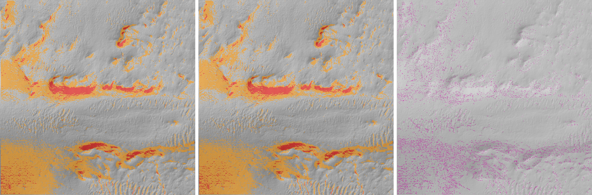
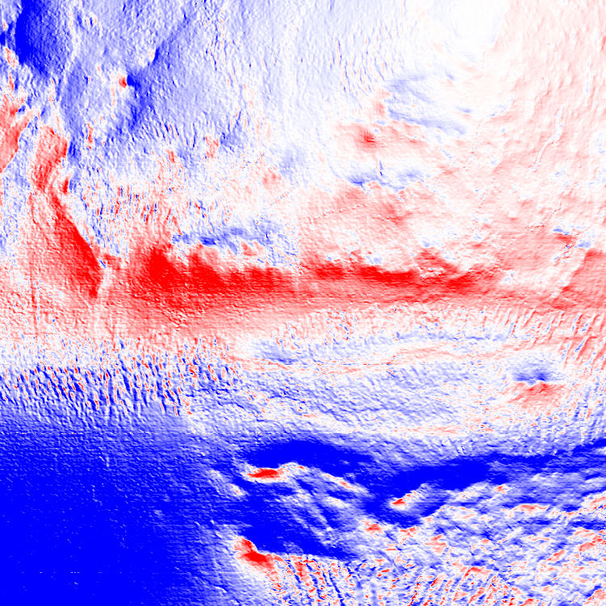
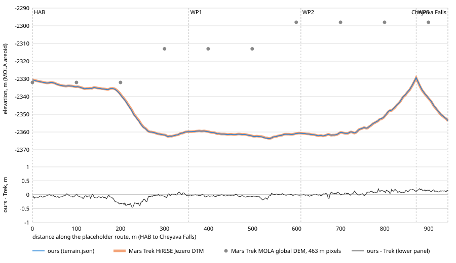
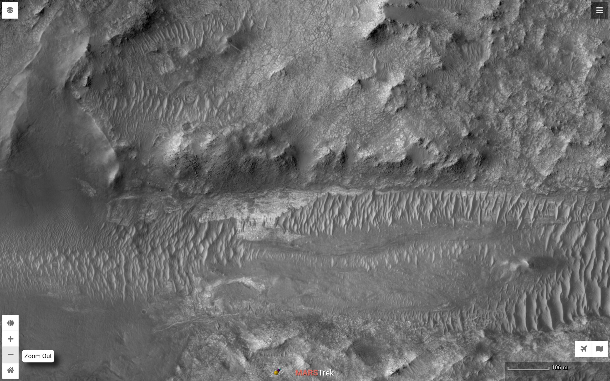

# Terrain layers checked against NASA Mars Trek

Checked 2026-11-14 for issue #44.

**For the presentation:** our terrain matches the HiRISE Jezero DEM that NASA Mars Trek serves to 0.14 m RMS over the whole 1.4 x 1.5 km tile, and matches Perseverance's own position fixes to 0.16 m RMS.

## What this check proves and what it does not

Mars Trek serves the same elevation model we built from: the USGS Mars 2020 TRN HiRISE DTM `JEZ_hirise_soc_006`, 1 m pixels. The team's 1500 x 1500 crop (`blender/data/jezero_cheyava_dtm_1m.npy`) is identical to the Trek file in all 2,250,000 pixels. So agreement with Trek does not prove the terrain is true. It proves our processing is right: the crop window, the alignment of the engine frame, the 5.4 % east-west correction, the axis directions, the units and the datum.

Two sources do not come from that DTM:

- Perseverance rover localizations (Trek's traverse path layer and the MMGIS waypoint list). The rover team fixes each position against orbital maps, so these are not fully independent, but they are measured on the ground.
- The MOLA global DEM, a laser altimeter map with 463 m pixels. Too coarse for a 1.5 km tile, but from a different instrument.

## Result per point

Ours is `terrain.json` read with `heightAt` and `slopeAt` from `src/sim/costGrid.js`. Trek is the Trek DTM read at the same latitude and longitude, with the same 2 m central difference for slope. Elevations are metres above the MOLA areoid. "Slope, 10 m" is the mean over a 10 m radius disc.

| Point | Engine x, z (m) | Lat N, lon E | Ours elev (m) | Trek elev (m) | Diff (m) | Ours slope (deg) | Trek slope (deg) | Diff (deg) | Slope, 10 m: ours / Trek | Verdict |
|---|---|---|---|---|---|---|---|---|---|---|
| Cheyava Falls (origin) | 0, 0 | 18.497514, 77.305274 | -2353.55 | -2353.69 | +0.14 | 17.5 | 16.9 | +0.6 | 13.6 / 13.6 | Match |
| Steep spot | -201, -52 | 18.498391, 77.301698 | -2314.03 | -2314.34 | +0.31 | 37.8 | 36.9 | +0.9 | 34.3 / 34.3 | Match. The README's "34 deg average" holds |
| Channel floor (WP1) | 330, 300 | 18.492453, 77.311144 | -2359.87 | -2359.83 | -0.04 | 4.7 | 4.5 | +0.2 | 3.5 / 3.6 | Match |
| Habitat airlock | 535.1, 574.1 | 18.487828, 77.314793 | -2331.61 | -2331.49 | -0.12 | 8.7 | 6.0 | +2.7 | 7.7 / 7.4 | Match. The point slope differs because our 2 m grid smooths a small step; the 10 m mean agrees |

At Cheyava Falls the rover itself gives a third value. The MMGIS localization of sol 1210 (RMC 55_434) puts the rover at -2353.65 m. Ours there is -2353.55 m, 0.10 m higher.

The habitat point is the `HAB` entry of `public/data/shelters.json`, the foot of the airlock steps that the engine's placement rule produces. I used it instead of the `HAB` waypoint (520, 600) because that is where the habitat actually stands.

## Whole tile

All 564,001 nodes of the 751 x 751 grid, compared with the Trek DTM at the same position:

| Measure | Value |
|---|---|
| Ours minus Trek, mean | -0.05 m |
| Ours minus Trek, RMS | 0.14 m |
| 5 % to 95 % of nodes | -0.32 m to +0.13 m |
| Largest difference | -0.90 m / +0.64 m |
| Slope, ours minus Trek, RMS | 0.75 deg |
| Slope class agreement (0-15, 15-25, over 25 deg) | 97.3 % of nodes |
| Nodes over 25 deg in ours but 15 deg or less in Trek, or the reverse | 0 |

Every class disagreement is between neighbouring classes, on the 15 and 25 degree boundaries. The full confusion matrix is in `results.json`.



Left, our slope classes (amber 15 to 25 deg, red over 25 deg). Middle, the same classes from the Trek DTM. Right, magenta where the two differ.



Ours minus Trek over the tile. Red is ours higher, blue ours lower, full colour at 0.25 m. The pattern follows the slopes, which is what a sub-metre horizontal offset looks like (next section).

### Frame tests

To find a flipped axis, a missing east-west correction or an offset, the script tries each mapping of the engine frame onto the DTM, searches for the horizontal shift that fits best (1 m steps, then 0.1 m), and reports the spread of the residual after removing the mean.

| Frame | Spread at zero shift | Best shift (east, south) | Spread at best shift |
|---|---|---|---|
| As built, origin from `jezero_cheyava_meta.json` | 0.133 m | +0.3 m, -0.6 m | 0.058 m |
| Origin from `docs/marswalk-assets/README.md` | 0.308 m | -1.1 m, -1.4 m | 0.058 m |
| No east-west correction | 2.25 m | -6.7 m, +0.4 m | 2.21 m |
| East-west mirrored | 55 m | no fit | 55 m |
| North-south mirrored | 44 m | no fit | 42 m |

Read it like this:

- Axes and units are right. Mirroring either axis gives 40 to 55 m of error, and dropping the east-west correction gives 2.2 m that no shift can remove.
- The east-west correction is right. With the correction the residual falls to 0.058 m, the size of the 2 m grid's own smoothing. Without it the tile is 5.4 % too narrow and a shift cannot fix that.
- The datum is right. The mean offset is under 0.05 m.
- Our grid is centred on the crop window (DTM pixel edges column 4881, row 10183), to within 0.1 m. That point is 18.49752164 N, 77.30527850 E.

### Origin

Two origin values are recorded in the repo, both from the Perseverance waypoint of sol 1210 in the MMGIS list:

| Source | Lat N | Lon E | Offset from the grid centre |
|---|---|---|---|
| `blender/data/jezero_cheyava_meta.json` (`center_latlon`, from PR #108) | 18.49751379 | 77.30527379 | 0.26 m west, 0.47 m south |
| `docs/marswalk-assets/README.md`, `CONTEXT.md`, issue #44 | 18.4975 | 77.3053 | 1.47 m east of the metadata value, 0.82 m south of it, 1.7 m in all |

The README value is the metadata value rounded to 4 decimals. One unit in the 4th decimal is about 5.6 m east-west and 5.9 m north-south, so rounding alone allows up to about 3 m. The script uses the metadata value. The leftover 0.5 m between the metadata point and the grid centre is the crop window starting on a whole pixel. It is half of one source pixel and a quarter of our grid spacing.

The uncertainty of the origin is the rover localization itself. MMGIS gives no error bar per waypoint. The 64 rover fixes inside the tile agree with the DTM to 0.065 m RMS in height (below), On the sloped parts of the traverse a 1 m horizontal error would show up as tens of centimetres in height, so the fit is good to about a metre.

I did not open a `[Bug]` issue for the 1.7 m. No code reads the latitude and longitude: the engine, the planner and the layers all work in the local x, z frame. The offset only matters to someone who converts our coordinates to Mars latitude and longitude, and the exact value now lives in `jezero_cheyava_meta.json`. A follow-up can point `docs/marswalk-assets/README.md` and `CONTEXT.md` at that file.

## Elevation profile along the placeholder route

HAB waypoint (520, 600), WP1, WP2, WP3, Cheyava Falls, 943.5 m, sampled every 2 m (`route.json`).

| Measure | Value |
|---|---|
| Ours minus Trek, mean | -0.02 m |
| Ours minus Trek, RMS | 0.12 m |
| Largest difference | -0.45 m / +0.22 m |
| Slope, ours minus Trek, RMS | 0.66 deg |



The two lines lie on top of each other, so the lower panel shows the difference. Every 10th sample is in `profile.csv`.

The grey dots are Trek's MOLA global DEM, every 100 m. They sit between 1.5 m below and 63 m above the HiRISE profile (`profile.mola` in `results.json`). That is a limit of MOLA here, not an error in the DTM: MOLA's 463 m cells average the crater rim and the channel walls into one number, and between laser tracks the global grid is interpolated. Over the same 463 m cell the HiRISE mean differs from the MOLA value by 12 m at the habitat, 55 m at Cheyava Falls and the channel floor, and 74 m at the steep spot (`hiriseMeanOverMolaCell` in `results.json`). The USGS tied the HiRISE DTM to MOLA laser shots, not to this gridded map, so the gap is expected. Use MOLA only as a sanity check that we are in the right crater and the right height range.

## Rover positions with elevation

| Source | Points in the tile | Ours minus rover | Trek DTM minus rover |
|---|---|---|---|
| Trek traverse path layer, vertices with Z (sols 1148 to 1176) | 814 | mean -0.03 m, RMS 0.15 m | mean +0.01 m, RMS 0.16 m |
| MMGIS waypoint list, `elev_geoid` (sols 1140 to 1266) | 64 | mean -0.08 m, RMS 0.16 m | mean +0.00 m, RMS 0.07 m |

Our 2 m grid adds about 0.1 m of RMS over the 1 m DTM at the rover fixes, the cost of halving the resolution. Some traverse segments carry Z = 0 (sols 1140, 1142 to 1145 and 1162); the script skips those vertices.

## Which Mars Trek layers cover this area

Found with Trek's search API for the tile's bounding box:

| Layer | Trek label | How Trek serves it | Used here |
|---|---|---|---|
| MRO HiRISE, Jezero DEM, Controlled (1 m) | `JEZ_hirise_soc_006_DTM_MOLAtopography_DeltaGeoid_1m_Eqc_latTs0_lon0_blend40` | Download only. No tiles, no ImageServer, so no point query | Yes, through the catalogue download stream |
| MRO HiRISE, Jezero Mosaic, Controlled (25 cm) | `JEZ_hirise_soc_006_orthoMosaic_25cm_Eqc_latTs0_lon0_first_dd` | WMTS tiles | Screenshot below |
| MRO CTX, Jezero DEM, Controlled (20 m) | `JEZ_ctx_B_soc_008_DTM_MOLAtopography_DeltaGeoid_20m_Eqc_latTs0_lon0` | Download only | No. The 1 m DEM covers the tile |
| MGS MOLA, Global DEM (463 m) | `mola128_mola64_merge_90Nto90S_SimpleC_clon0` | ArcGIS ImageServer with an `identify` point query | Yes |
| Perseverance (Mars 2020) Path | `Perseverance_Traverse_Path` | ArcGIS MapServer, polylines with Z | Yes |
| Slope | none | Trek lists no slope product for Jezero | Slope computed from the Trek DTM |

Trek's elevation profile tool (`TrekServices/ws/elevationProfile/multiDEM`) returns only the MOLA global DEM at this site, because the Jezero DEM is not in its raster list. The subset service (`TrekWS/rest/transform/latlon/subset/stream/tiff`) returns an empty file without a login token. So the script reads the full DTM stream, which is a 1.84 GB uncompressed GeoTIFF with one row per strip. The server ignores HTTP range requests, so the script reads from the start, keeps rows 9300 to 11099, columns 3900 to 5899, and stops after 906 MB (about 5 minutes at 3 MB/s).



Mars Trek in a browser, 2026-11-14, centred on the origin at zoom 15 (view 77.2916 to 77.3190 E, 18.4889 to 18.5061 N), HiRISE 25 cm mosaic on top. The light-toned Bright Angel outcrop runs east-west across the middle with the dune-filled Neretva Vallis channel below it. Link: <https://trek.nasa.gov/mars/#v=0.1&x=77.3053&y=18.4975&z=15&p=urn%3Aogc%3Adef%3Acrs%3AEPSG%3A%3A104905&d=&b=mars>

## Decisions

- **Origin.** The metadata file from PR #108 replaced the rounded README value, because it carries 8 decimals and the crop window. The rounded value stays in the frame tests to show its 1.7 m offset.
- **Slope method.** Both sides use the planner's slope (`slopeAt`, 2 m central difference), because that is the number the route uses. The engine's slope layer computes slope in the shader from the normal map baked from the 1 m DEM and uses the same 15 and 25 deg classes; I did not decode `normal_ao.jpg` for this check.
- **Trek slope.** Trek has no slope layer here, so "Trek slope" means the slope of Trek's DTM, with the east-west correction applied. Without the correction the slope RMS is about the same (0.78 deg against 0.75) but the mean is biased by +0.15 deg, the 5.4 % stretch.
- **Habitat point.** The airlock entry from `shelters.json`, not the waypoint, because that is where the habitat stands.
- **Channel point.** WP1 "channel floor", the flattest named point on the route.
- **No code or data changed.** Nothing disagrees beyond what the 2 m grid explains.

## Reproduce

```bash
node scripts/mars-trek-check.mjs            # downloads the DTM window on first run, then compares
node scripts/mars-trek-check.mjs fetch      # download only
node scripts/mars-trek-check.mjs --cache <dir>   # keep the 14 MB window somewhere other than the OS temp folder
```

The script needs Node 22 or later and no extra packages. It writes `results.json`, `profile.csv`, `profile.svg`, `slope-classes-ours-trek-diff.png` and `elevation-diff.png` in this folder. Every number on this page comes from `results.json`, except the screenshot, which I took by hand in the Trek web app.

URLs the script calls:

- DTM: `https://trek.nasa.gov/mars/TrekWS/rest/cat/data/stream?label=JEZ_hirise_soc_006_DTM_MOLAtopography_DeltaGeoid_1m_Eqc_latTs0_lon0_blend40`
- MOLA point value: `https://trek.nasa.gov/mars/trekarcgis/rest/services/mola128_mola64_merge_90Nto90S_SimpleC_clon0/ImageServer/identify?geometry={"x":<lon>,"y":<lat>}&geometryType=esriGeometryPoint&f=json` (the exact URL per point is in `results.json`)
- Traverse: `https://trek.nasa.gov/mars/trekarcgis/rest/services/Perseverance_Traverse_Path/MapServer/0/query` with the tile envelope and `returnZ=true`
- Rover waypoints: `https://mars.nasa.gov/mmgis-maps/M20/Layers/json/M20_waypoints.json`
- Layer search: `https://trek.nasa.gov/mars/TrekServices/ws/index/eq/searchItems?bbox=77.25,18.45,77.36,18.55&proj=urn:ogc:def:crs:EPSG::104905&start=0&rows=100&facetKeys=*&facetValues=*&intersects=true`

Credits: HiRISE DTM and orthomosaic, NASA/JPL-Caltech/University of Arizona/USGS Astrogeology, served by NASA Mars Trek (JPL). MOLA, NASA/GSFC. Rover localizations, NASA/JPL-Caltech (Mars 2020 MMGIS).
