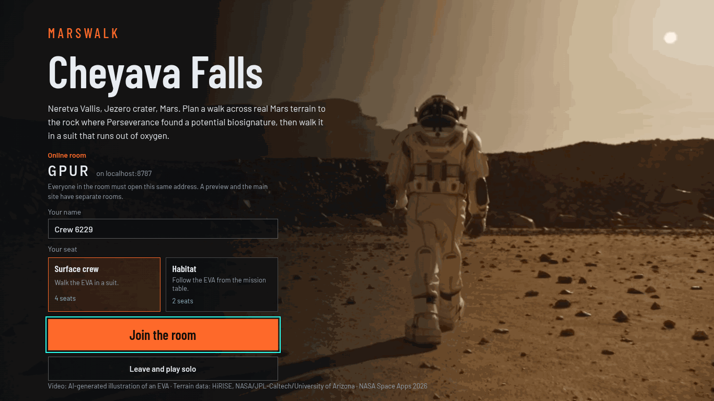
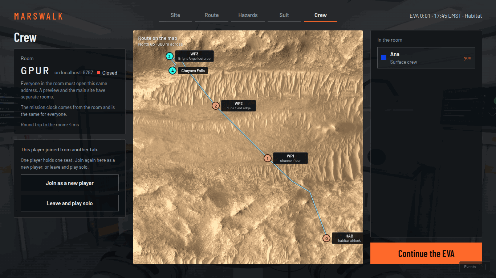

# Online M1 UI check, 15 November 2026

End-to-end check of the join panel, the role choice, the crew list, the shared mission clock and the close-code messages (#52, #55). Two to five real browsers against `wrangler dev` on port 8787, which serves `dist/` and `/api` on one origin.

The run recorded here passed 19 of 19 checks. It started at 05:13 PST and took 101 s, on headed Chromium with the GPU through WSLg (`QA_GPU=1`). The renderer was `ANGLE (Microsoft Corporation, D3D12 (NVIDIA GeForce RTX 3070), OpenGL 4.6)`, so the 3D scene rendered behind the table. Its raw output, with every number in the table below, is [img/e2e-results.json](img/e2e-results.json).

Earlier runs, not recorded in that file:

- Five runs on SwiftShader (headless, software WebGL), 10 to 12 minutes each. The first stopped at once: that build did not expose the store to the script. The next three failed checks, from the script problems listed at the end of this page and once from a 2825 ms join during a memory-pressure spike. The fifth passed every check.
- Three earlier GPU runs. Two passed 19 of 19. The third, during the memory-pressure spike, timed out at the room-full step.

## How to rerun

```sh
NODE_ENV=development npx vite build --mode development   # the script reads window.__missionStore, a dev-only global
npm run dev:room                                          # port 8787
CHROME=/path/to/chrome ROOM=ABCD node scripts/room-e2e-ui.mjs docs/qa/img
QA_GPU=1 CHROME=/path/to/chromium ROOM=ABCD node scripts/room-e2e-ui.mjs docs/qa/img   # GPU through WSLg
```

Use a fresh `ROOM` for each run: the room keeps its mission start. Without `QA_GPU=1` the script uses headless Chrome with SwiftShader (`scripts/qaBrowser.mjs`). It writes `docs/qa/img/e2e-results.json` and the screenshots.

## Results

From [img/e2e-results.json](img/e2e-results.json):

| Check | Result |
| --- | --- |
| Bad code `?room=IOIO` | the start screen says `"IOIO" is not a room code`; "Open the mission table" still works; no `/api/` request |
| `?room=` before Join | src/net is loaded, `online.status` is `off`, no socket |
| Join, A then B (surface) | A sees B 331 ms after B pressed Join, B sees A 422 ms |
| Crew tab | both names, a colour swatch each, roles, "you" on A's row, code and host |
| Mission clock after A begins the EVA | same mission time on A and B within 0.5 ms (5 reads at one wall time) |
| B closes its tab | gone from A's crew list after 739 ms |
| Spanish | join panel reads "Sala en línea", "Equipo de superficie", "Hábitat", "Entrar en la sala" |
| Habitat join | no Begin EVA on the Route tab, the habitat note instead; M keeps the table; crew entry with colour `null` |
| 5th surface player (A plus three socket players) | "Surface crew is full: all 4 seats are taken"; "Join as Habitat" seats it |
| Duplicated tab (same player id from sessionStorage) | the old tab shows "This player joined from another tab"; "Join as a new player" seats it with a new id, both tabs in the room |

The earlier runs gave join times from 51 to 2825 ms (the 2825 ms under the memory-pressure spike), leave times from 119 to 983 ms and clock differences from 0.0 to 64.5 ms (the 64.5 ms under load). Those numbers come from console logs that were not kept.

The mission clock check reads `(Date.now() - mission.anchorMs) x timeScale` in each page. That is the clock's own formula: while the room's start is known, the anchor is `mission.sharedStartMs`. Both browsers ran on one machine, so their server clock offsets are close to 0. The two-client unit test in `src/online/clockSync.test.js` covers different offsets (0 and -3456.7 ms): mission times stay within 1 ms.

The first SwiftShader runs failed on three problems in the script, not in the app. Filler sockets that never sent `ping` were closed by the room as stale after 30 s. A tab rendering Walk on SwiftShader starved its own pings. And the "both tabs seated" check ran before the welcome arrived. The script now pings, takes A back to the table after the clock check, and waits up to 10 s for the crew list.

## Screenshots, 1366 x 768

| Join panel | Crew tab | Room full |
| --- | --- | --- |
|  |  |  |

| Habitat seat, crew tab | Replaced |
| --- | --- |
|  |  |
