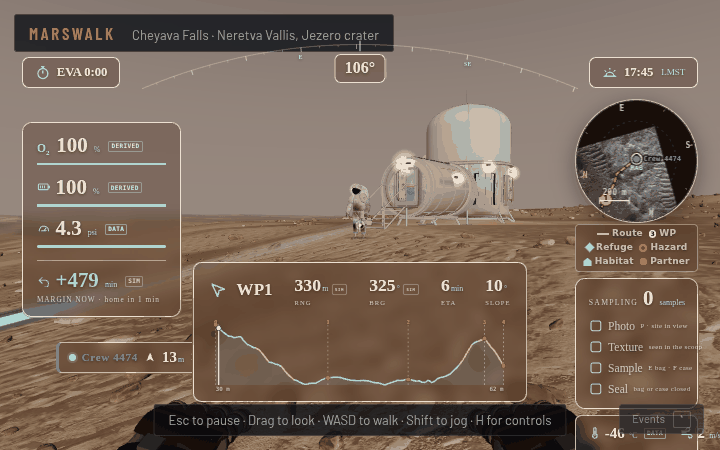
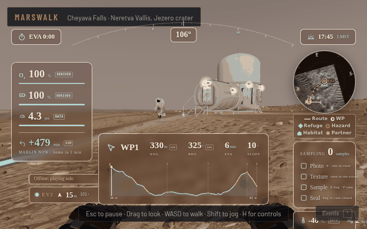

# Online M2 pose check, 14 November 2026

End-to-end check of pose broadcast and remote astronauts (#53) on one laptop: `wrangler dev` and the Vite dev server, with `.wrangler/state` deleted first. Another worktree held ports 8787 and 5173, so this run used 8788 and 5175 (a scratch Vite config pointed the `/api` proxy at 8788). Every Node check passed, direct and through the proxy. The machine was under heavy load from other sessions (load average 20 to 40), so the latencies are an upper bound, and the browser numbers are limited by software WebGL (see Browser).

## How to rerun

```sh
npm run build                      # once; wrangler dev serves dist/
npm run dev:room                   # terminal 1, port 8787
npm run dev                        # terminal 2, port 5173
node scripts/room-smoke.mjs                          # every group, straight to the Worker
node scripts/room-smoke.mjs http://localhost:5173    # through the Vite proxy
ONLY=poses|poseflood|standing|walking|rtt node scripts/room-smoke.mjs
```

`IDLE_MS` sets how long the standing pair stays idle (default 15000).

## Results (Node clients, `scripts/room-smoke.mjs`)

| Check | Direct (8788) | Through the proxy (5175) |
| --- | --- | --- |
| `p` reaches the others with the sender's `id`, no echo to the sender | 6.8 ms | pass |
| `tel` relayed with the `id` | pass | pass |
| `p` from a habitat seat | dropped | dropped |
| Walking at 1 m/s through the real throttle (`createPoseSender`, ticked 60 times per second) | 39 poses in 8 s (4.88/s), send gaps 200 to 215 ms, arrival gaps 196 to 215 ms | 4.88/s, arrival gaps 204 to 212 ms |
| Standing pair running the real throttle every frame | 1 pose each (the first, which the join also asked for), then 0 in 15 s, pings only | same |
| Client that sends 60 `p` per second | 353 sent, 114 relayed (19.8/s: the 30 burst plus 15 per second), closed 1008 `rate limit` after 5.7 s | 1008 after 5.7 s |
| `t` round trip, 20 samples | min 1.6 ms, median 2.4 ms, max 7.3 ms | min 1.8 ms, median 2.9 ms, max 8.1 ms |
| Whole script, M1 and M3 groups included | 36/36 | 36/36 |

The room stores nothing for poses: `worker/test/poses.test.js` counts SQL writes while 20 poses and 20 `tel` go through and finds none.

### Hibernation with a standing pair

For this run only, the `Room` constructor logged its time (the line was removed before the commit). Room `SHRZ`, direct run:

```text
TEMP Room constructor 2026-11-15T06:05:27.234Z    first player connects
[wrangler:info] GET /api/room/SHRZ 101 ...         second player; one pose each, then pings only
                                                    15 s standing still, both clients ticking the throttle every frame
TEMP Room constructor 2026-11-15T06:05:43.276Z    a third player connects: the room was evicted and is built again
[wrangler:info] GET /api/room/SHRZ 101 ...
```

The pings are answered by the auto-response and do not wake the room. Standing players send no poses, so nothing else does either.

## Browser

Two headless Chromium windows (puppeteer-core with Playwright's Chromium, one browser per player so neither loses focus) on `http://localhost:5175/?room=TEST&tier=low`. Each went through Open the mission table, Suit, Begin EVA. Player A walked with a real `W` key press. Headless Chromium grants the pointer lock without capturing anything, so the script turned the engine's input on through `getCurrentEngine().setInputEnabled(true)`.

| Check | Result |
| --- | --- |
| Remote suit colour | B sees A in A's slot colour, blue (slot 0). A sees B in orange (slot 1). The team chip and the minimap marker use the same colour and the player's name. |
| Poses received by B while A stood still | 0.00 per second over 6 s |
| Poses received by B while A walked | 2.0 per second |
| Poses after A stopped | 0.00 per second over 6 s |
| Team panel on B | one entry for A: name, colour, range 13 m, O2 99.9 %, battery 99.8 % from A's `tel`, `remote: true` |
| B goes offline | the remote suit goes, the scripted partner EV2 comes back in orange, and the visor shows "Offline: playing solo" |

Software WebGL (SwiftShader) on this loaded machine drew 1 to 2 frames per second. The engine moves the player once per frame with dt capped at 0.1 s, so A only moved a few times a second and sent 2 poses per second, not 5. The drawn remote suit moved 0.03 to 0.25 m per frame with no frame standing still while walking, and the largest step was 0.205 m: steady, but this run cannot judge smoothness at 60 fps. The 5 per second rate and its 10 per second cap come from the Node walking check above and from `src/net/poseSync.test.js`, which ticks the sender every frame at 60 fps.





## Pause and focus

- The engine's frame loop keeps running behind the pause menu, so remote suits keep walking while the local player is paused.
- A hidden tab stops requestAnimationFrame. When it comes back, the pose buffer samples at wall-clock time minus 150 ms, so each remote suit jumps to where that player is now instead of replaying the gap.
- A hidden tab or a pause can leave the engine's `moveSpeed` at its last value. The sender reports the walk gait only if the position also changed in the last 400 ms, so the others see a stopped suit, not one walking on the spot. On resume the next pose is read from the true position again (`src/net/poseSync.test.js`, "a frame loop that stopped mid-walk").

## Not measured

- The `t` round trip at the venue. The numbers above are local and belong in issue #53 once someone measures the venue network.
