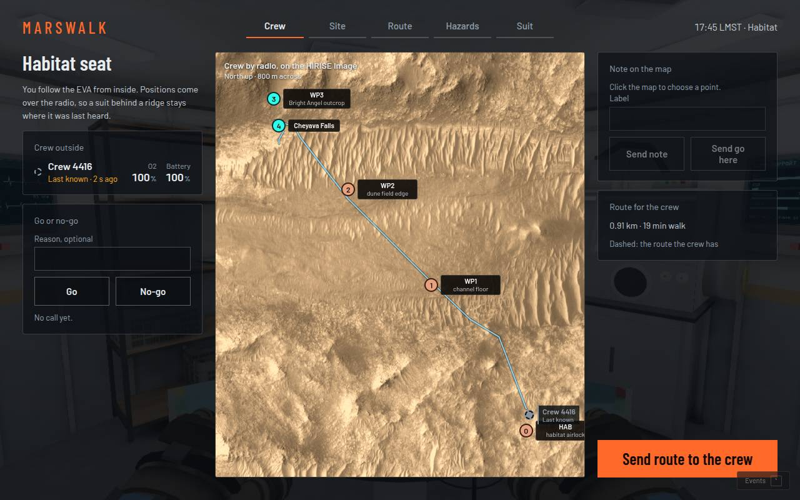
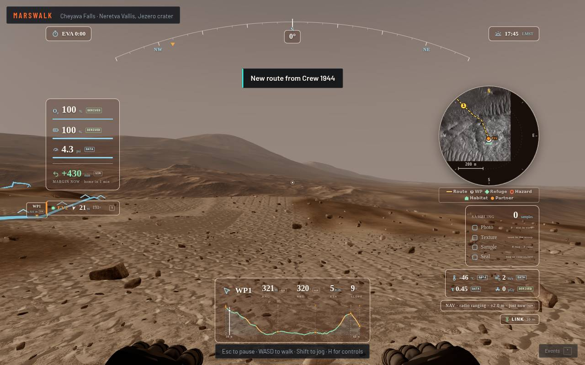
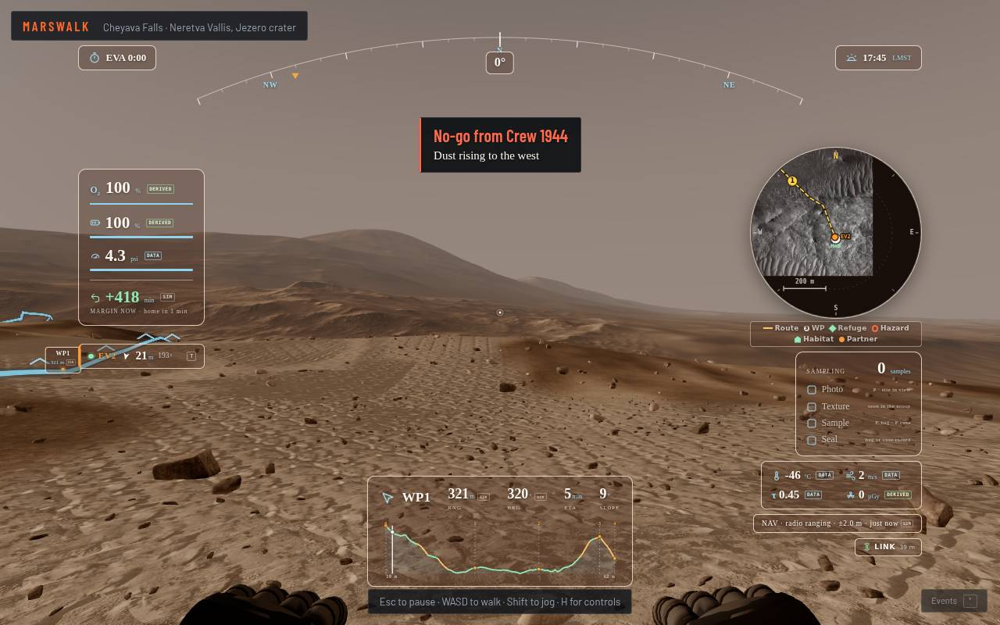

# Online M4 habitat seat check, 15 November 2026

End-to-end check of the habitat seat (#55) on one laptop: `wrangler dev` on port 8791 serving a development build from `dist/`, with `.wrangler/state` deleted first. Port 8787 belonged to another worktree. The protocol checks use Node clients from `scripts/room-smoke.mjs`; the app checks use two headed Chromium windows on the RTX 3070 through WSLg (`QA_GPU=1`, `scripts/qaBrowser.mjs`), one for the habitat seat and one for a surface player. Every check passed.

The browser run needs a development build because the scripts drive the app through `window.__missionStore`, `window.__online` and the engine's `window.__marswalk.place` (all dev-only). The habitat role comes from the join panel's role choice (#308, merged from `feat/online`): each page opens on the join panel for `?room=`, the habitat page picks the Habitat seat there, and both join with the panel's main action. The temporary `?role=habitat` link hook that earlier runs used is gone.

## How to rerun

```sh
NODE_ENV=development npx vite build --mode development   # dev build: window.__missionStore, window.__online
npx wrangler dev --port 8791                              # terminal 1
ONLY=habitat node scripts/room-smoke.mjs http://localhost:8791
QA_GPU=1 BASE=http://localhost:8791 SHOTS=docs/qa/img node scripts/room-e2e-habitat.mjs
```

Without `QA_GPU=1` the browser script runs headless on SwiftShader with `CHROME` set to the binary. On this machine, under a load average of about 30 from other sessions, that took minutes per screen; on the GPU the whole run takes 32 s.

## Protocol (Node clients, `ONLY=habitat`)

| Check | Result |
| --- | --- |
| A new room's `welcome` has `route: null` and `go: null` | pass |
| A habitat route reaches the surface player, with `by` and `at`, and echoes to the sender | 4.2 ms; a 3000-point path decimated to 169 points by `routeToDecimetres`, 2170 B |
| The widest route: 200 points at the far corner of the tile | 2821 B, under the 4096 B cap |
| 201 points, and a route from a surface player | both refused; no socket closed |
| A no-go call with a reason reaches the surface player | pass |
| A go call from a surface player | refused |
| Poses from the habitat seat | reach nobody |
| A surface player reloads (same id, new socket) | `welcome` has the 200-point route and the no-go call, 3315 B |
| Whole script, M1 to M3 groups included | 44/44 (the hibernation group needs the default `IDLE_MS` of 15 s, longer than the 10 s ping) |

## Browser (`scripts/room-e2e-habitat.mjs`, GPU)

The surface player is moved with the engine's `window.__marswalk.place`. The spot in sight of the habitat mast (535, 544) and the spot behind the ridge north of it (535, 474) came from a line-of-sight pass over the terrain height map; the surface HUD's own radio indicator confirms the second one.

| Check | Result |
| --- | --- |
| Habitat seat joins with role `habitat` and no colour, through the join panel's seat choice; the table opens on the Crew step | pass |
| The habitat map shows the surface player move, live, in their colour | surface estimate (535.7, 544.7) then (550.8, 549.0); the habitat map shows the same two points |
| Update rate on the habitat map while the surface player steps | 9 crew updates in about 4 s |
| Behind the ridge | the surface HUD radio goes from linked to lost; the habitat marker turns grey with "Last known" at (542.1, 544.5), where it was last heard; the crew list reads "Last known · 2 s ago" |
| Back in sight | live again |
| "Send route to the crew" | confirmed on the habitat after 112 ms (the run used the first wording, "The crew has the route, sent at 03:19 AM."; it now reads "The room stored the route at …", because the confirmation is the room's echo, not an answer from the crew); the surface adopts it after at most 117 ms, with the notice "New route from Crew 1944" |
| No-go with a reason | surface visor: "No-go from Crew 1944 / Dust rising to the west"; habitat: "Last call: No-go · Dust rising to the west" |
| A note dropped on the habitat map | reaches the surface labelled "Check the dark band"; the habitat map shows it too |
| The surface player reloads | the route comes back from `welcome` (11 points); still the habitat's after 3 s at the table and after Begin EVA; the last call too |
| The habitat seat sends no poses | its socket sent `hello`, `t`, `ping`, `rt`, `go` and `mk` only, no `p` and no `tel`; the surface received no `p` with the habitat's id |

Both clients plan the same route from `route.json`, so in this run the route the surface adopts has the same 11 points as its own. The adoption itself (`route.origin`, the waypoints kept, the notice) is what the run checks; `src/state/habitatRoute.test.js` covers a route that differs.







`img/online-m4-habitat-crew.jpg` shows the habitat seat with the crew member in sight.

## Found and fixed during the run

- **Stale estimate on the habitat map.** The pose sender sent a `p` only when the true position or heading changed. The navigation estimate updates 4 times per second, so the pose sent on a move could carry the estimate from before it, and a suit that then stood still never sent another. The habitat map held a point 30 m away. The sender now also sends when the estimate moves more than 0.5 m (`ESTIMATE_MIN_MOVE_M` in `src/net/poseSync.js`). That also carries a terrain fix taken while standing still.
- **H opened Controls while typing.** The app's H key paused into Controls even with focus in a text field, so a note label lost every key after the first "h". The handler in `src/App.jsx` now returns early when focus is in a text field.
