# Marswalk

**Technical report for the local judges · NASA Space Apps Challenge 2026 · Ensenada**

Challenge: Interplanetary Survival Guide: Martian Map

Team: **Los Frijolitos Espaciales Refritos Nueva Generación**

App: https://martian-map.fernando-haro-c.workers.dev

## Development team

| Name | Role | Email |
|---|---|---|
| Teresa Rivas Gómez | UI/UX and 3D art | [email] |
| Andrea Rivas Gómez | Graphics, effects and audio [confirm] | [email] |
| Fernando Haro Calvo | Full stack and data | [email] |
| Jorge Antonio Vazquez Guzmán | Backend and analyst: route planner and events | [email] |
| Antonio Ramos Gonzalez | Full stack | [email] |
| Brayan Iván Pérez Ventura | App, 3D engine and suit model [confirm] | [email] |

## Index

1. Challenge
   - Interplanetary Survival Guide: Martian Map
   - Background
   - Why did we choose this challenge?
2. Project overview
3. Problem statement
4. Proposed solution
5. Technical implementation
6. Results
7. Impact and relevance
8. Future work
9. Team contributions
10. References
11. Appendices

## Challenge

### Interplanetary Survival Guide: Martian Map

> NASA has explored Mars robotically for decades, studying its extreme environment, mapping its surface, and collecting many types of data. Far from home, the first astronauts to set foot on Mars will want the best map possible, with information on the details of their routes and destinations, updates on current conditions, and the data needed to complete their mission quickly and safely. Your challenge is to create a layered, integrated view of a location or route on the Martian surface that pulls together data from multiple NASA science missions and could help a human explorer plan and carry out a successful Marswalk while conducting new and exciting science along the way.

### Background

> Human explorers are able to conduct science and do other activities that robotic systems cannot. As seen during the recent Artemis II mission's lunar flyby, astronauts use their critical thinking skills to make connections, solve problems quickly, and apply context to observations and scientific measurements in real time. This is why NASA sends humans into the extreme environments of space, where we can learn more about our solar system and how it formed, and do science we can't on Earth. Today, human exploration is focused on the lunar surface, with more Artemis missions upcoming and planning for the phased buildup of a Moon Base underway. Part of the role of science missions at NASA is to pave the way for humans to visit new destinations in the future. Each new robotic Mars mission has represented a hugely complex engineering challenge. Sending humans will be the biggest challenge, and the biggest achievement, yet, and becoming an interplanetary species will take all of our knowledge, imagination, and hard work.
>
> Data from NASA's current and past Mars missions paints a detailed picture of the planet, but it isn't yet layered together in the combinations needed to plan specific human missions. Tools like the Jet Propulsion Laboratory's (JPL) Mars Trek and the USGS-NASA Planetary Geologic Mapping Program allow you to layer different data over a global map of Mars, but they are built for regional and global views rather than the hyperlocalized areas astronauts will target on individual spacewalks or surface excursions.

Statement and background copied from the challenge page on spaceappschallenge.org on 15 November 2026.

### Why did we choose this challenge?

In 1971 Apollo 15's planners capped every rover drive at the distance the crew could walk back, with a 20 % oxygen pad, and Apollo 17 kept 30 minutes of every consumable in reserve. On Mars there is no GPS, and a radio call to Earth takes 4 to 24 minutes one way. Nobody on Earth can answer "can I still make it back?" in time, so the crew must answer it from the terrain, the suit and the weather.

The statement asks for a map at the scale of one spacewalk, and we wanted it to answer the walkback question. Mars Trek shows a slope. It does not say the slope ahead costs 129 g of oxygen per kilometre against 40 g on the flat, and each of those numbers has a NASA source we could check. NASA's SEXTANT already plans slope-aware routes. We wanted the walk home to be what the crew sees, recomputed when an event hits.

We also wanted a reason to walk. Cheyava Falls, in Jezero crater, is the rock where Perseverance found what NASA called a potential biosignature in 2025, a strong candidate for the first human sample. So our astronaut walks there.

## Project overview

Marswalk is a planning map and a walking test for one marswalk on real terrain. The astronaut leaves a habitat in Neretva Vallis, walks to Cheyava Falls and the Bright Angel outcrop, takes a sample and walks home, on a 1.4 by 1.5 km tile of the HiRISE terrain model NASA and USGS made to land Perseverance.

At a mission table the crew sees the site with six data layers and Perseverance's 47 real drives, and sets its needs: goal, crew of one or two, time, oxygen, battery and risk. The planner builds a route, costs every leg in minutes and grams of oxygen and gives a go or no-go. Then the astronaut walks it in first person. A dust storm and a replay of a 2017 solar particle event break the plan and send the crew to shelter. A debrief judges the walked route against the plan.

Every number on screen carries a tag. DATA means a NASA mission measured it or a NASA document states it, DERIVED means we calculated it from DATA, and SIM means we assumed it.

## Problem statement

A Mars EVA plan has to answer one question at every step. How far can the astronaut go and still get home with the reserve intact? Four facts make that hard.

1. Slope costs oxygen. In our suit model, 1 km of flat walking burns 40 g of oxygen and 1 km along a 20° slope burns 129 g, from a 771 g tank.
2. NASA rates its exploration suit for slopes up to 20°. Mars Trek shows slope but does not route around steeper ground.
3. Conditions change mid-walk. A 2022 dust storm over Jezero raised the optical depth from about 0.3 to about 2, and a 2017 solar particle event tripled the dose rate Curiosity measured.
4. Mars has no navigation satellites and no usable compass.

The data exists across HiRISE, MEDA, RAD, DONKI and NASA's suit reports. We found no tool that recomputes the walk home from it as the astronaut moves.

## Proposed solution

Marswalk turns the walkback question into one number. On the table it is the go or no-go and the margin at the end of the plan. In the helmet it is MARGIN NOW, the minutes left after the walk home and the 30-minute reserve.

1. **A walkability map from HiRISE.** Every 2 m cell gets a cost from slope and rock cover, and ground over 20° is closed. A planner finds the cheapest route, and a suit model turns each leg into minutes, grams of oxygen and watt-hours.
2. **A mission table that plans from the crew's needs.** Goal, crew, time, oxygen, battery and risk decide which stops fit. A solo astronaut must keep radio contact, so the planner picks the radio route.
3. **A walk that tests the plan.** The helmet shows oxygen, the margin, the next waypoint, slope ahead, radio and position error. Events replay NASA records and re-plan to shelter.

### What is new

- The map prices each metre in oxygen, from NASA suited tests at Mars gravity, and reprices it when an event hits.
- A crew of one gets a different plan from a crew of two, because a solo astronaut works 1.5 times as long at each stop (Image 2.5).
- Every number links to its mission, instrument and reference, and we publish the ones our audit found wrong (Appendix A).
- Position drifts without GPS and resets on a terrain fix, which a dust storm takes away.
- The debrief prices every detour from the plan in seconds and grams and gives it a verdict.

## Technical implementation

### Architecture

Marswalk is a static web app that runs entirely in the browser. Offline tools turn NASA archives into small data files once. In the browser the code has four layers, each depending only on those below it: the interface, the mission state, the simulation and the 3D engine.

*Image 1.1. System architecture.*

### Frontend

The app is JavaScript on Vite 8 and React 19, with three.js drawing the terrain, astronaut, habitat, sky and dust. One Blender scene produces both the terrain mesh and the planner's height grid, so the astronaut walks on the same ground the planner costs. The engine picks a graphics tier from the measured frame rate, so the app runs on integrated GPUs. It works with keyboard, mouse, touch and gamepad, in English and Spanish, and synthesizes every suit sound in code.

### Simulation

The simulation has no graphics code, so it runs in background threads and in automated tests.

**Routes.** Cost rises with slope and rock cover, and cells over 20° are closed. An A* search finds the cheapest route off the main thread, and an emergency re-plan takes under 50 ms. The same search prices three profiles: fastest, gentlest and in radio contact. When an event hits, it prices a route to every reachable shelter and keeps the cheapest.

**Suit model.** The suit follows NASA's xEMU design: 771 g of usable oxygen, a 756 Wh battery and an 8-hour limit. Walking power comes from slope walking tests, scaled to Mars gravity and calibrated to NASA suited tests. The walk home gets Apollo 15's 20 % pad, and the margin keeps Apollo 17's 30-minute reserve. MARGIN NOW is the smaller of the oxygen margin and the time left before the 8-hour limit. It raises a caution under 15 minutes and a warning at zero. We model only oxygen and battery, though on Mars the suit's CO2 removal or cooling could end a walk first.

**Events.** Each event is a data definition with a trigger, a timeline, an alert and an optional re-plan, and the same inputs start it at the same moment on every computer. The dust storm raises optical depth from Jezero's clear 0.45 to 8.0, the 2018 global storm value, and re-plans to the habitat. The radiation alert replays 10 September 2017, when Curiosity saw the dose rate rise 224 minutes after the flare, to about three times background. The game compresses that 57-hour event into minutes and says so. Low oxygen warns under a 15-minute margin.

**Navigation, radio and shelters.** Position error grows with distance walked and resets after 5 s standing still. Radio is line of sight to the habitat mast. Natural shelters are cells that see less sky, and the habitat is the only full one.

**EV2 and route review.** The second astronaut walks the approved route with the player, waits when they stop, sets the sample case down at a stop, closes in during the storm and leads to shelter in the radiation alert. It radios these moves only with line of sight to the astronaut. After the walk, any stretch more than 15 m off the plan counts as a detour and gets a verdict: risky, forced, worth it or costly.

### Data processing

Offline scripts crop and convert several gigabytes of NASA downloads into small files. Every value keeps its mission, instrument, product and sol.

| Data | NASA source | What we built |
|---|---|---|
| Terrain | HiRISE DTM for Mars 2020, 1 m | 1.4 × 1.5 km crop on a 2 m grid |
| Ground photo | HiRISE orthomosaic, 25 cm | Texture, outcrop mask, Image layer |
| Horizon | CTX DEM and mosaic | A 12 km ring of distant terrain |
| Rover drives | Mars 2020 traverse | 47 drives, sols 1140 to 1266 |
| Weather | Mars 2020 MEDA | Sol 1187 pressure and temperature |
| Radiation | MSL RAD and DONKI | Background dose and the 2017 curve |
| Suit | xEMU and xEVA documents, Apollo reports, NASA suited tests | 75 values: 57 DATA, 7 DERIVED, 11 SIM |
| Science | Mastcam-Z, NASA Photojournal, Hurowitz et al. 2025 | Stop cards and the rock model |

The six layers are Image, Terrain (slope and contours), Rocks (a brightness proxy for rock cover), Outcrop, Radio (mast shadow) and Exposure (sky view). Each legend names the decision it drives. We dropped a THEMIS thermal layer, which covers the tile with 15 × 15 pixels, and a geologic map that sat 100 to 200 m off our terrain.

**Checking the terrain.** Across all 564,001 grid points, our terrain differs from the HiRISE model NASA Mars Trek serves by 0.14 m RMS, and 97.3 % share a slope class. That proves our processing reproduces the USGS model, not that the model is true.

*Image 1.2. Our slope classes (left), Mars Trek's (middle) and the 2.7 % that differ (right).*

### Deployment

Cloudflare Workers serves the app as static files on the free plan. Every accepted change deploys in about a minute, and every proposed change gets a preview link. Online play, with one Cloudflare Durable Object per room, is in development and not in the live app.

### Presentation mode

The talk runs inside the app. One camera move falls from a Viking globe of Mars onto the HiRISE terrain at Cheyava Falls. Ten beats cover where, why, the danger, the route, the walkback zone, the radiation alert, the storm and how we know. In the alert the walkback zone shrinks from 14.3 ha to 1.1 ha, computed by the app's own planner.

### Technologies used

JavaScript, React 19, Vite 8, three.js, Zustand, Web Workers, Web Audio API, Vitest, oxlint, Blender, Node.js, Python, Cloudflare Workers and Durable Objects, GitHub Actions.

## Results

Every screenshot comes from the running app at 1366 × 768, and some screens have changed since. The first mission is a 55 m sortie with the storm and the radiation alert brought forward, so a player reaches the debrief in about 3.5 minutes. Walking speed and the clock stay real, and the shortened event times are tagged SIM.

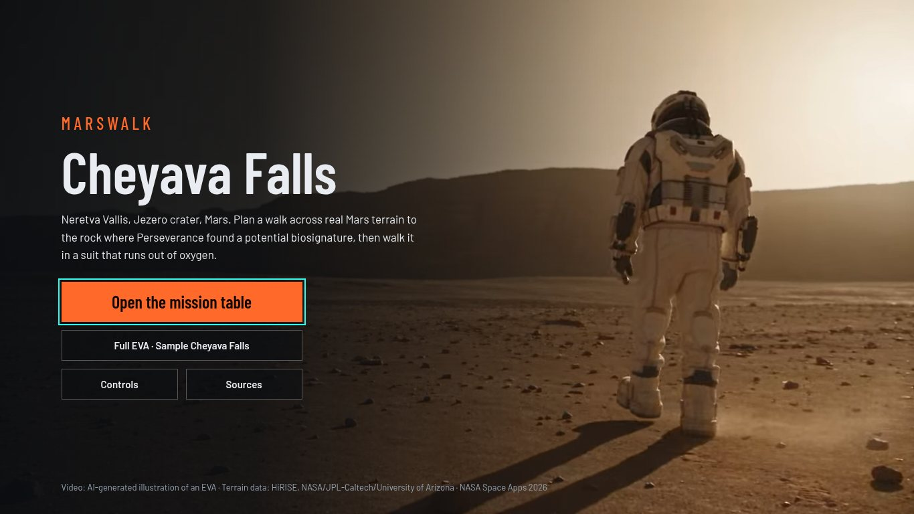

*Image 2.1. Start screen.*

The start screen offers the first sortie and the full EVA to Cheyava Falls, 913 m from the habitat by the route. Its video is SI-generated artwork, labelled as such.

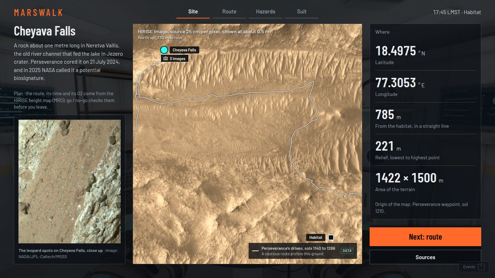

*Image 2.2. Mission table, Site step.*

The table has four steps: Site, Route, Hazards and Suit. Site places Cheyava Falls 785 m from the habitat, with Perseverance's image of the rock.

*Image 2.3. Route step with the Terrain layer, goal "Sample Cheyava Falls", cautious risk.*

For a cautious pair with 2 hours, the route is 0.94 km and 55 minutes out. It bends around the red ground over 20°, and time is the tightest limit, with 14 minutes to spare.

| | |
|---|---|
|  | 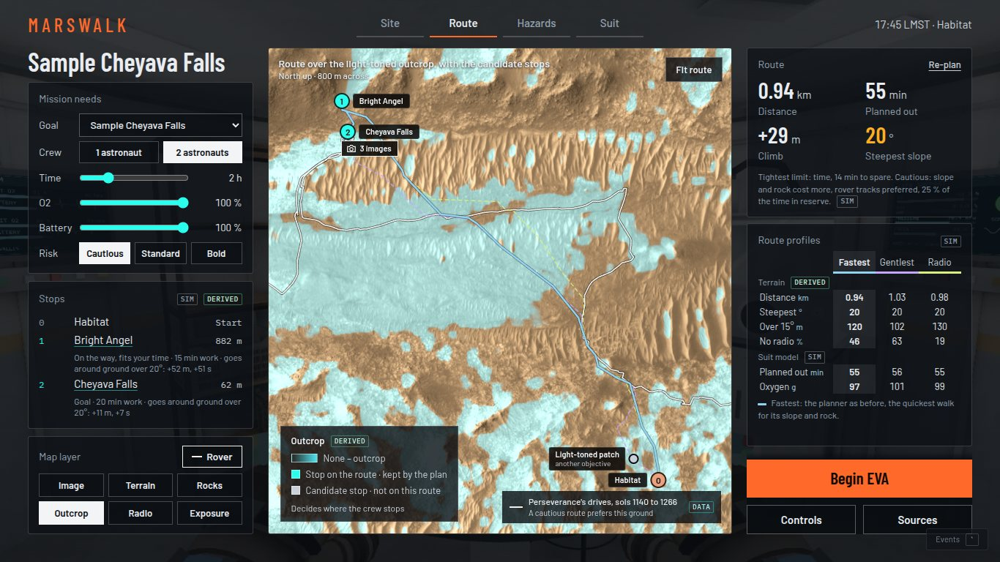 |

*Image 2.4. Rocks layer (left) and Outcrop layer (right).*

*Image 2.5. Radio layer with a crew of one.*

With one astronaut the planner takes the radio route, out of contact for 21 % of its length against 76 % on the fastest line, and drops Bright Angel as "5 min over your time".

| | |
|---|---|
|  | 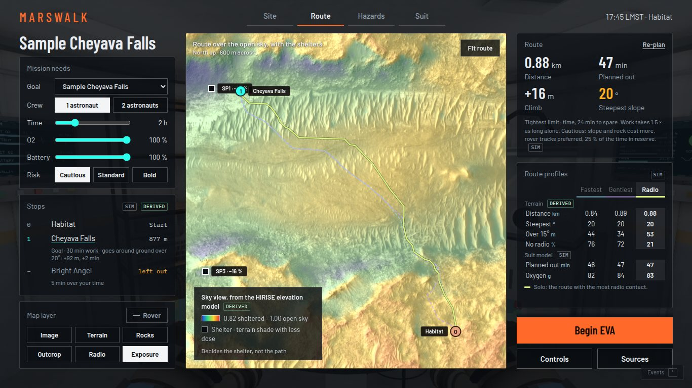 |

*Image 2.6. Exposure layer (left) and Perseverance's drives (right).*

Exposure picks the shelter in a re-plan, because dose scales with visible sky. The white lines are Perseverance's drives, which a cautious plan prefers.

| | |
|---|---|
|  | 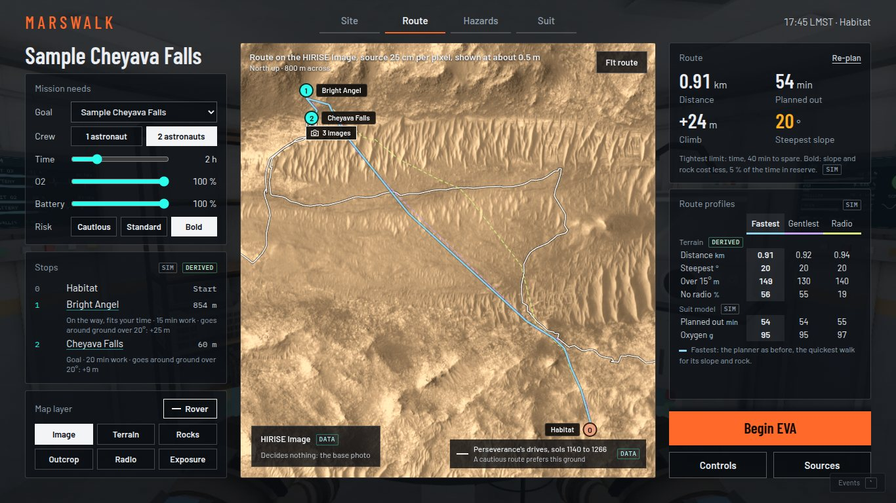 |

*Image 2.7. Two plans from different needs.*

A cautious solo crew with 100 minutes walks 0.88 km to one stop. A bold pair with 2 hours walks 0.91 km to both.

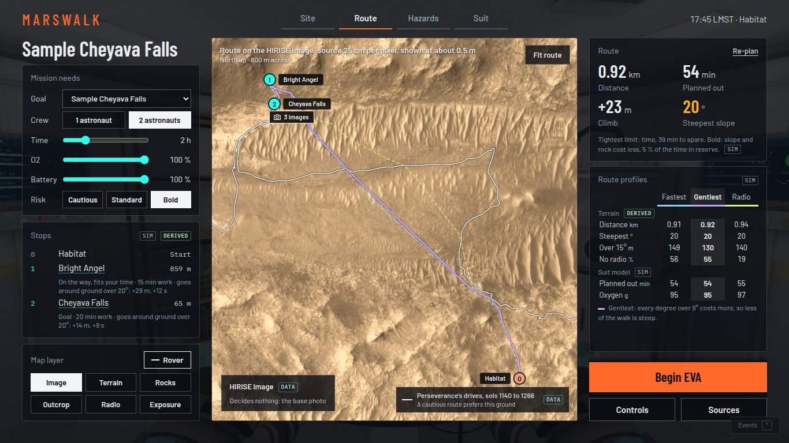

*Image 2.8. Route profiles, gentlest selected.*

Here the three profiles stay within 0.1 km and 4 g of oxygen, so radio contact separates them.

*Image 2.9. Cheyava Falls stop card.*

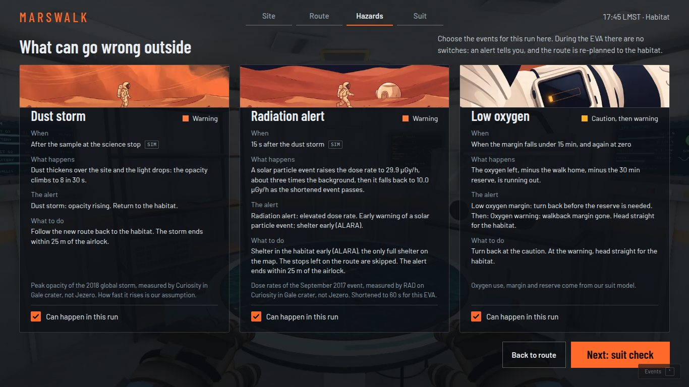

*Image 2.10. Hazards step.*

Each hazard card names the real event behind it, and says when its numbers come from Gale crater, not Jezero.

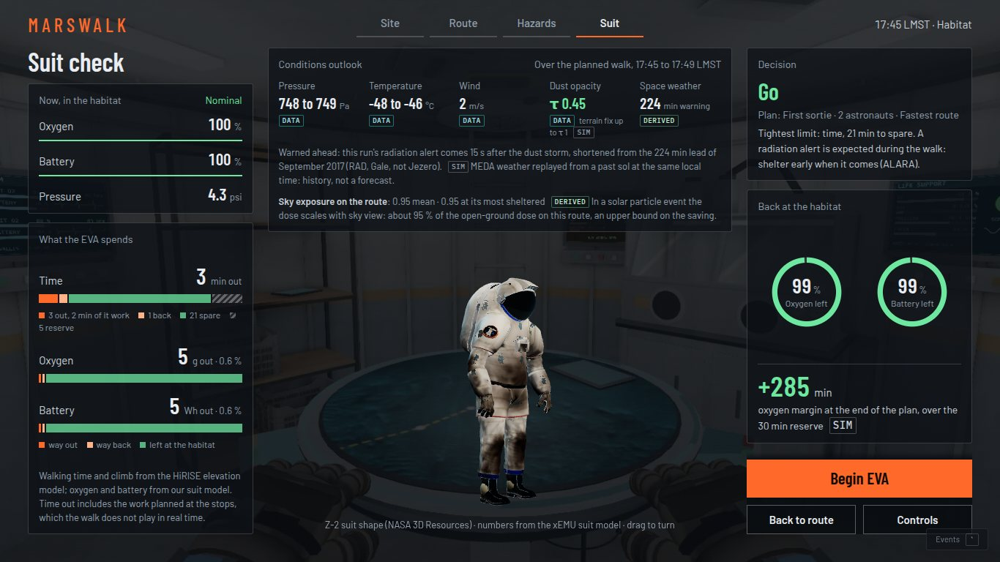

*Image 2.11. Suit step with the conditions outlook and the go decision.*

The first sortie is a Go, with 21 minutes to spare and +285 minutes of oxygen margin over the reserve.

| | |
|---|---|
|  |  |

*Image 2.12. Habitat cabin (left). Image 2.13. Airlock before Begin EVA (right).*

A version in development starts inside a habitat built on NASA's Habitat Demonstration Unit, with an airlock cycle. It is not live yet.

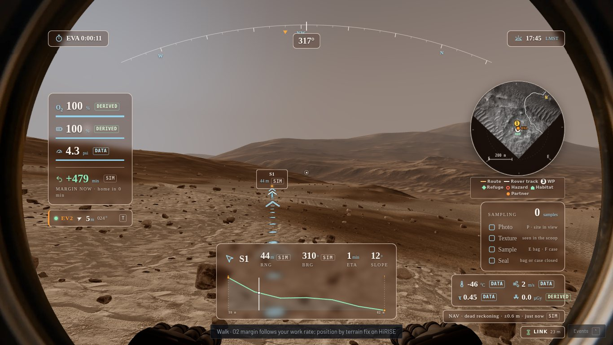

*Image 2.14. Walk HUD.*

MARGIN NOW reads +479 min outside the airlock, where the 8-hour limit sets it. The helmet also shows EV2, the next waypoint, a minimap, weather, dose and position error.

| | |
|---|---|
|  | 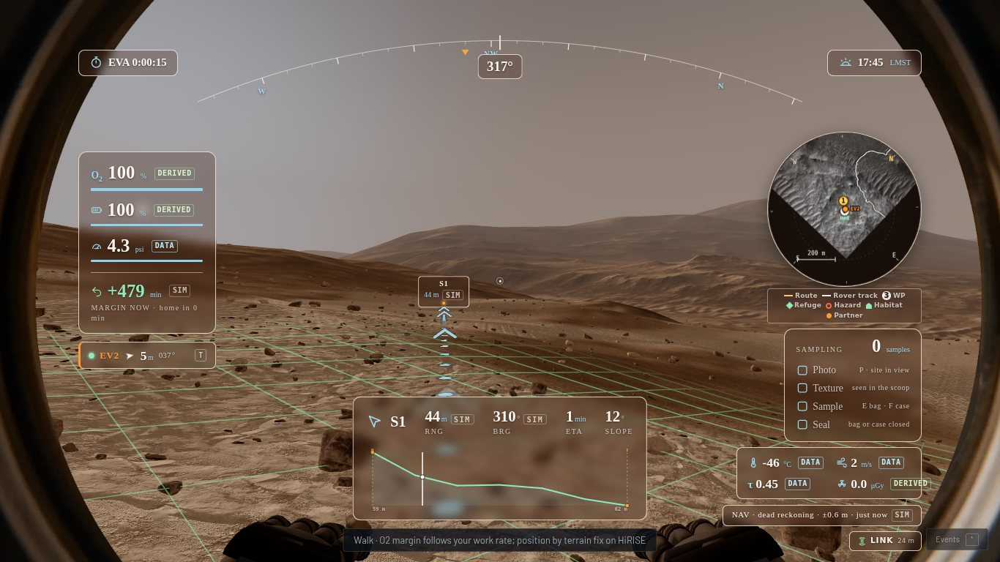 |

*Image 2.15. Wrist screen (left). Image 2.16. Slope grid on the ground (right).*

The wrist holds the map, layers and sampling checklist. The slope grid shows the planner's 15° and 20° limits on the ground.

*Image 2.17. Marking a find off the route.*

The planner prices a detour to a marked rock in seconds, grams and margin, and the crew decides.

| | |
|---|---|
|  | 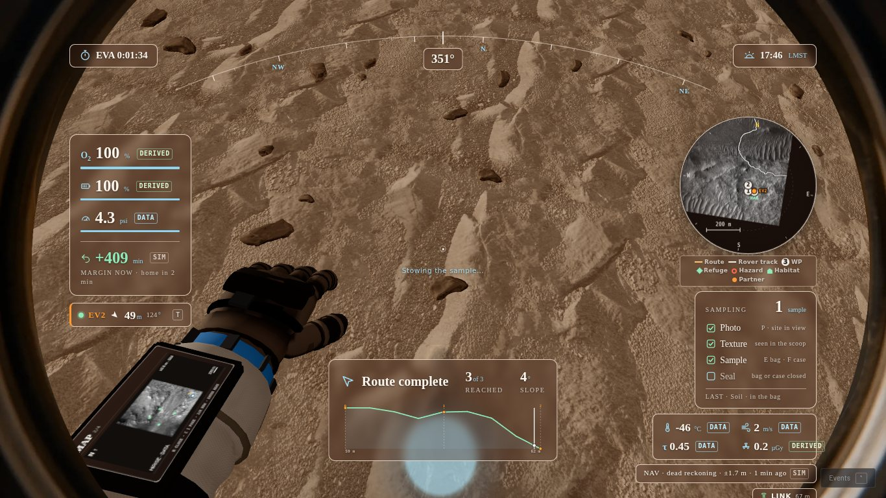 |

*Image 2.18. Science stop (left) and sampling (right).*

| | |
|---|---|
|  |  |

*Image 2.19. Dust storm in the helmet (left) and its re-plan on the mission table (right).*

The storm re-plans the route to the habitat, 54 m away. Fifteen seconds in, optical depth reads 2.34.

*Image 2.20. Radiation alert.*

The radiation alert follows the 2017 dose curve and marks the habitat, 45 m away, as shelter.

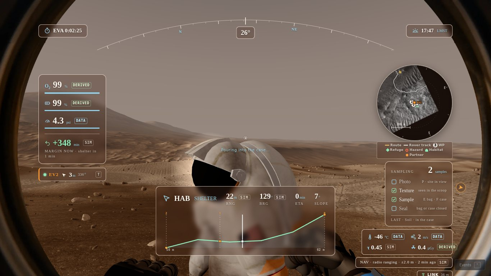

*Image 2.21. EV2 brings the sample case.*

| | |
|---|---|
|  |  |

*Image 2.22. Debrief with the route review (left) and the verdict rules (right).*

The debrief gives 3 min 37 s outside, 171 m walked, 2 samples and a lowest margin of +224 min. The review judged the detour to the find "worth it", at +20 s and +1 g of oxygen.

*Image 2.23. Sources screen.*

The Sources screen lists 62 sources with credits and licences, built from the same records as the tags.

## Impact and relevance

**Impact.** An EVA planner picks a route and calls go or no-go (Images 2.8 and 2.11). The astronaut decides when to turn back from one number that updates every step (Image 2.14). A teacher in Ensenada can run a Mars EVA in a browser, in Spanish, with no install, though no class has used it yet. The pipeline takes any HiRISE terrain model, and we have run it on one site.

**Creativity.** Mars Trek answers "what is here?". Marswalk answers "can I get there and back on what is in my tank?", and asks again at every step.

**Validity.** We checked 109 numbers on screen against their primary sources and publish the result (Appendix A). Our terrain reproduces the model NASA Mars Trek serves to 0.14 m RMS. The app has no live data, no Earth-Mars delay and no radiation measured at Jezero, and we say so.

**Relevance.** The statement asks for a layered view of one route from several NASA missions. Marswalk has a science goal, optical and terrain layers, weather and radiation on the HUD, space weather and dust events, NASA suit limits, habitat and helmet displays, rover images and a crew of two. Two parts are partial. Weather and radiation are not map layers, and rock cover is a proxy, so the route avoids steep ground but not single boulders.

**Presentation.** The team gives a talk of at most 4 minutes [confirm: the organisers' page still says 3 minutes], in the app's presentation mode, with an edited video of the app in place of a live demo. The script for the 4-minute cut is [confirm]. The talk opens on one thesis: "On Mars, the question isn't where you can go. It's where you can go and still get home."

## Future work

1. Fix what our audit found, starting with the profile's no-go slope, the Sun's angle and the radiation tags.
2. Draw the walkback zone on the live map.
3. Finish online play, with a surface crew and a habitat seat per room.
4. Feed a heart rate sensor into the suit model.
5. Run the pipeline on Curiosity's boxwork terrain at Mount Sharp, the challenge's own example.

## Team contributions

**Teresa Rivas Gómez (UI/UX and 3D art).** Teresa built the 3D world in Blender: the HiRISE terrain tile, the rigged Z-2 astronaut, the habitat and the layered Bright Angel outcrop. She kept the terrain mesh and the planner's grid in step, designed the HUD and mission table in Figma, built the table and the start, pause and sources screens, and generated the start video and hazard art.

**Andrea Rivas Gómez (graphics, effects and audio) [confirm role].** Andrea made the graphics and sound follow the simulation. She drew the route on the ground, built the dust storm and the Sun and sky that follow mission time, and added boot prints, the slope grid and the habitat wall screens. She wrote all the suit audio in code.

**Fernando Haro Calvo (full stack and data).** Fernando set up hosting and researched the sourced suit, dust and radiation numbers. He wrote the weather and radiation pipelines, the shelters, the per-leg budget and the science stops, checked the terrain against Mars Trek, and built the source tags, the audit, EV2's behaviour and the presentation mode. He leads online play and the habitat start.

**Jorge Antonio Vazquez Guzmán (backend and analyst: route planner and events).** Jorge wrote the walkability grid, the route planner, the shelter re-plan and the event engine, then the storm, radiation and low-oxygen events. He added off-route re-planning, the elevation profile, the radio layer and navigation drift, and dropped the geologic map after measuring it against our terrain.

**Antonio Ramos Gonzalez (full stack).** Antonio built the tests and automatic checks, loading, the mission clock in Mars time, the minimap, the start screen and menus, the English and Spanish interface, the debrief, the wrist screen, and touch and gamepad controls.

**Brayan Iván Pérez Ventura (app, 3D engine and suit model) [confirm role].** Brayan wrote the implementation plan and set up the app, its mission state and graphics tiers. He wrote the suit model and walkback margin, the first-person walk, the helmet HUD, sampling and collisions, the route profiles, the rover drives, the first mission, planning from the crew's needs and the walked-route review.

## References

### NASA data products and services

- Fergason, R. L. et al. 2020. HiRISE digital terrain model mosaic for Mars 2020 TRN, 1 m (JEZ_hirise_soc_006). USGS. https://doi.org/10.5066/P9REJ9JN
- HiRISE orthorectified image mosaic for Mars 2020 TRN, 25 cm (JEZ_hirise_soc_006). USGS. https://doi.org/10.5066/P9QJDP48
- CTX digital terrain model mosaic for Mars 2020 TRN, 20 m (JEZ_ctx_B_soc_008). USGS. https://doi.org/10.5066/P906QQT8
- CTX orthorectified image mosaic for Mars 2020 TRN, 6 m (JEZ_ctx_B_soc_008). USGS. https://doi.org/10.5066/P9GV1ND3
- NASA Mars Trek, HiRISE Jezero DEM. https://trek.nasa.gov/mars/
- Mars 2020 Where is the rover, MMGIS traverse. https://mars.nasa.gov/mmgis-maps/M20/Layers/json/M20_traverse.json
- Mars 2020 Where is the rover, MMGIS waypoints. https://mars.nasa.gov/mmgis-maps/M20/Layers/json/M20_waypoints.json
- Rodriguez-Manfredi et al. Mars 2020 MEDA bundle, PDS Atmospheres node. https://doi.org/10.17189/1522849
- MSL RAD reduced data records, PDS PPI node. https://pds-ppi.igpp.ucla.edu/data/MSL-M-RAD-3-RDR-V1.0/
- NASA CCMC DONKI, flare 2017-09-10T15:35:00-FLR-001. https://ccmc.gsfc.nasa.gov/DONKI/WS/get/FLR?startDate=2017-09-10&endDate=2017-09-10
- NASA CCMC DONKI notifications, 10 September 2017. https://ccmc.gsfc.nasa.gov/DONKI/WS/get/notifications?startDate=2017-09-10&endDate=2017-09-10&type=all
- Mars 2020 raw images, Mastcam-Z left, sol 1187 (ZL0_1187_0772321307_818EBY_N0541010ZCAM09237_0630LMJ). https://mars.nasa.gov/mars2020/multimedia/raw-images/ZL0_1187_0772321307_818EBY_N0541010ZCAM09237_0630LMJ
- Mars 2020 raw images gallery, sols 1211 to 1217. https://mars.nasa.gov/mars2020/multimedia/raw-images/
- PIA26336, Perseverance Views 'Bright Angel'. https://science.nasa.gov/photojournal/perseverance-views-bright-angel/
- PIA26368, Perseverance Finds a Rock with Leopard Spots. https://science.nasa.gov/photojournal/perseverance-finds-a-rock-with-leopard-spots/
- PIA26401, Mastcam-Z Views the 'Cheyava Falls' Workspace. https://science.nasa.gov/photojournal/mastcam-z-views-the-cheyava-falls-workspace
- NASA 3D Resources, Z-2 Spacesuit. https://github.com/nasa/NASA-3D-Resources/tree/master/3D%20Models/Z2%20Spacesuit
- NASA 3D Resources, Habitat Demonstration Unit. https://github.com/nasa/NASA-3D-Resources/tree/master/3D%20Models/Habitat%20Demonstration%20Unit
- NASA GISS, Mars24 sunclock technical notes. https://www.giss.nasa.gov/tools/mars24/help/notes.html
- NSSDC Mars fact sheet. https://nssdc.gsfc.nasa.gov/planetary/factsheet/marsfact.html

### NASA documents

- NASA JSC. Schematics and Behavioral Description for the AEMU PLSS, CTSD-ADV-959 Rev A. https://ntrs.nasa.gov/citations/20170009505
- NASA. Exploration EVA System Concept of Operations, EVA-EXP-0042 Rev B. https://www.nasa.gov/wp-content/uploads/2017/02/eva-exp-0042_xeva_system_con_ops_rev_b_final_dtd_10192020_ref_doc.pdf
- Ogilvie et al. 2026. Mars Spacesuit Mass Requirements, ICES-2026-127. https://ntrs.nasa.gov/citations/20260003038
- NASA MSC. Apollo 17 Final Lunar Surface Procedures, Volume 2: Contingency. https://pds-geosciences.wustl.edu/Lunar/urn-nasa-pds-apollodoc/document_a17/mission/a17_final_lunar_surface_procedures_vol2_contingency.pdf
- Benjamin. Apollo 15 EVA Capability and Constraints Envelopes, Bellcomm memorandum B70 10028. https://webarchive.library.unt.edu/eot2008/20090109180220id_/http://www.hq.nasa.gov/alsj/19790073512_1979073512.pdf
- Waligora, J. M. and Horrigan, D. J. 1975. Metabolism and Heat Dissipation During Apollo EVA Periods, NASA SP-368. https://ntrs.nasa.gov/citations/19760005584
- Norcross, J. et al. 2008. Feasibility of Suited 10 km Walkback on the Moon. https://ntrs.nasa.gov/citations/20080014853
- Norcross, J. et al. 2009. Feasibility of Performing a Suited 10-km Ambulation on the Moon, NASA/TP-2009-214796. https://www.lpi.usra.edu/lunar/artemis/NorcrossEtAl_NASA-TP-2009-214796_EVA%20Walkback%20Test.pdf
- Norcross, J. R. et al. 2010. Metabolic Costs and Biomechanics of Inclined Ambulation and Exploration Tasks in a Planetary Suit, NASA/TP-2010-216125. https://ntrs.nasa.gov/citations/20110003409
- Hoffmann, B. 2021. Extravehicular Activity Metabolic Rate Model. https://ntrs.nasa.gov/citations/20210024317
- NASA OCHMO. Design for Ionizing Radiation Protection, OCHMO-TB-020 Rev E. https://www.nasa.gov/wp-content/uploads/2023/03/radiation-protection-technical-brief-ochmo.pdf
- JPL, 18 February 2026. NASA's Perseverance Now Autonomously Pinpoints Its Location on Mars. https://www.jpl.nasa.gov/news/nasas-perseverance-now-autonomously-pinpoints-its-location-on-mars
- NASA, 10 June 2024. NASA Watches Mars Light Up During Epic Solar Storm. https://www.nasa.gov/missions/maven/nasa-watches-mars-light-up-during-epic-solar-storm/
- JPL, 20 June 2018. Martian Dust Storm Grows Global; Curiosity Captures Photos of Thickening Haze. https://www.jpl.nasa.gov/news/martian-dust-storm-grows-global-curiosity-captures-photos-of-thickening-haze/
- JPL, 16 August 2018. Six Things to Know About NASA's Opportunity Rover Recovery Efforts. https://www.jpl.nasa.gov/news/six-things-about-opportunitys-recovery-efforts/
- JPL, 9 June 2016. NASA Mars Orbiters Reveal Seasonal Dust Storm Pattern. https://www.jpl.nasa.gov/news/nasa-mars-orbiters-reveal-seasonal-dust-storm-pattern/
- NASA, 25 July 2024. NASA's Perseverance Rover Scientists Find Intriguing Mars Rock. https://www.nasa.gov/missions/mars-2020-perseverance/perseverance-rover/nasas-perseverance-rover-scientists-find-intriguing-mars-rock/
- NASA, 10 September 2025. NASA Says Mars Rover Discovered Potential Biosignature Last Year. https://www.nasa.gov/news-release/nasa-says-mars-rover-discovered-potential-biosignature-last-year/
- NASA Goddard. Space Communications: 7 Things You Need to Know. https://www.nasa.gov/centers-and-facilities/goddard/space-communications-7-things-you-need-to-know/

### Papers

- Bell, J. F. et al. 2022. Geological, multispectral, and meteorological imaging results from the Mars 2020 Perseverance rover in Jezero crater. Science Advances 8, eabo4856. https://doi.org/10.1126/sciadv.abo4856
- Lemmon, M. T. et al. 2022. Dust, Sand, and Winds Within an Active Martian Storm in Jezero Crater. GRL 49, e2022GL100126. https://doi.org/10.1029/2022GL100126
- Smith, C. L. et al. 2019. Visibility and Line-of-Sight Extinction Estimates in Gale Crater During the 2018/MY34 Global Dust Storm. GRL 46, 9414-9421. https://doi.org/10.1029/2019GL083788
- Sánchez-Lavega, A. et al. 2025. JGR Planets 130, e2024JE008565. https://doi.org/10.1029/2024JE008565
- Hassler, D. M. et al. 2014. Mars' Surface Radiation Environment Measured with the Mars Science Laboratory's Curiosity Rover. Science 343, 1244797. https://doi.org/10.1126/science.1244797
- Guo, J. et al. 2015. Modeling the Variations of Dose Rate Measured by RAD During the First MSL Martian Year: 2012-2014. ApJ 810, 24. https://doi.org/10.1088/0004-637X/810/1/24
- Zeitlin, C. et al. 2018. Analysis of the Radiation Hazard Observed by RAD on the Surface of Mars During the September 2017 Solar Particle Event. GRL 45, 5845-5851. https://doi.org/10.1029/2018GL077760
- Hurowitz, J. A. et al. 2025. Redox-driven mineral and organic associations in Jezero Crater, Mars. Nature 645, 332-340. https://doi.org/10.1038/s41586-025-09413-0
- Minetti, A. E. et al. 2002. Energy cost of walking and running at extreme uphill and downhill slopes. J Appl Physiol 93, 1039-1046. https://doi.org/10.1152/japplphysiol.01177.2001
- Farley, C. T. and McMahon, T. A. 1992. Energetics of walking and running: insights from simulated reduced-gravity experiments. J Appl Physiol 73, 2709-2712. https://doi.org/10.1152/jappl.1992.73.6.2709
- Golombek, M. P. et al. 2003. Rock size-frequency distributions on Mars and implications for Mars Exploration Rover landing safety and operations. JGR Planets 108(E12). https://doi.org/10.1029/2002JE002035
- Ehresmann, B. et al. 2021. JGR Planets. https://doi.org/10.1029/2021JE006851
- Deans, M. et al. 2017. Minerva: User-Centered Science Operations Software Capability for Future Human Exploration (SEXTANT traverse planner). https://ntrs.nasa.gov/citations/20170002363
- Marquez, J. J. et al. 2019. Future Needs for Science-Driven Geospatial and Temporal Extravehicular Activity Planning and Execution (BASALT). Astrobiology 19(3). https://pmc.ncbi.nlm.nih.gov/articles/PMC6442304

### Software, models and fonts

three.js, React and Zustand (MIT). Barlow, Barlow Condensed and IBM Plex Mono (SIL OFL 1.1). Rocks, textures and habitat props from Poly Haven (CC0). Start screen video and hazard illustrations generated with Higgsfield. Each licence is listed on the app's Sources screen.

## Appendices

### Appendix A. Measured versus simulated

Every number in Marswalk carries one of three tags. We checked 109 of them against their primary sources.

| Verdict | Count |
|---|---|
| Matches the source | 72 |
| Rounded to the precision shown | 7 |
| Our assumption, tagged SIM | 11 |
| Right number, wrong tag, page or wording | 14 |
| Wrong on screen | 2 |
| Not verified, because the publisher blocked the paper | 3 |

The main values behind the walkback number:

| Value | We use | Tag |
|---|---|---|
| No-go slope | 20° | DATA |
| Usable oxygen | 771 g | DATA |
| EVA length | 8 h | DATA |
| 1 km flat at 1.0 m/s | 40 g of oxygen | DERIVED |
| 1 km along 20° at 0.5 m/s | 129 g of oxygen | DERIVED |
| Walking speed on the flat | 1.0 m/s, where NASA plans at 0.56 m/s | SIM |
| Route cost weights | Our choice | SIM |
| Walk home pad | 20 % | DATA |
| Reserve | 30 min | DATA |
| Margin caution and warning | 15 min and 0 min | SIM |
| Clear and storm optical depth | 0.45 and 8.0 | DATA |
| Storm onset | 90 s, where a real one takes up to a sol | SIM |
| Background dose rate | 0.210 mGy/day, Gale crater | DATA |
| 2017 event, flare to dose rise | 224 min | DERIVED |
| 2017 event peak | 3 times background | DATA |
| Position drift and terrain fix | 2 % of distance, 5 s standing still | SIM |

Marswalk does not model CRISM, a geology map, the Earth-Mars delay, live data or radiation measured at Jezero.

### Appendix B. Use of SI (AI) tools

We built Marswalk with SI tools and checked their output ourselves.

- **Code.** AI coding agents wrote most of the code from tasks we wrote. Changes went in as pull requests with automatic checks, and teammates reviewed some of them.
- **Research.** AI agents found the NASA reports and papers behind our numbers and ran the audit of 109 numbers, which we reviewed.
- **Writing.** Language models helped write the documentation, the Spanish translation and this report.
- **Images and video.** The start screen video and the hazard illustrations were generated with Higgsfield. They are artwork, not mission images, carry no NASA marks and are credited as AI-generated. [confirm: say whether each now carries a visible "SI-generated" watermark]
- **Ideation.** One of us worked through the challenge choice and the concept with a conversational assistant on 13 November.
- **Inside the app.** No SI model runs in Marswalk. The data are NASA measurements, the route planner is a shortest-path search and the suit model is a formula.

### Appendix C. Prior work [confirm after the local lead answers]

On 12 and 13 November, before the event, Teresa prepared 3D assets: the terrain tile, the rigged Z-2 suit, the habitat, two props and a three.js test scene. We chose the challenge and concept on 13 November. We wrote everything else during the event.

### Appendix D. Links

- App: https://martian-map.fernando-haro-c.workers.dev
- Repository: https://github.com/JVPresti/NasaSpaceApps-MartianMap [confirm: public before submission]
- Video: [confirm: add the link]
