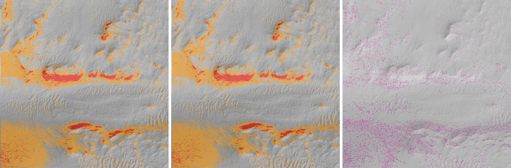
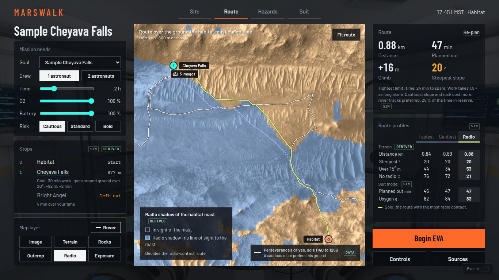
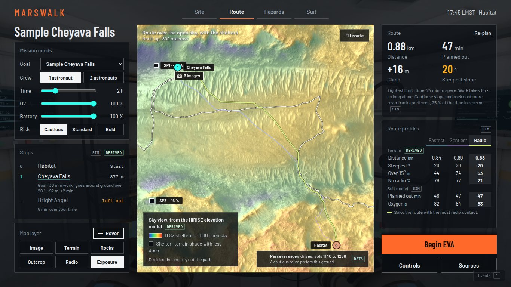
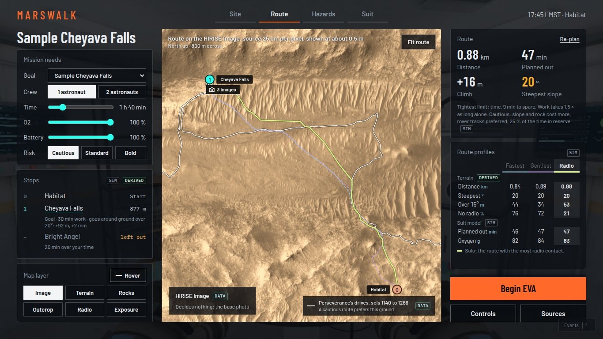
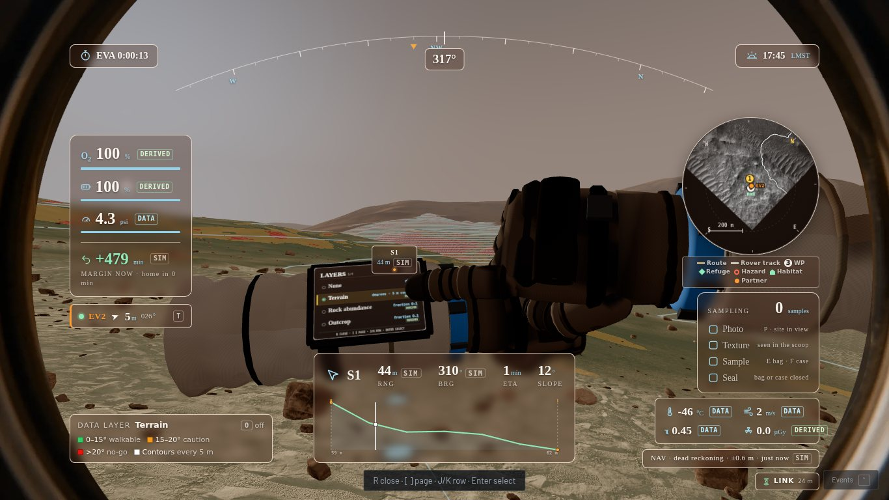
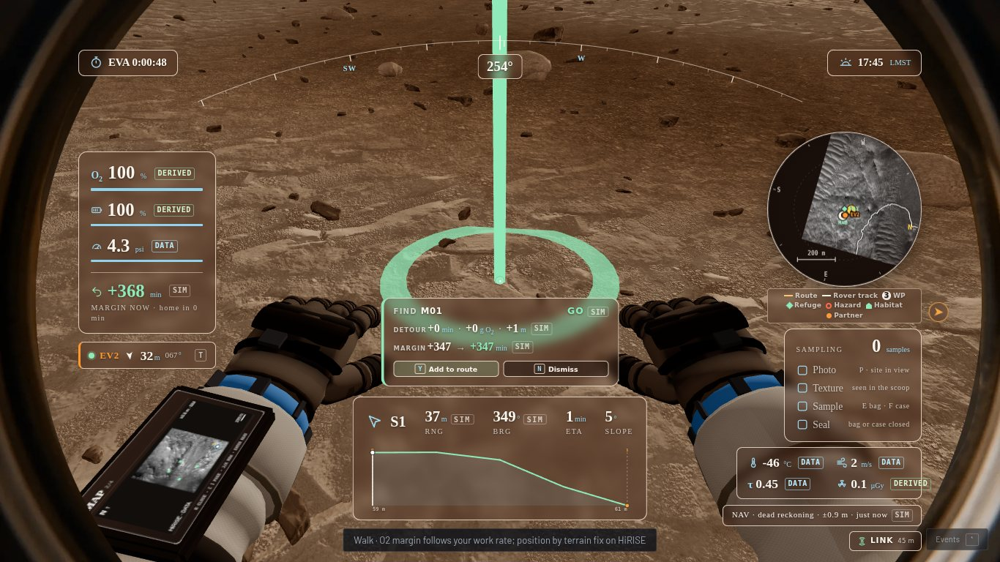
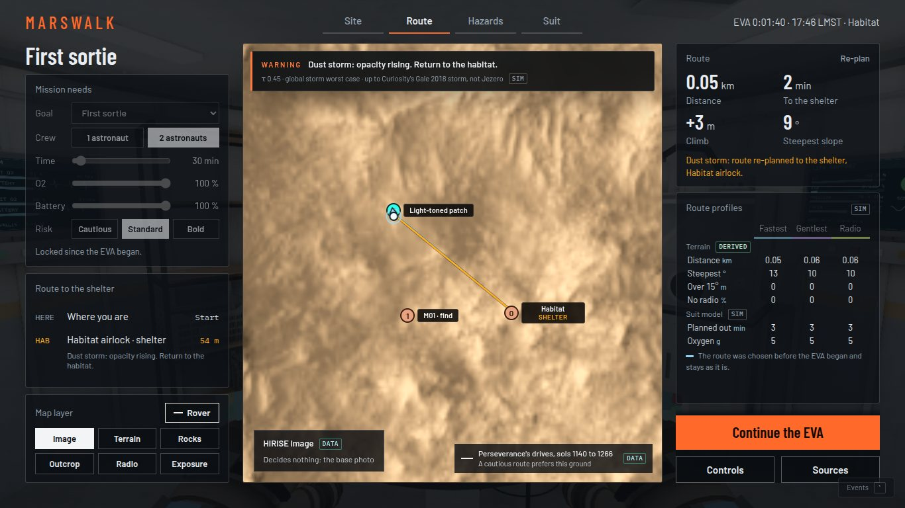
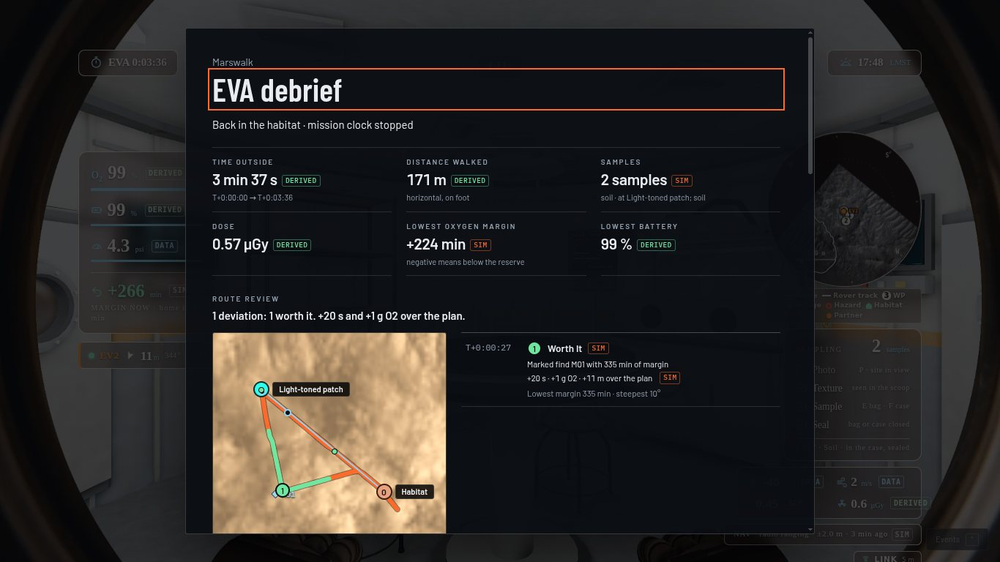
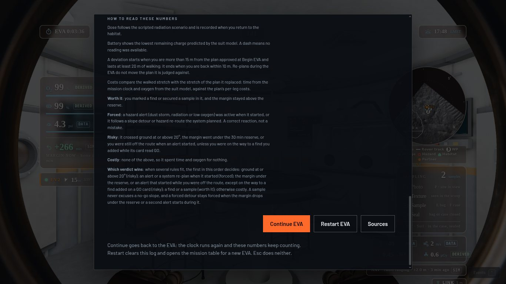

# Marswalk

**Technical report for the local judges · NASA Space Apps Challenge 2026 · Ensenada**

Challenge: Interplanetary Survival Guide: Martian Map

Team: **Los Frijolitos Espaciales Refritos Nueva Generación**

App: https://martian-map.fernando-haro-c.workers.dev

## Development team

| Name | Role | Email |
|---|---|---|
| Teresa Rivas Gómez | UI/UX and 3D art | [email] |
| Andrea Rivas Gómez | Graphics, effects and audio [confirm] | [email] |
| Fernando Haro Calvo | Full stack and data | [email] |
| Jorge Antonio Vazquez Guzmán | Backend and analyst, route planner and events | [email] |
| Antonio Ramos Gonzalez | Full stack | [email] |
| Brayan Iván Pérez Ventura | App, 3D engine and suit model [confirm] | [email] |

## Index

1. Challenge
   - Interplanetary Survival Guide: Martian Map
   - Background
   - Why did we choose this challenge?
2. Project overview
3. Problem statement
4. Proposed solution
5. Technical implementation
6. Results
7. Impact and relevance
8. Future work
9. Team contributions
10. References
11. Appendices

## Challenge

### Interplanetary Survival Guide: Martian Map

> NASA has explored Mars robotically for decades, studying its extreme environment, mapping its surface, and collecting many types of data. Far from home, the first astronauts to set foot on Mars will want the best map possible, with information on the details of their routes and destinations, updates on current conditions, and the data needed to complete their mission quickly and safely. Your challenge is to create a layered, integrated view of a location or route on the Martian surface that pulls together data from multiple NASA science missions and could help a human explorer plan and carry out a successful Marswalk while conducting new and exciting science along the way.

### Background

> Human explorers are able to conduct science and do other activities that robotic systems cannot. As seen during the recent Artemis II mission's lunar flyby, astronauts use their critical thinking skills to make connections, solve problems quickly, and apply context to observations and scientific measurements in real time. This is why NASA sends humans into the extreme environments of space, where we can learn more about our solar system and how it formed, and do science we can't on Earth. Today, human exploration is focused on the lunar surface, with more Artemis missions upcoming and planning for the phased buildup of a Moon Base underway. Part of the role of science missions at NASA is to pave the way for humans to visit new destinations in the future. Each new robotic Mars mission has represented a hugely complex engineering challenge. Sending humans will be the biggest challenge, and the biggest achievement, yet, and becoming an interplanetary species will take all of our knowledge, imagination, and hard work.
>
> Data from NASA's current and past Mars missions paints a detailed picture of the planet, but it isn't yet layered together in the combinations needed to plan specific human missions. Tools like the Jet Propulsion Laboratory's (JPL) Mars Trek and the USGS-NASA Planetary Geologic Mapping Program allow you to layer different data over a global map of Mars, but they are built for regional and global views rather than the hyperlocalized areas astronauts will target on individual spacewalks or surface excursions.

Statement and background copied from the challenge page on spaceappschallenge.org on 15 November 2026.

### Why did we choose this challenge?

On Mars, nobody can come and get you. A radio call to Earth takes 4 to 24 minutes each way and there is no GPS, so the crew has to know at every step whether it can still walk home. Marswalk is a map that shows where the astronaut can go and still get home.

NASA has planned this way before. Apollo 15's planners sized every excursion by the walk back to the lander, with a 20 % pad on the walking effort, and Apollo 17 held 30 minutes of every suit consumable in reserve. The challenge asks for a map at the scale of one spacewalk, and we wanted it to carry Apollo's rule. Mars Trek shows a slope. It does not say what the slope costs in oxygen, or whether the walk home still fits after a storm arrives. Marswalk says both.

We also wanted a reason to walk. Cheyava Falls, in Jezero crater, is the rock where Perseverance found what NASA called in 2025 a potential biosignature. The finding is potential and unconfirmed, which makes the rock a strong candidate for a first human sample. Our astronaut walks there.

## Project overview

Marswalk is a planning map and a first-person walking test for one marswalk on real terrain. The astronaut leaves a habitat in Neretva Vallis, walks to the Bright Angel outcrop and Cheyava Falls, takes a sample and walks home. The ground is a 1.4 by 1.5 km tile of the HiRISE terrain model that USGS built for Perseverance's landing.

At a mission table, the crew sets its goal, size, time, oxygen, battery and risk. The planner builds a route, prices every leg in minutes and grams of oxygen and gives a go or no-go. Then the astronaut walks the route in first person, in a browser, in English or Spanish. A dust storm and a replay of a 2017 solar particle event break the plan and send the crew to shelter.

Every number on screen carries one of three tags, used here too. DATA means a NASA mission measured it or a NASA document states it. DERIVED means we calculated it from DATA. SIM means we assumed it.

## Problem statement

A Mars EVA plan has to answer one question at every step. How far can the astronaut go and still get home with the reserve intact? Four facts make that hard.

1. Slope costs oxygen. In our suit model, 1 km of flat ground costs 40 g of oxygen. One kilometre up a 20° slope costs about 140 g, because the walker slows from 1.0 to 0.3 m/s to hold the same effort (DERIVED). The tank holds 771 g (DATA).
2. NASA's exploration EVA concept rates suited walking for slopes up to 20°. Mars Trek shows slope but plans no route around steeper ground.
3. Conditions change during a walk. Perseverance watched a 2022 dust storm over Jezero raise the optical depth from about 0.3 to about 2. Curiosity measured dose rates two to three times the background during a 2017 solar particle event.
4. Mars has no navigation satellites and no global magnetic field to steer a compass.

The data sits in separate archives: HiRISE, MEDA, RAD, DONKI and NASA's suit reports. We found no tool that combines them to recompute the walk home as the astronaut moves.

## Proposed solution

Marswalk answers the question at the three moments a crew needs it.

**Before the walk, a go or no-go.** The planner finds the cheapest route to the stops that fit the crew's needs. A suit model prices each leg and the walk home, then says go or no-go and names the tightest limit.

**During the walk, a margin.** The helmet shows MARGIN NOW, the minutes left after the walk home and the 30-minute reserve.

**When conditions change, a way to shelter.** A storm or a radiation alert starts a new search for the cheapest route to shelter, priced like the first one.

### The return zone

The same calculation, run for every cell of the map, draws the ground the astronaut can reach and still get home. On our tile, oxygen does not set the edge of that zone. The fastest route to Cheyava Falls is 913 m and costs 45 g of oxygen out and 62 g home with the pad, 14 % of the tank (DERIVED). The reserve on time sets the edge. The first sortie plans 30 minutes and holds 15 % of them back, which leaves 25.5 usable minutes, and every minute of work at the stop shrinks the zone.

In our presentation scenario the zone covers 32.4 ha at the airlock and 14.3 ha after 13 minutes outside. When the radiation alert leaves 210 seconds to reach shelter, the zone falls to 1.1 ha, all of it toward home. We computed those areas with the app's cost grid and suit model, on a SIM clock. The presentation shows the zone today, and the live mission table is next.

### What is new

- The map prices ground in oxygen, from NASA suited tests in simulated Mars gravity, and reprices the way home when an event hits.
- A solo astronaut must keep radio contact and works 1.5 times as long at each stop, so a crew of one gets a different route and fewer stops than a crew of two.
- Every number links to its mission, instrument and reference, and we publish the ones our own audit found wrong (Appendix A).

## Technical implementation

### Architecture

Marswalk is a static web app, and the browser does all the computing. Offline tools turn NASA archives into small data files once. The code has four layers: interface, mission state, simulation and 3D engine.

*Image 1.1. System architecture.*

### Simulation

**Routes.** Every 2 m cell gets a cost that rises with slope and rock cover, and cells over 20° are closed. A shortest-path search finds the cheapest route and prices three profiles: fastest, gentlest and most radio contact. A re-plan to shelter took 34 ms or less from five test positions on our development machine (measured).

**Suit model.** The suit follows NASA's xEMU design, with 771 g of usable oxygen, a 756 Wh battery and an 8-hour limit (DATA). Walking effort comes from published slope walking tests, scaled to Mars gravity and calibrated to NASA suited tests (DERIVED). The walk home gets Apollo 15's 20 % pad, and the margin keeps Apollo 17's 30-minute reserve. We model oxygen and battery only, though on Mars the suit's CO2 removal or cooling could end a walk first.

**Two margins.** The app shows two margins that measure different things. The Suit step gives the oxygen left at the end of the plan, in minutes over the 30-minute reserve. The helmet's MARGIN NOW is the smaller of the oxygen margin at the current work rate and the time left on the 8-hour suit limit, each after the walk home. Outside the airlock the 8-hour limit is the smaller, so the two screens read different numbers for the same plan. We quote neither here, and one definition for both is first in our future work.

**Dust storm.** Optical depth rises from 0.45, the clear-season value Perseverance's Mastcam-Z measured at Jezero, to 8.0, which Curiosity recorded at Gale crater in the 2018 global storm. The peak is DATA from Gale, not Jezero. The rise is SIM, 90 seconds in the full EVA and 30 in the first sortie, where a real storm builds over hours.

**Radiation alert.** The alert replays the solar particle event of 10 September 2017 as Curiosity's RAD measured it at Gale crater. No instrument has measured surface radiation at Jezero, and the app says so beside each value. Three dose rates appear on screen, each measuring something different. Outside the event the helmet reads 8.75 µGy/h, the 0.210 mGy/day background from Hassler et al. 2014. The alert banner opens at 10.0 µGy/h, the rate before the 2017 event, and the hazard card quotes its peak, 29.9 µGy/h. Those two come from Zeitlin et al. 2018 and a different RAD detector. The app plays the 57-hour event in 12 minutes, or 1 minute in the first sortie (SIM).

**Navigation, radio and shelters.** Position error grows by 2 % of the distance walked and resets after 5 seconds standing still, while the dust is thin enough to see the terrain (SIM). Perseverance has fixed its position by matching camera views to orbital maps since February 2026. Radio is line of sight to the habitat mast. Natural shelters are cells that see less sky, and the habitat is the only full shelter.

**EV2 and route review.** The second astronaut walks the route with the player, carries the sample case, closes in during the storm and leads to shelter in the radiation alert. EV2 radios only with line of sight to the player. After the walk, any stretch more than 15 m off the plan gets a verdict: risky, forced, worth it or costly.

### Data processing

Every value keeps its mission, instrument, product and sol.

| Data | NASA source | What we built |
|---|---|---|
| Terrain | HiRISE terrain model for Mars 2020, 1 m | 1.4 × 1.5 km crop on a 2 m grid |
| Ground photo | HiRISE orthomosaic, 25 cm | Texture, outcrop mask, Image layer |
| Rover drives | Mars 2020 traverse | 47 drives, sols 1140 to 1266 |
| Weather | Mars 2020 MEDA | Sol 1187 pressure and temperature |
| Radiation | MSL RAD and DONKI | Background dose and the 2017 curve |
| Suit | xEMU and xEVA documents, Apollo reports, NASA suited tests | 75 values: 57 DATA, 7 DERIVED, 11 SIM |
| Science | Mastcam-Z, NASA Photojournal, Hurowitz et al. 2025 | Stop cards and the rock model |

The six layers are Image, Terrain, Rocks, Outcrop, Radio and Exposure, and each legend names the decision it drives. Rocks is image brightness, a proxy for rock cover. We dropped two layers that would have misled: a THEMIS thermal layer that covers the whole tile with 15 × 15 pixels, and a geologic map offset 100 to 200 m from our terrain.

**Checking the terrain.** Across all 564,001 grid points, our terrain differs from the HiRISE model that NASA Mars Trek serves by 0.14 m RMS, and 97.3 % of points share a slope class (measured). That proves our processing reproduces the USGS model. It does not prove the model is true.

*Image 1.2. Our slope classes (left), Mars Trek's (middle) and the 2.7 % that differ (right).*

### App and hosting

The app is JavaScript on React and three.js. One Blender scene produces both the terrain mesh and the planner's height grid, so the astronaut walks on the same ground the planner prices. The engine picks a graphics tier from the measured frame rate, so the app runs on integrated graphics, with keyboard, mouse, touch or gamepad. Cloudflare Workers serves it as static files on the free plan.

## Results

Every screenshot comes from the running app on 15 November 2026. The full EVA walks to Cheyava Falls. The first sortie is a 55 m walk with the storm and the radiation alert brought forward, so a player reaches the debrief in about 3 minutes at real walking speed.

*Image 2.1. Mission table, Site step.*

The table has four steps: Site, Route, Hazards and Suit. Site places Cheyava Falls 785 m from the habitat and shows Perseverance's image of the rock.

*Image 2.2. Route step with the Terrain layer, goal "Sample Cheyava Falls", cautious risk.*

For a cautious pair with 2 hours, the route is 0.94 km and 55 minutes out, 35 of them working at the two stops. It bends around the red ground over 20°, and time is the tightest limit, with 14 minutes to spare.

*Image 2.3. Radio layer with a crew of one.*

With one astronaut the planner takes the radio route, out of contact for 21 % of its length against 76 % on the fastest line. It drops Bright Angel and says why: "5 min over your time".

| | |
|---|---|
|  |  |

*Image 2.4. Exposure layer (left) and Perseverance's drives (right).*

Exposure picks the shelter in a re-plan. A cautious plan prefers the white lines, Perseverance's 47 drives.

| | |
|---|---|
|  |  |

*Image 2.5. Two plans from different needs.*

A cautious solo crew with 100 minutes walks 0.88 km to one stop. A bold pair with 2 hours walks 0.91 km to both.

| | |
|---|---|
|  |  |

*Image 2.6. Cheyava Falls stop card (left) and sampling at a stop (right).*

Each stop card shows Perseverance's images, so the astronaut knows what to expect on arrival.

*Image 2.7. Hazards step.*

Each hazard card names the real event behind it and says its numbers come from Gale crater, not Jezero.

*Image 2.8. Suit step with the conditions outlook and the go decision.*

The first sortie is a Go. It spends 5 g of oxygen out, and time is the tightest limit with 21 minutes to spare.

*Image 2.9. Walk HUD.*

The helmet shows oxygen, MARGIN NOW, EV2, the next waypoint, the slope ahead, weather, dose and position error, each with its tag.

| | |
|---|---|
|  |  |

*Image 2.10. Wrist screen (left) and slope grid on the ground (right).*

The slope grid paints the planner's 15° and 20° limits on the ground ahead.

*Image 2.11. Marking a find off the route.*

The planner prices a detour to a marked rock in seconds, grams and margin, and the crew decides.

| | |
|---|---|
|  |  |

*Image 2.12. Dust storm in the helmet (left) and its re-plan on the mission table (right).*

The storm re-plans the route to the habitat, 54 m away in this run.

| | |
|---|---|
|  |  |

*Image 2.13. Radiation alert (left) and EV2 bringing the sample case (right).*

The radiation alert follows the 2017 dose curve and marks the habitat, 45 m away, as shelter.

| | |
|---|---|
|  |  |

*Image 2.14. Debrief with the route review (left) and the verdict rules (right).*

This run took 3 min 37 s outside, 171 m and 2 samples. The review judged the detour to the find "worth it", at +20 s and +1 g of oxygen over the plan.

*Image 2.15. Sources screen.*

The Sources screen lists every dataset, paper, model and library with its credit and licence.

## Impact and relevance

**Impact.** An EVA planner calls go or no-go from the crew's own limits (Image 2.8). The astronaut decides when to turn back from one number that updates at every step (Image 2.9). A teacher in Ensenada can run a Mars EVA in a browser, in Spanish, though no class has used it yet. The data tools accept any HiRISE terrain model, and so far we have run them on one site.

**Creativity.** Mars Trek answers "what is here?". Marswalk answers "can I get there and back?", and asks again at every step.

**Validity.** We checked 109 numbers on screen against their primary sources and publish the result, errors included (Appendix A). Our terrain reproduces the model NASA Mars Trek serves to 0.14 m RMS. The app has no live data and no radiation measured at Jezero, and it says so on screen.

**Relevance.** Marswalk is a layered view of one route built from several NASA missions. It has a science goal, optical and terrain layers, weather and radiation in the helmet, dust and space weather events, NASA suit limits, displays for habitat, helmet and wrist, rover images at each stop and a crew of two. Two parts are partial. Weather and radiation are not map layers, and rock cover is a brightness proxy, so the route avoids steep ground but not single boulders.

**Presentation.** The team gives a talk of at most 4 minutes [confirm: the organisers' page still says 3 minutes], with a recorded video of the app in the presentation in place of a live demo. The script for the 4-minute cut is [confirm]. The app's presentation mode supplies the opening, one camera move from a Viking globe of Mars down to the HiRISE terrain at Cheyava Falls. The thesis comes first: "On Mars, the question isn't where you can go. It's where you can go and still get home."

## Future work

1. Give the Suit step and the helmet one margin definition.
2. Draw the return zone on the live mission table.
3. Fix what our audit found, starting with the elevation profile's slope limit, the Sun's angle and the radiation tags.
4. Replace the rock proxy with mapped rocks, so the route avoids boulders.
5. Start the walk inside the habitat with an airlock cycle, and finish online play with a surface crew and a habitat seat. Both are in development and not in the live app.
6. Run the data tools on a second site, starting with Curiosity's route at Mount Sharp.

## Team contributions

**Teresa Rivas Gómez, UI/UX and 3D art.** Teresa built the 3D world in Blender, with the HiRISE terrain tile, the Z-2 astronaut, the habitat and the Bright Angel outcrop. She designed the HUD and the mission table and built the table, start, pause and sources screens.

**Andrea Rivas Gómez, graphics, effects and audio [confirm role].** Andrea drew the route on the ground and built the dust storm, the Sun and sky that follow mission time, the boot prints, the slope grid and the habitat wall screens. She wrote all the suit audio in code.

**Fernando Haro Calvo, full stack and data.** Fernando set up hosting and researched the suit, dust and radiation numbers. He wrote the weather and radiation pipelines, the shelters and the science stops, checked the terrain against Mars Trek, and built the source tags, the audit, EV2's behaviour and the presentation mode.

**Jorge Antonio Vazquez Guzmán, backend and analyst for the route planner and events.** Jorge wrote the walkability grid, the route planner, the shelter re-plan and the event engine, then the storm, radiation and low-oxygen events, the radio layer and navigation drift.

**Antonio Ramos Gonzalez, full stack.** Antonio built the automatic checks, the mission clock in Mars time, the minimap, the menus, the English and Spanish interface, the debrief, the wrist screen, and touch and gamepad controls.

**Brayan Iván Pérez Ventura, app, 3D engine and suit model [confirm role].** Brayan set up the app, its mission state and graphics tiers. He wrote the suit model and walkback margin, the first-person walk, the helmet HUD, sampling, the route profiles, the first sortie, planning from the crew's needs and the walked-route review.

## References

### NASA data products and services

- Fergason, R. L. et al. 2020. HiRISE digital terrain model mosaic for Mars 2020 TRN, 1 m (JEZ_hirise_soc_006). USGS. https://doi.org/10.5066/P9REJ9JN
- HiRISE orthorectified image mosaic for Mars 2020 TRN, 25 cm (JEZ_hirise_soc_006). USGS. https://doi.org/10.5066/P9QJDP48
- CTX digital terrain model mosaic for Mars 2020 TRN, 20 m (JEZ_ctx_B_soc_008). USGS. https://doi.org/10.5066/P906QQT8
- CTX orthorectified image mosaic for Mars 2020 TRN, 6 m (JEZ_ctx_B_soc_008). USGS. https://doi.org/10.5066/P9GV1ND3
- NASA Mars Trek, HiRISE Jezero DEM. https://trek.nasa.gov/mars/
- Mars 2020 Where is the rover, MMGIS traverse. https://mars.nasa.gov/mmgis-maps/M20/Layers/json/M20_traverse.json
- Mars 2020 Where is the rover, MMGIS waypoints. https://mars.nasa.gov/mmgis-maps/M20/Layers/json/M20_waypoints.json
- Rodriguez-Manfredi et al. Mars 2020 MEDA bundle, PDS Atmospheres node. https://doi.org/10.17189/1522849
- MSL RAD reduced data records, PDS PPI node. https://pds-ppi.igpp.ucla.edu/data/MSL-M-RAD-3-RDR-V1.0/
- NASA CCMC DONKI, flare 2017-09-10T15:35:00-FLR-001. https://ccmc.gsfc.nasa.gov/DONKI/WS/get/FLR?startDate=2017-09-10&endDate=2017-09-10
- NASA CCMC DONKI notifications, 10 September 2017. https://ccmc.gsfc.nasa.gov/DONKI/WS/get/notifications?startDate=2017-09-10&endDate=2017-09-10&type=all
- Mars 2020 raw images, Mastcam-Z left, sol 1187 (ZL0_1187_0772321307_818EBY_N0541010ZCAM09237_0630LMJ). https://mars.nasa.gov/mars2020/multimedia/raw-images/ZL0_1187_0772321307_818EBY_N0541010ZCAM09237_0630LMJ
- Mars 2020 raw images gallery, sols 1211 to 1217. https://mars.nasa.gov/mars2020/multimedia/raw-images/
- PIA26336, Perseverance Views 'Bright Angel'. https://science.nasa.gov/photojournal/perseverance-views-bright-angel/
- PIA26368, Perseverance Finds a Rock with Leopard Spots. https://science.nasa.gov/photojournal/perseverance-finds-a-rock-with-leopard-spots/
- PIA26401, Mastcam-Z Views the 'Cheyava Falls' Workspace. https://science.nasa.gov/photojournal/mastcam-z-views-the-cheyava-falls-workspace
- NASA 3D Resources, Z-2 Spacesuit. https://github.com/nasa/NASA-3D-Resources/tree/master/3D%20Models/Z2%20Spacesuit
- NASA 3D Resources, Habitat Demonstration Unit. https://github.com/nasa/NASA-3D-Resources/tree/master/3D%20Models/Habitat%20Demonstration%20Unit
- NASA GISS, Mars24 sunclock technical notes. https://www.giss.nasa.gov/tools/mars24/help/notes.html
- NSSDC Mars fact sheet. https://nssdc.gsfc.nasa.gov/planetary/factsheet/marsfact.html

### NASA documents

- NASA JSC. Schematics and Behavioral Description for the AEMU PLSS, CTSD-ADV-959 Rev A. https://ntrs.nasa.gov/citations/20170009505
- NASA. Exploration EVA System Concept of Operations, EVA-EXP-0042 Rev B. https://www.nasa.gov/wp-content/uploads/2017/02/eva-exp-0042_xeva_system_con_ops_rev_b_final_dtd_10192020_ref_doc.pdf
- Ogilvie et al. 2026. Mars Spacesuit Mass Requirements, ICES-2026-127. https://ntrs.nasa.gov/citations/20260003038
- NASA MSC. Apollo 17 Final Lunar Surface Procedures, Volume 2: Contingency. https://pds-geosciences.wustl.edu/Lunar/urn-nasa-pds-apollodoc/document_a17/mission/a17_final_lunar_surface_procedures_vol2_contingency.pdf
- Benjamin. Apollo 15 EVA Capability and Constraints Envelopes, Bellcomm memorandum B70 10028. https://webarchive.library.unt.edu/eot2008/20090109180220id_/http://www.hq.nasa.gov/alsj/19790073512_1979073512.pdf
- Waligora, J. M. and Horrigan, D. J. 1975. Metabolism and Heat Dissipation During Apollo EVA Periods, NASA SP-368. https://ntrs.nasa.gov/citations/19760005584
- Norcross, J. et al. 2008. Feasibility of Suited 10 km Walkback on the Moon. https://ntrs.nasa.gov/citations/20080014853
- Norcross, J. et al. 2009. Feasibility of Performing a Suited 10-km Ambulation on the Moon, NASA/TP-2009-214796. https://www.lpi.usra.edu/lunar/artemis/NorcrossEtAl_NASA-TP-2009-214796_EVA%20Walkback%20Test.pdf
- Norcross, J. R. et al. 2010. Metabolic Costs and Biomechanics of Inclined Ambulation and Exploration Tasks in a Planetary Suit, NASA/TP-2010-216125. https://ntrs.nasa.gov/citations/20110003409
- Hoffmann, B. 2021. Extravehicular Activity Metabolic Rate Model. https://ntrs.nasa.gov/citations/20210024317
- NASA OCHMO. Design for Ionizing Radiation Protection, OCHMO-TB-020 Rev E. https://www.nasa.gov/wp-content/uploads/2023/03/radiation-protection-technical-brief-ochmo.pdf
- JPL, 18 February 2026. NASA's Perseverance Now Autonomously Pinpoints Its Location on Mars. https://www.jpl.nasa.gov/news/nasas-perseverance-now-autonomously-pinpoints-its-location-on-mars
- NASA, 10 June 2024. NASA Watches Mars Light Up During Epic Solar Storm. https://www.nasa.gov/missions/maven/nasa-watches-mars-light-up-during-epic-solar-storm/
- JPL, 20 June 2018. Martian Dust Storm Grows Global; Curiosity Captures Photos of Thickening Haze. https://www.jpl.nasa.gov/news/martian-dust-storm-grows-global-curiosity-captures-photos-of-thickening-haze/
- JPL, 16 August 2018. Six Things to Know About NASA's Opportunity Rover Recovery Efforts. https://www.jpl.nasa.gov/news/six-things-about-opportunitys-recovery-efforts/
- JPL, 9 June 2016. NASA Mars Orbiters Reveal Seasonal Dust Storm Pattern. https://www.jpl.nasa.gov/news/nasa-mars-orbiters-reveal-seasonal-dust-storm-pattern/
- NASA, 25 July 2024. NASA's Perseverance Rover Scientists Find Intriguing Mars Rock. https://www.nasa.gov/missions/mars-2020-perseverance/perseverance-rover/nasas-perseverance-rover-scientists-find-intriguing-mars-rock/
- NASA, 10 September 2025. NASA Says Mars Rover Discovered Potential Biosignature Last Year. https://www.nasa.gov/news-release/nasa-says-mars-rover-discovered-potential-biosignature-last-year/
- NASA Goddard. Space Communications: 7 Things You Need to Know. https://www.nasa.gov/centers-and-facilities/goddard/space-communications-7-things-you-need-to-know/

### Papers

- Bell, J. F. et al. 2022. Geological, multispectral, and meteorological imaging results from the Mars 2020 Perseverance rover in Jezero crater. Science Advances 8, eabo4856. https://doi.org/10.1126/sciadv.abo4856
- Lemmon, M. T. et al. 2022. Dust, Sand, and Winds Within an Active Martian Storm in Jezero Crater. GRL 49, e2022GL100126. https://doi.org/10.1029/2022GL100126
- Smith, C. L. et al. 2019. Visibility and Line-of-Sight Extinction Estimates in Gale Crater During the 2018/MY34 Global Dust Storm. GRL 46, 9414-9421. https://doi.org/10.1029/2019GL083788
- Sánchez-Lavega, A. et al. 2025. JGR Planets 130, e2024JE008565. https://doi.org/10.1029/2024JE008565
- Hassler, D. M. et al. 2014. Mars' Surface Radiation Environment Measured with the Mars Science Laboratory's Curiosity Rover. Science 343, 1244797. https://doi.org/10.1126/science.1244797
- Guo, J. et al. 2015. Modeling the Variations of Dose Rate Measured by RAD During the First MSL Martian Year: 2012-2014. ApJ 810, 24. https://doi.org/10.1088/0004-637X/810/1/24
- Zeitlin, C. et al. 2018. Analysis of the Radiation Hazard Observed by RAD on the Surface of Mars During the September 2017 Solar Particle Event. GRL 45, 5845-5851. https://doi.org/10.1029/2018GL077760
- Hurowitz, J. A. et al. 2025. Redox-driven mineral and organic associations in Jezero Crater, Mars. Nature 645, 332-340. https://doi.org/10.1038/s41586-025-09413-0
- Minetti, A. E. et al. 2002. Energy cost of walking and running at extreme uphill and downhill slopes. J Appl Physiol 93, 1039-1046. https://doi.org/10.1152/japplphysiol.01177.2001
- Farley, C. T. and McMahon, T. A. 1992. Energetics of walking and running: insights from simulated reduced-gravity experiments. J Appl Physiol 73, 2709-2712. https://doi.org/10.1152/jappl.1992.73.6.2709
- Golombek, M. P. et al. 2003. Rock size-frequency distributions on Mars and implications for Mars Exploration Rover landing safety and operations. JGR Planets 108(E12). https://doi.org/10.1029/2002JE002035
- Ehresmann, B. et al. 2021. JGR Planets. https://doi.org/10.1029/2021JE006851
- Deans, M. et al. 2017. Minerva: User-Centered Science Operations Software Capability for Future Human Exploration (SEXTANT traverse planner). https://ntrs.nasa.gov/citations/20170002363
- Marquez, J. J. et al. 2019. Future Needs for Science-Driven Geospatial and Temporal Extravehicular Activity Planning and Execution (BASALT). Astrobiology 19(3). https://pmc.ncbi.nlm.nih.gov/articles/PMC6442304

### Software, models and fonts

three.js, React and Zustand (MIT). Barlow, Barlow Condensed and IBM Plex Mono (SIL OFL 1.1). Rocks, textures and habitat props from Poly Haven (CC0). Start screen video and hazard illustrations generated with Higgsfield. Each licence is listed on the app's Sources screen.

## Appendices

### Appendix A. Measured versus simulated

On 15 November 2026 we checked 109 numbers shown in Marswalk against their primary sources.

| Verdict | Count |
|---|---|
| Matches the source | 72 |
| Rounded to the precision shown | 7 |
| Our assumption, tagged SIM | 11 |
| Right number, wrong tag, page or wording | 14 |
| Wrong on screen | 2 |
| Not verified, because the publisher blocked the paper | 3 |

The two wrong numbers are the elevation profile, which turns red above 25° where the planner says 20°, and the Sun's height, drawn for the wrong season.

The main values behind the walk home:

| Value | We use | Tag |
|---|---|---|
| No-go slope | 20° | DATA |
| Usable oxygen | 771 g | DATA |
| 1 km flat at 1.0 m/s | 40 g of oxygen | DERIVED |
| 1 km up 20° at 0.3 m/s | About 140 g of oxygen | DERIVED |
| Walking speed on the flat | 1.0 m/s, where NASA plans at 0.56 m/s | SIM |
| Walk home pad | 20 % | DATA |
| Reserve | 30 min | DATA |
| Clear-season optical depth | 0.45, Jezero | DATA |
| Storm optical depth | 8.0, Gale crater, 2018 | DATA |
| Storm rise | 90 s, or 30 s in the first sortie | SIM |
| Background dose rate | 0.210 mGy/day (8.75 µGy/h), Gale crater | DATA |
| 2017 event, before and peak | 10.0 and 29.9 µGy/h, Gale crater, checked against the abstract only | DATA |
| 2017 event, length in the app | 12 min, or 1 min in the first sortie, for 57 h | SIM |
| Position drift and terrain fix | 2 % of distance, 5 s standing still | SIM |
| Return zone areas | 32.4, 14.3 and 1.1 ha | SIM |

Marswalk has no live data, no Earth-Mars delay and no radiation measured at Jezero.

### Appendix B. Use of SI (AI) tools

We built Marswalk with SI tools and checked their output ourselves.

- **Code.** AI coding agents wrote most of the code from tasks we wrote. Every change passed automatic checks, and teammates reviewed part of them.
- **Research.** AI agents found the NASA reports and papers behind our numbers and ran the audit, which we reviewed.
- **Writing.** Language models helped write the documentation, the Spanish translation and this report.
- **Images and video.** We generated the start screen video and the hazard illustrations with an SI tool. They are artwork, not mission images, carry no NASA marks and are credited as AI-generated. [confirm: say whether each now carries a visible "SI-generated" watermark]
- **Ideation.** One of us worked through the challenge choice and the concept with a conversational assistant.
- **Inside the app.** No SI model runs in Marswalk. The route planner is a shortest-path search and the suit model is a formula.

### Appendix C. Prior work [confirm after the local lead answers]

On 12 and 13 November, before the event, Teresa prepared 3D assets: the terrain tile, the rigged Z-2 suit, the habitat, two props and a test scene. We chose the challenge and concept on 13 November. We wrote everything else during the event.

### Appendix D. Links

- App: https://martian-map.fernando-haro-c.workers.dev
- Repository: https://github.com/JVPresti/NasaSpaceApps-MartianMap [confirm: public before submission]
- Video: [confirm: add the link]
