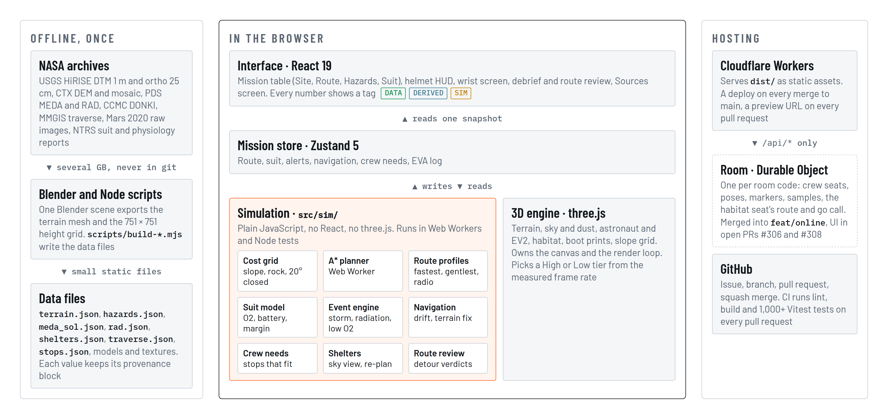
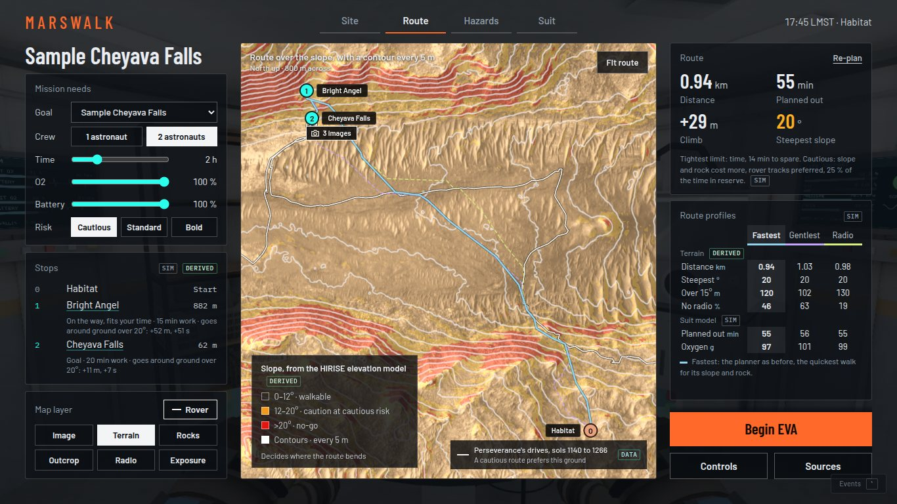
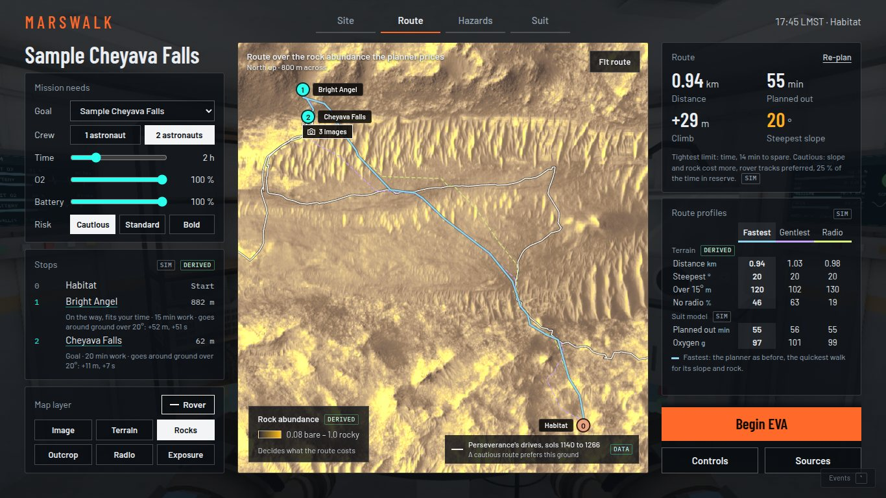
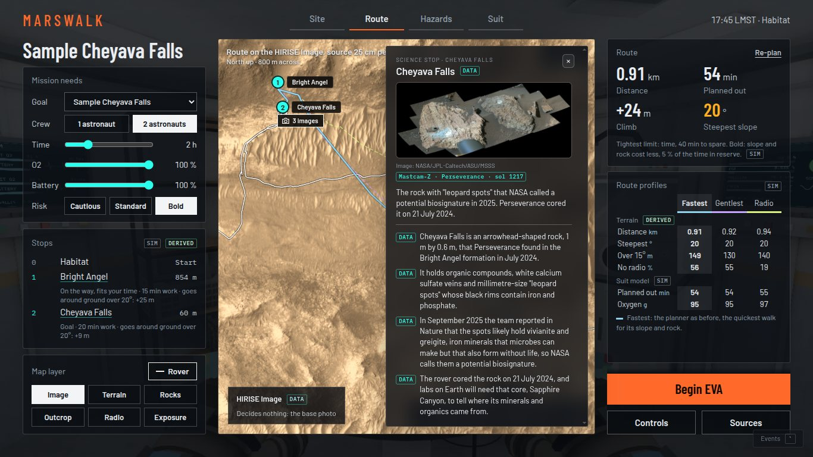
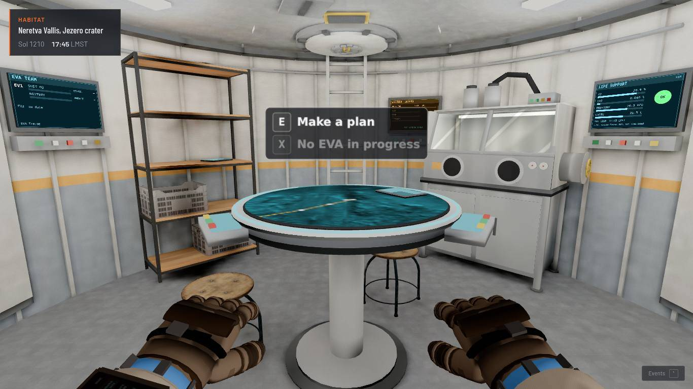
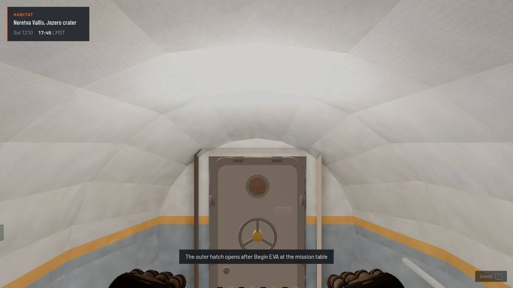
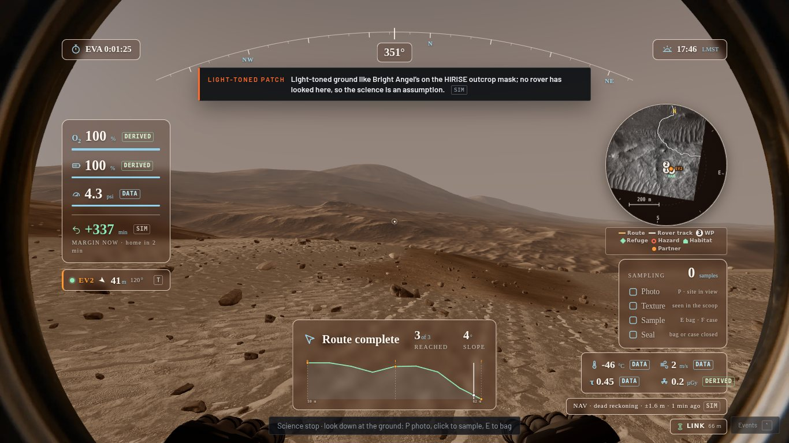
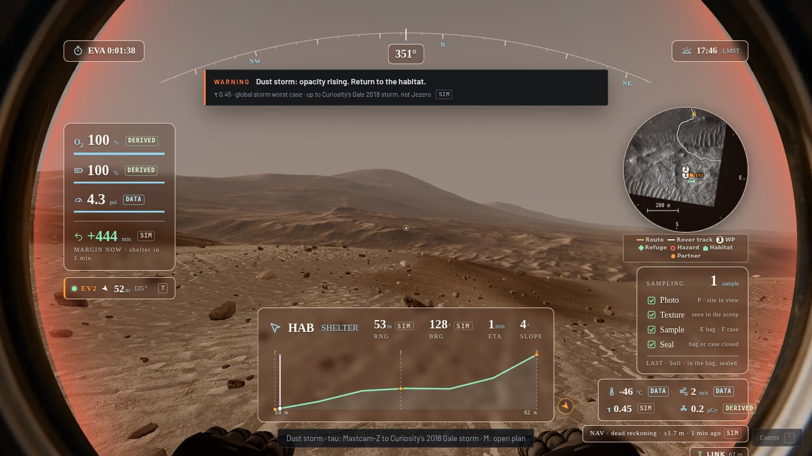
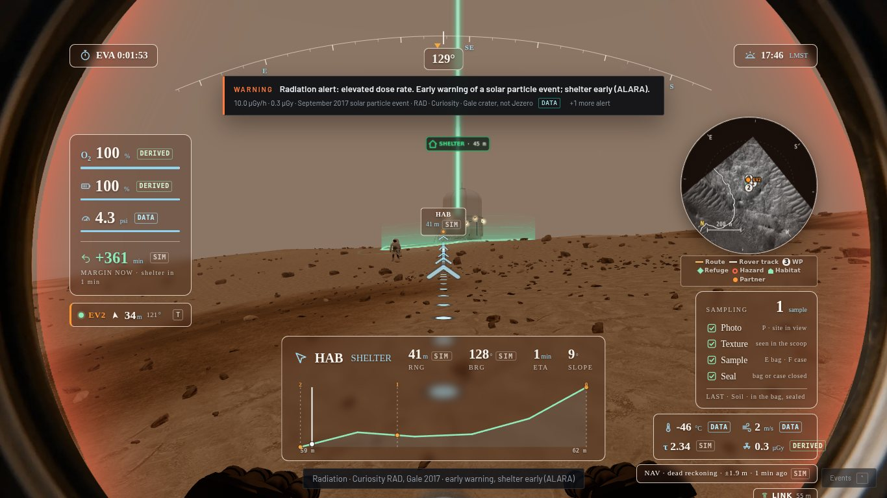
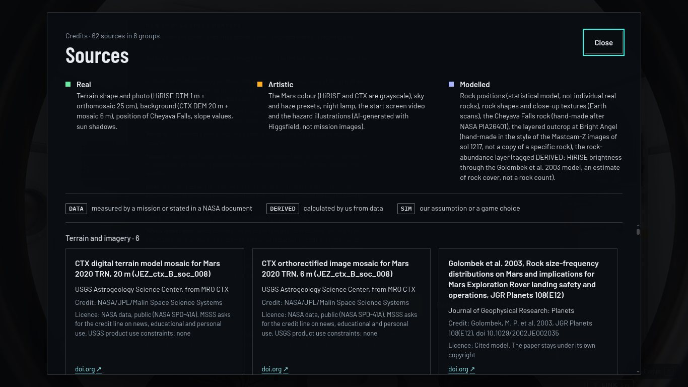

# Marswalk

**Technical report for the local judges · NASA Space Apps Challenge 2026 · Ensenada**

Challenge: Interplanetary Survival Guide: Martian Map

Team: **Los Frijolitos Espaciales Refritos Nueva Generación**

App: https://martian-map.fernando-haro-c.workers.dev

## Development team

| Name | Role | Email |
|---|---|---|
| Teresa Rivas Gómez | UI/UX and 3D art | [email] |
| Andrea Rivas Gómez | Graphics, effects and audio [confirm] | [email] |
| Fernando Haro Calvo | Full stack and data | [email] |
| Jorge Antonio Vazquez Guzmán | Backend and analyst: route planner and events | [email] |
| Antonio Ramos Gonzalez | Full stack | [email] |
| Brayan Iván Pérez Ventura | App, 3D engine and suit model [confirm] | [email] |

## Index

1. Challenge
   - Interplanetary Survival Guide: Martian Map
   - Background
   - Why did we choose this challenge?
2. Project overview
3. Problem statement
4. Proposed solution
5. Technical implementation
6. Results
7. Impact and relevance
8. Future work
9. Team contributions
10. References
11. Appendices

## Challenge

### Interplanetary Survival Guide: Martian Map

> NASA has explored Mars robotically for decades, studying its extreme environment, mapping its surface, and collecting many types of data. Far from home, the first astronauts to set foot on Mars will want the best map possible, with information on the details of their routes and destinations, updates on current conditions, and the data needed to complete their mission quickly and safely. Your challenge is to create a layered, integrated view of a location or route on the Martian surface that pulls together data from multiple NASA science missions and could help a human explorer plan and carry out a successful Marswalk while conducting new and exciting science along the way.

### Background

> Human explorers are able to conduct science and do other activities that robotic systems cannot. As seen during the recent Artemis II mission's lunar flyby, astronauts use their critical thinking skills to make connections, solve problems quickly, and apply context to observations and scientific measurements in real time. This is why NASA sends humans into the extreme environments of space, where we can learn more about our solar system and how it formed, and do science we can't on Earth. Today, human exploration is focused on the lunar surface, with more Artemis missions upcoming and planning for the phased buildup of a Moon Base underway. Part of the role of science missions at NASA is to pave the way for humans to visit new destinations in the future. Each new robotic Mars mission has represented a hugely complex engineering challenge. Sending humans will be the biggest challenge, and the biggest achievement, yet, and becoming an interplanetary species will take all of our knowledge, imagination, and hard work.
>
> Data from NASA's current and past Mars missions paints a detailed picture of the planet, but it isn't yet layered together in the combinations needed to plan specific human missions. Tools like the Jet Propulsion Laboratory's (JPL) Mars Trek and the USGS-NASA Planetary Geologic Mapping Program allow you to layer different data over a global map of Mars, but they are built for regional and global views rather than the hyperlocalized areas astronauts will target on individual spacewalks or surface excursions.

Statement and background copied from the challenge page on spaceappschallenge.org on 15 November 2026.

### Why did we choose this challenge?

In 1971 Apollo 15 took a rover to the Moon, and its planners still capped every drive at the distance the crew could walk back to the lunar module if the rover broke. Bellcomm memo B70 10028 sets that envelope. It adds a 20 % oxygen pad to the walk home, and Apollo 17's procedures held 30 minutes of every consumable in reserve. On Mars that rule gets harder to keep. There is no GPS. A radio call to Earth takes 4 to 24 minutes one way, so nobody on Earth can answer "can I still make it back?" in time. The crew has to answer it themselves, from the terrain, the suit and the weather.

The statement asks for a map at the scale of one spacewalk. We wanted that map to answer the walkback question. Mars Trek shows a slope. It does not tell you that the slope in front of you costs 129 g of oxygen per kilometre while the flat channel floor costs 40 g. It does not tell you that a dust storm just took away your terrain fix. We chose this challenge because every one of those numbers has a NASA source we could open and check. HiRISE gives the terrain, xEMU documents give the suit, Perseverance's MEDA gives the weather and Curiosity's RAD gives the radiation. NASA already has slope-aware EVA planners: SEXTANT optimizes routes for length, time or metabolic rate under a set slope limit, and BASALT's planners used it with xGDS. We wanted the walk home to be the constraint the crew sees, re-planned when a replayed Mars event hits.

We also wanted a place with a reason to walk there. Cheyava Falls is the rock in Neretva Vallis, Jezero crater, where Perseverance found what NASA called a potential biosignature in 2025. If humans go to Mars to sample one rock first, it is a good candidate. So our astronaut walks there.

## Project overview

Marswalk is a planning map and a walking test for one marswalk on real terrain. The astronaut leaves a habitat in Neretva Vallis, walks to Cheyava Falls and the Bright Angel outcrop, takes a sample and walks home. The site is a 1422.5 m by 1500 m tile cut from the HiRISE terrain model that NASA and USGS made to land Perseverance. It is centred on the spot where the rover stood on sol 1210 (18.4975 N, 77.3053 E).

The crew plans at a mission table inside the habitat. They see the site from above with data layers and Perseverance's 47 real drives. There are six layers, Radio and Exposure among them. The crew also sets its needs: goal, crew of one or two, time, oxygen, battery and risk. The planner builds a route from those needs and costs every leg in minutes and grams of oxygen. Then it compares three versions of the same route (fastest, gentlest and in radio contact) and gives a go or no-go with the tightest limit named.

Then the astronaut walks the plan in first person, with a helmet display and a wrist screen. A dust storm and a replay of the September 2017 solar particle event each break the plan and re-route the crew to shelter. A low-oxygen warning would do the same, but on this tile the margin never drops under its 15-minute trigger unless the run forces it. Back inside, a debrief judges the walked route against the approved plan.

Every number on screen carries a tag. DATA means a NASA mission measured it or a NASA document states it. DERIVED means we calculated it from DATA. SIM means we assumed it or scripted it. We checked 109 of those numbers against their primary sources and list the 16 we got wrong (Appendix A).

## Problem statement

At every step a Mars EVA plan has to answer one question. How far can the astronaut go and still get home with the reserve intact? Four facts make that hard.

1. Slope costs oxygen fast. In our suit model, built from NASA's suit and suited-walking figures, 1 km of flat walking at 1 m/s burns 40 g of oxygen. The same kilometre along a 20° slope at 0.5 m/s burns 129 g. The xEMU's primary tank holds 771 g of usable oxygen. Per kilometre, the slope costs 3.2 times the flat.
2. NASA's xEVA Concept of Operations (EVA-EXP-0042 Rev B) rates the suit for walking on slopes up to 20°, and we use that as the hard limit. Mars Trek shows slope, but it does not close ground over 20° or route around it.
3. Conditions change mid-walk. In January 2022 a regional dust storm over Jezero raised the optical depth from about 0.3 to about 2 (Lemmon et al. 2022). In September 2017 a solar particle event tripled the dose rate Curiosity measured in Gale crater (Zeitlin et al. 2018). The storm removes the terrain fix, and the particle event makes open ground the wrong place to stand.
4. Position is uncertain. Mars has no navigation satellites and no usable magnetic compass. Perseverance only began fixing its own position against orbital maps in February 2026.

The data to answer the question exists, spread across HiRISE, CTX, MEDA, RAD, DONKI, the Mars 2020 traverse and NASA's suit and physiology reports. SEXTANT plans slope-aware routes before an EVA. We did not find a tool that recomputes the walk home from these numbers as the astronaut moves and as events arrive.

## Proposed solution

Marswalk turns the walkback question into a number the crew can act on. On the table it is the go or no-go and the margin left at the end of the plan. In the helmet it is MARGIN NOW, the minutes left after the walk home and the 30-minute reserve. Every input to that number is a NASA measurement, a calculation from one, or an assumption we name on screen.

1. **A walkability map from HiRISE.** Each 2 m cell costs 1 + (slope / 9°)² + 0.6 × rock abundance. Ground steeper than 20° is closed. An A* planner finds the cheapest route through it in a Web Worker, and a suit model turns each leg into minutes, grams of oxygen and watt-hours.
2. **A mission table that plans from the crew's needs.** The goal, crew, time, oxygen, battery and risk choose which stops fit and in what order. A solo astronaut must keep radio contact with the habitat, so the planner forces the radio route. Each layer says which decision it drives. Terrain decides where the route bends, Radio decides the contact route and Exposure decides which shelter a re-plan picks.
3. **A walk that tests the plan.** The helmet shows only what a walker needs: oxygen, the margin, the next waypoint with its elevation profile, slope ahead, radio link and a position estimate with its error ring. Events replay real NASA records and re-plan to shelter. The debrief scores each detour as worth it, forced, costly or risky.

### What is new

- **The map prices each metre in oxygen.** Mars Trek shows slope and elevation. Ours shows what each metre costs to walk out and back, from NASA suited treadmill tests at 3/8 g (Norcross et al. 2008 and 2010), and redraws the cost when an event hits.
- **The plan comes from the crew's needs.** Changing a crew of two to a crew of one drops Bright Angel from the plan, because a solo astronaut works 1.5 times as long at each stop and the 2-hour budget no longer fits both (Image 2.5).
- **Every number says where it came from.** Hover any tag to see the mission, instrument, sol and reference. We also publish the 16 numbers our own audit found mislabelled or wrong, each with an issue (Appendix A).
- **Navigation without GPS.** Position drifts by 2 % of the distance walked (SIM) and resets when the astronaut stands still for a terrain fix. Perseverance has done the same since February 2026. In a dust storm above optical depth 1 the fix is unavailable.
- **The debrief reviews the walked route.** It compares the track with the plan the crew approved at Begin EVA. It prices every detour in seconds and grams and gives one verdict per detour.

## Technical implementation

### Architecture

Marswalk is a static web app with no backend on the critical path. Everything runs in the browser. The code has five layers, and each one depends only on the layers below it.

| Layer | Folder | Rule |
|---|---|---|
| Interface (React 19) | `src/plan/`, `src/hud/`, `src/debrief/`, `src/components/` | Reads one store snapshot. Never renders per frame |
| State (Zustand 5) | `src/state/` | The mission snapshot: route, suit, alerts, navigation, EVA log |
| Simulation | `src/sim/` | Plain JavaScript with no React and no three.js imports, so it runs in Web Workers and in Node tests |
| Engine (three.js 0.187) | `src/engine/` | Owns the canvas and the render loop. No React |
| Data | `public/data/`, `public/marswalk/` | Static files built offline from NASA archives, loaded once |

*Image 1.1. System architecture.*

### Frontend

The app uses Vite 8 and React 19 in plain JavaScript, linted with oxlint. three.js 0.187 draws the terrain, the astronaut, the habitat, the sky and the dust. The terrain mesh and the height grid come out of one Blender scene, so the ground the astronaut stands on and the ground the planner costs never disagree. On start the engine measures the frame rate and picks a High or Low graphics tier. On integrated GPUs it drops texture sizes and the astronaut's shadow pass.

The interface runs on keyboard, mouse, touch and gamepad, in English and Spanish. We test every step at 1366 by 768. The mission table and HUD fit. The wrist screen was unreadable at that size, with the HUD over the arm (#286). #331 closed that issue on 15 November, after we took Image 2.15. The app synthesizes the suit sounds (fans, breathing, footsteps, wind, dosimeter clicks and radio) in code with the Web Audio API. The app ships no sound files.

### The simulation (`src/sim/`)

**Cost grid** (`costGrid.js`). The grid reads the 751 by 751 height grid (1.90 m east-west by 2.00 m north-south cells) and the rock abundance map. Slope comes from a central difference over ±2 m, so features under 4 m are smoothed. Each open cell costs `1 + (slope / 9)^2 + 0.6 × rock`. The 9° and 0.6 are our choice, carried over from the test bench, and no source sets them (#311). They only rank routes against each other. The suit model, not the cost, prices the oxygen. Cells over 20° are closed for every risk setting. Caution starts at 15°. At cautious risk the Terrain layer marks 12° to 20° as caution. `costGrid.test.js` fails if those limits drift from `public/data/hazards.json`.

**Route planner** (`routePlanner.js`). A* runs on the 8-connected grid in a Web Worker, off the render thread. Normal routes use the exact Euclidean heuristic. Emergency re-plans use weighted A* with three times the heuristic, which can return a longer route but answers faster. `npm run bench` (#133) times an emergency re-plan from five places on the tile at 0.2 to 47.7 ms, against a 100 ms target. `findDetour.js` prices a marked find by trying each insertion point with two A* runs. `replan.js` compares complete routes to every reachable shelter and keeps the cheapest. A close shelter behind a steep band loses to a farther one on open ground. `offRoute.js` re-plans when the walker stays more than 20 m off the route for 5 s.

**Route profiles** (`routeProfiles.js`). The same planner prices the same stops three ways. Fastest uses the default cost. Gentlest cubes the slope term. Radio triples the cost where the habitat mast is out of line of sight. On the Cheyava Falls route for a cautious pair, gentlest cuts ground over 15° from 120 m to 102 m for 90 m of extra distance. The radio route cuts the stretch out of contact from 46 % to 19 % (Image 2.3). The three differ by at most 4 g of oxygen, so on this site the profiles decide radio contact, not oxygen.

**Crew needs** (`missionNeeds.js`, PR #282). Goal, crew, time, oxygen, battery and risk choose the stops and check the budget. Each leg's walk out, work at the stop and walk home must fit. The 20° limit never moves with risk. At 17° no route reaches Cheyava Falls.

**Suit model** (`suitModel.js`). The suit is NASA's xEMU design: 771 g of usable primary oxygen, a 756 Wh battery, 8 hours maximum and 4.3 psi. Walking power comes from Minetti et al. 2002 (13 gradient values, 1.64 J/kg/m on the level), scaled to Mars gravity and calibrated to NASA's suited tests at 3/8 g. On a slope the astronaut slows to hold the same effort as flat walking (589 W), down to 0.3 m/s. The walk home gets Apollo 15's 20 % pad, and the margin holds Apollo 17's 30-minute reserve. MARGIN NOW is the smaller of two numbers. One is the oxygen margin, which is oxygen left minus the padded walk home and the reserve, divided by the current burn rate. The other is the time left before the 8-hour EVA cap, minus the walk home. Just outside the airlock the cap wins. On the first sortie the HUD reads +479 min there (Image 2.14), the Suit step +285 min and the debrief's lowest margin +224 min, while walking at 589 W. On the full EVA the same screens read +457 and +245, measured before #282 merged (`docs/CHALLENGE_FIT.md`, #328). Two definitions of one number on two screens is a known problem (#323). The pitch's 13-minute margin comes from a different, SIM scenario, late in a long EVA with 205 g of oxygen left. A margin under 15 minutes raises a caution. At zero it raises a warning, and the crew turns back.

The xEMU was designed for the Moon. Its CO2 scrubber and cooler vent to vacuum, and Mars has about 700 Pa of CO2, so on Mars CO2 or heat could end a walk before oxygen does. We model oxygen and battery only. The flat walking speed of 1.0 m/s is our assumption. NASA plans traverses at 2 km/h, so our walk times run 1.45 to 1.8 times shorter than NASA's planning pace.

**Event engine** (`eventEngine.js`). An event is a JSON definition with a trigger (mission time, area, threshold or manual), a timeline of store changes, an alert, an optional planner request and an end condition. The engine owns no clock and no rendering. It decides from the mission time and the position passed to `update()`, so two clients with the same inputs start an event at the same moment. That matters for online play. The three events are:

- **Dust storm.** Optical depth rises from Jezero's clear-season 0.45 (Bell et al. 2022) to 8.0, the value Curiosity saw in Gale crater during the 2018 global storm. The sky, the sunlight and the visibility follow it, and the route re-plans to the habitat.
- **Radiation alert.** A replay of the 10 September 2017 event. An X8.2 flare peaked at 16:06 UTC (DONKI). Curiosity's RAD saw the dose rate start rising at Mars at 19:50 UTC, 224 minutes later, and peak at about three times background (Zeitlin et al. 2018). The game compresses the 57-hour event into minutes and says so.
- **Low oxygen.** A threshold event. It raises a caution when the margin drops under 15 minutes and a warning at zero. The Hazards step lists it as possible, but neither mission's route brings the margin that low.

**Navigation** (`navigationDrift.js`). Dead reckoning grows the error by 2 % of the distance walked. Standing still for 5 s with the horizon in view takes a terrain fix and resets the error below 1 m. There are no fixes at night or in a storm above optical depth 1. Line of sight to the habitat mast bounds the error by radio ranging.

**Radio and shelters** (`radio.js`, `skyView.js`, `shelters.js`). The radio link is line of sight through the height grid to the habitat mast. Natural shelters come from a sky view factor. Rays at 48 azimuths find the horizon from each cell, and cells that see 81 % to 85 % of the sky become partial shelters. The habitat is the only full shelter.

**Route review** (`routeReview.js`, PR #282). The EVA log keeps one track point every 2 m. A deviation starts 15 m off the approved path and ends back within 10 m. Each deviation gets its extra minutes, grams of oxygen, lowest margin and steepest slope. Then it gets one verdict. "Risky" means it crossed 20° or broke the reserve, "forced" means an event caused it, "worth it" means it reached a find or a sample, and "costly" covers the rest.

Vitest runs the tests in Node, with no browser. `main` at `cfcf299` has 1,672 test cases in 170 files.

### Data processing

The raw NASA downloads never reach the browser or git. Node scripts in `scripts/` process them offline and write small files to `public/data/`. Each file keeps a provenance block with mission, instrument, product ID, site and sol.

| Data | NASA source | What we built |
|---|---|---|
| Terrain heights | HiRISE DTM mosaic for Mars 2020 TRN, 1 m (JEZ_hirise_soc_006), USGS | 1500 × 1500 pixel crop in Blender, 1422.5 × 1500 m on the ground after a 5.4 % east-west scale correction, resampled to the 751 × 751 grid in `terrain.json`. Base elevation -2393.37 m MOLA |
| Ground photo | HiRISE orthomosaic, 25 cm | Terrain texture, outcrop mask, the Image layer |
| Horizon | CTX DEM 20 m and CTX mosaic 6 m | A 12 km ring around the tile |
| Rover drives | Mars 2020 MMGIS traverse and waypoints | 47 drives across the tile, sols 1140 to 1266, 2827 m inside it (`traverse.json`, PR #279) |
| Weather | Mars 2020 MEDA bundle, PDS Atmospheres | Sol 1187, recorded within 12 m of the scene origin: pressure 777.9 to 757.8 Pa and air temperature 200.8 to 245.6 K from midnight to noon. Wind from sol 312, because MEDA has no wind after sol 315 (`meda_sol.json`) |
| Radiation | MSL RAD reduced data, PDS PPI, and DONKI | Background 0.210 mGy/day (Hassler et al. 2014) and the September 2017 curve (`rad.json`) |
| Suit and walking | xEMU PLSS (CTSD-ADV-959), xEVA ConOps, Apollo SP-368, Norcross 2008 to 2010, Minetti 2002 | 75 values in `hazards.json`: 57 DATA with a quote and page, 7 DERIVED and 11 SIM |
| Science stops | Mastcam-Z sol 1187, PIA26336, PIA26368, PIA26401, Hurowitz et al. 2025 | Stop cards and the Cheyava Falls rock model (`stops.json`) |

**The map layers.** All six are derived from the same products, and each legend names the decision it drives.

- Image: the HiRISE photo.
- Terrain: slope classes with 5 m contours.
- Rocks: rock cover estimated from HiRISE brightness, with rock sizes from the Golombek et al. 2003 model. Brightness also follows dust and rock type, so this layer is a proxy (#311).
- Outcrop: light-toned rock from the orthophoto.
- Radio: radio shadow of the habitat mast.
- Exposure: sky view.

Perseverance's drives draw on top as a seventh, DATA-tagged overlay. We dropped two layers after checking them. A THEMIS thermal layer would have put 15 × 15 pixels on the whole tile. USGS geologic map SIM 3464 sits 100 to 200 m off our terrain.

**Checking the terrain.** We compared all 564,001 nodes of our grid with the HiRISE Jezero DEM that NASA Mars Trek serves. They differ by 0.14 m RMS, and 97.3 % of nodes fall in the same slope class. No node is steep in one and flat in the other. The check proves our crop, resampling, frame and units reproduce the USGS model. It does not prove the model is true, because both sides come from the same USGS product.

*Image 1.2. Slope classes from our grid (left) and from the NASA Mars Trek DEM (middle). Magenta marks the 2.7 % of nodes that differ (right).*

### Deployment

Cloudflare Workers serves the built `dist/` folder as static assets on the free plan. Every merge to `main` builds and deploys in about a minute. Every pull request gets its own preview URL, posted as a comment, so a change can be tried on a live link before it merges. The largest served file is 2.4 MB.

Online play is in progress, not on `main`. One Durable Object per room code holds the room state, and the event engine's deterministic triggers keep every client's events in step. The room object, its client connection, shared markers and samples, remote astronauts, and the join screen with its seat choice are merged into the `feat/online` branch (#252, #273, #280, #308). The habitat seat, which sends routes and go or no-go calls to the surface crew, is an open pull request against that branch (#306). `main` already carries the Worker entry and the Room migration (#234).

### Presentation mode

`?present=1` turns the app into the pitch (#330). One camera move falls from Mars orbit onto the engine's HiRISE terrain at Cheyava Falls. It crosses the Viking colour globe (MDIM 2.1), THEMIS day infrared at 100 m and the CTX mosaic at 6 m on the way down. Ten beats in `src/present/beats.js` each answer one judge question: where we are, why Cheyava Falls, the danger (the 8-hour suit limit and the 30-minute reserve), the 913 m route with its leg costs, the walkback zone, the radiation alert, the dust storm, the DATA, DERIVED and SIM tags, and the live app. In the alert the walkback zone drops from 14.3 ha to 1.1 ha. The last beat presses the start screen's own button, so the live demo starts with no reload.

A clicker steps the beats. Right, Space, PageDown and Enter go forward, Left and PageUp go back, L switches English and Spanish and Esc leaves. Under `&autoplay=1` the ten beats run 111 seconds. One clock drives the globe, the engine and every label, so `scripts/present/record.mjs` records a frame-exact 1080p60 video for a backup. Every number on screen reads `public/present/plan.json`. `scripts/present/build-plan.mjs` writes that file by running the app's own cost grid, route planner and suit model, and the zone from `computeReturnZone`. That function lands with #335, which is still open, so only a rebuild of `plan.json` needs it. The committed file runs the presentation on `main` today. If WebGL fails, the presentation shows each beat's captions over a still image and the keys keep working. It loads as a separate chunk, so the normal app downloads none of it.

### Technologies used

JavaScript, React 19, Vite 8, three.js 0.187, Zustand 5, Web Workers, Web Audio API, Vitest 5, oxlint, Blender 5.3, Node.js scripts, Python (terrain checks and the audit), Cloudflare Workers and Durable Objects, GitHub Actions (lint, build and tests on every pull request), puppeteer-core (frame rate and demo measurement).

## Results

Marswalk runs at https://martian-map.fernando-haro-c.workers.dev. By 8:52 PST on 15 November we had merged 142 pull requests into `main`. The screenshots below come from pull request #282 at `8ec6f72`, which merged into `main` as `cfcf299`. Captions marked #290 show the habitat-first flow, which starts the EVA inside the habitat and is still an open pull request. Two later merges changed screens after we took them. #331 put the Walk HUD on the #232 design system, and #346 made EV2 a crewmate. We took every screenshot from the running app at 1366 × 768 in Chrome on an RTX 3070. None is a mockup.

The demo runs the first mission, a 55 m sortie from the airlock to a light-toned patch, with the dust storm and the radiation alert brought forward so both play before the crew is home. Walking speed stays at 1.0 m/s and the clock runs at real time. Only the event times are shortened, and they are tagged SIM. A player reaches the debrief in about 3.5 minutes.

*Image 2.1. Start screen.*

The start screen offers two missions. "Open the mission table" starts the first sortie. "Full EVA · Sample Cheyava Falls" starts the full walk: 934 m out from the habitat by Bright Angel to the rock on the fastest profile. The walk home from Cheyava Falls is 913 m by the route, the figure the pitch uses. Controls and Sources are one click away. The background video is artwork generated with Higgsfield, an SI tool (SI, Super Intelligence, is the 2026 Space Apps term for AI), and the caption on screen says so. It is not a mission image.

*Image 2.2. Mission table, Site step.*

The mission table has four steps: Site, Route, Hazards and Suit. Site answers "where are we and why". Cheyava Falls is at 18.4975 N, 77.3053 E, 785 m from the habitat in a straight line, with 221 m of relief across the 1422 × 1500 m tile. The close-up is Perseverance's own image of the leopard spots on the rock (PIA26368).

*Image 2.3. Route step with the Terrain layer, goal "Sample Cheyava Falls", cautious risk.*

The Route step plans from the crew's needs on the left. With a pair, 2 hours and cautious risk, the planner keeps both stops: Bright Angel, then Cheyava Falls. On the fastest profile at cautious risk the route is 0.94 km with 55 minutes out, a 29 m climb and a 20° steepest point. At cautious risk the Terrain layer paints 12° to 20° amber and over 20° red. The route bends around the red bands, which is why it is not a straight line. The summary names time as the tightest limit, with 14 minutes to spare.

| | |
|---|---|
|  |  |

*Image 2.4. Rocks layer (left) and Outcrop layer (right).*

The Rocks layer shows the rock cover that a cautious plan prices higher. The Outcrop layer marks light-toned rock from the HiRISE photo, and the stops the plan kept sit on it. Each legend ends with one line on what the layer decides.

*Image 2.5. Radio layer with a crew of one.*

Switching the crew to one astronaut changes the plan. A solo walker must stay in radio contact, so the planner walks the radio profile. Blue marks ground the habitat mast cannot see. The route now follows the channel and is out of contact for 21 % of its length, against 76 % on the fastest line. A solo astronaut also works 1.5 times as long at each stop. Bright Angel no longer fits the 2-hour budget, and the stop list says "left out: 5 min over your time".

| | |
|---|---|
|  |  |

*Image 2.6. Exposure layer (left) and Perseverance's drives (right).*

Exposure shows the sky view of each cell, from 0.82 to 1.00. In a solar particle event the dose scales with visible sky, so this layer decides which shelter a re-plan picks. The white lines are Perseverance's 47 real drives from sols 1140 to 1266. The cautious risk setting prefers ground the rover already drove.

| | |
|---|---|
|  |  |

*Image 2.7. Two plans from different needs.*

Plan A is a solo crew, cautious, with 100 minutes. It walks 0.88 km to Cheyava Falls only and leaves Bright Angel out for time. Plan B is a pair, bold, with 2 hours. It walks 0.91 km to both stops.

*Image 2.8. Route profiles, gentlest selected.*

The route profiles compare one set of stops three ways. Each column shows distance, steepest slope, metres over 15°, percent out of radio contact, minutes out and grams of oxygen. The crew picks one and the map redraws it. Between the habitat and Cheyava Falls the terrain leaves little room, and the three routes stay within 0.1 km and 4 g of oxygen. Radio contact is where they differ.

*Image 2.9. Cheyava Falls stop card.*

Clicking a stop opens its card, with Perseverance's Mastcam-Z and WATSON images and what the science team found there, each line tagged DATA. The card quotes the September 2025 Nature paper (Hurowitz et al.) on the potential biosignature and the Sapphire Canyon core taken on 21 July 2024.

*Image 2.10. Hazards step.*

The Hazards step lists the three events for this run, with when each one comes, what happens, what to do and the real event behind it. Both the storm and the radiation cards say the numbers were "measured by Curiosity in Gale crater, not Jezero". The illustrations are artwork generated with an SI tool. The low-oxygen card says it can happen in this run, but this route never brings the margin under its 15-minute trigger.

*Image 2.11. Suit step with the conditions outlook and the go decision.*

The Suit step is the go or no-go. The outlook shows MEDA pressure and temperature for the planned local time, dust opacity and a 224-minute space weather warning. The budget bars split time, oxygen and battery into way out, work, way back and spare. For the first sortie the verdict is Go, with time as the tightest limit (21 minutes to spare) and +285 minutes of oxygen margin over the 30-minute reserve. The Z-2 suit is NASA's 3D model, and the numbers come from the xEMU documents.

| | |
|---|---|
|  |  |

*Image 2.12. Habitat cabin with the "E Make a plan" prompt (left). Image 2.13. Airlock before Begin EVA (right). Both need #290.*

In #290 the EVA starts inside the habitat, built on NASA's Habitat Demonstration Unit model. The table in the middle opens the plan. The wall screens draw the EVA team and life support from mission data. The outer hatch stays shut until the crew presses Begin EVA, and then the airlock cycles: inner hatch sealed, chamber pumped down, outer hatch open.

*Image 2.14. Walk HUD.*

Top left: oxygen, battery and suit pressure, and MARGIN NOW (+479 min here, just outside the airlock). The panel below the margin shows EV2, the partner, 5 m away. The waypoint panel shows range, bearing, time and slope to S1, with the elevation profile of the next leg. The minimap shows the route, the rover track and the habitat. Bottom right: MEDA temperature and wind, optical depth, dose and the navigation line "dead reckoning · ±0.6 m". The suit, environment and navigation values carry tags. The waypoint ETA, the EV2 distance and the radio range do not yet (#297).

| | |
|---|---|
|  |  |

*Image 2.15. Wrist screen (left). Image 2.16. Slope grid on the ground (right).*

Anything that takes reading goes to the wrist, not the visor. R raises it: a map page, the data layer list and the sampling checklist. G projects the slope grid onto the ground around the walker, coloured by the same 15° and 20° limits as the planner.

*Image 2.17. Marking a find off the route.*

Holding Q on a rock marks a find. The planner prices the detour with the same cost grid and suit model, in seconds, grams of oxygen and margin, and gives a GO or NO-GO. The crew decides. In the run behind these screenshots the debrief priced this detour at 20 s and 1 g of oxygen over the plan.

| | |
|---|---|
|  |  |

*Image 2.18. Science stop (left) and sampling (right).*

At the stop the banner gives the reason for the walk and tags it SIM. "Light-toned ground like Bright Angel's on the HiRISE outcrop mask: no rover has looked here, so the science is an assumption." The beat line says what to do: P to photograph, click to scoop, E to bag and seal. The checklist on the right fills in as each step is done.

| | |
|---|---|
|  |  |

*Image 2.19. Dust storm in the helmet (left) and its re-plan on the mission table (right).*

Four seconds after the sample the dust storm starts, and the route re-plans to the habitat. The banner names its source: "Mastcam-Z to Curiosity's 2018 Gale storm, not Jezero". The first mission shortens the ramp to 30 s, so its optical depth carries a SIM tag. Fifteen seconds in, the HUD reads 2.34 and the sky has closed in. M opens the table during the EVA. The route now runs 54 m to the habitat airlock, with the crew's live position on the map.

*Image 2.20. Radiation alert.*

Fifteen seconds after the storm, the radiation alert takes over the banner, and the storm drops to "+1 more alert". The dose rate follows the RAD curve of September 2017 (16.0 µGy/h here), and the banner says "Gale crater, not Jezero". A SHELTER marker stands over the habitat, 45 m away. The guidance follows ALARA: shelter early and keep the dose as low as reasonably achievable.

*Image 2.21. EV2 brings the sample case.*

EV2 is a crewmate with its own decisions (#346). A state machine in `src/sim/crewmate.js` walks the approved route with the astronaut. It steers at a point 3 m ahead on the route, never at the player, so it does not turn round when the player does. It waits 5 m away when the astronaut stops and steps to the gentler side of any slope of 15° or more ahead. At a science stop it sets the tool case down 1.6 m beside the astronaut. Events change what it does. In the dust storm it closes to 3 m behind. In the radiation alert it leads the way to the shelter, 5 m ahead. When its own margin drops under 15 minutes it says so and turns for home. It calls each of these out on the radio, in English or Spanish, and only with line of sight to the habitat. The separation limit stays 100 m, with a caution from 80 m. F calls EV2 with the case, and the astronaut pours a second sample into it. A crew of one has no EV2. EV2 runs on a partner source interface (`docs/PARTNER.md`), so a second human player can take the role in online play. Image 2.21 predates #346.

| | |
|---|---|
|  |  |

*Image 2.22. Debrief with the route review (left) and the verdict rules (right).*

Back inside, the debrief gives the run: 3 min 37 s outside, 171 m walked, 2 samples, 0.57 µGy of dose and a lowest oxygen margin of +224 min. The dose is the game's compressed event, not what the 2017 event delivered (#295). The route review draws the walked track (green and orange) over the approved plan. It reported "1 deviation: 1 worth it. +20 s and +1 g O2 over the plan" for the detour to the find. The right image is the review's key. It gives one rule per verdict, checked in a fixed order.

*Image 2.23. Sources screen.*

The Sources screen (key C, or the button on the start screen and the debrief) lists 62 sources in 8 groups: every dataset, paper, model and library, with its credit and licence. It opens with what is real, what is artistic and what is modelled. A build script generates it from the same provenance blocks as the tags, so a tag and its source cannot drift apart.

## Impact and relevance

**Impact.** Three users, each with a decision Marswalk supports.

- *An EVA planner at the habitat table* chooses one of three routes, checks the tightest limit and calls go or no-go (Images 2.8 and 2.11). The profile columns show metres over 15°, minutes out, grams of oxygen and the stretch out of radio contact.
- *The astronaut on the surface* decides when to turn back. MARGIN NOW gives that decision as one number, and it updates with every step and every event (Image 2.14). When the storm takes the terrain fix, the error ring tells them how much to trust the position.
- *A teacher in Ensenada* can run a Mars EVA in a browser on a classroom laptop, in Spanish, with no install. The app picks a low graphics tier on integrated GPUs. The Terrain layer and the Suit step show the 20° limit and the 30-minute reserve with their NASA sources. No class has used it yet.

The pipeline takes a HiRISE DTM as input, and the HiRISE team publishes DTMs of many other sites. We have run it on one site.

**Creativity.** Mars Trek and the USGS geologic maps answer "what is here?". Marswalk answers "can I get there and back on what is in my tank?", and it re-asks the question as the astronaut walks. A replayed NASA solar storm changes the route. NASA's suit numbers set the turnaround point. A crew of one gets a different mission from a crew of two (Images 2.5 and 2.7). The walked-route review judges the crew's decisions after the walk (Image 2.22).

**Validity.** We checked 109 numbers against their primary sources (Appendix A). 72 match, 7 round to the source and 11 are our stated assumptions tagged SIM. 14 carry the wrong tag, page or wording, 2 are wrong on screen, and 3 come from a paper the publisher would not let us open. The audit is `docs/VALIDITY.md` (#314). The 16 problems are grouped into 9 issues (#293 to #300 and #311), each with the source and the corrected value. Our grid reproduces the HiRISE model that NASA Mars Trek serves to 0.14 m RMS over 564,001 nodes (Image 1.2). The app has 1,672 unit tests on `main`, and CI runs them on every pull request. We also list what the app does not do. It has no live data, no Earth-Mars delay and no radiation measured at Jezero.

**Relevance.** The statement asks for a layered view of one route, built from several NASA missions, that helps an astronaut plan and carry out a marswalk while doing science. Marswalk covers each part with a named source:

- A science goal and a location: Cheyava Falls, chosen for its potential biosignature (Hurowitz et al. 2025).
- At least three data types, in part: optical (HiRISE, CTX, Mastcam-Z), topographic (HiRISE DTM, CTX DEM), atmospheric (MEDA), radiation (RAD, DONKI) and the rover traverse (MMGIS). Only optical and topographic data, and layers derived from them, sit on the map. Weather and radiation show on the HUD and the hazard cards (#325).
- Safety and space weather: the radiation alert and the dust storm.
- Suit mobility: the xEMU model and NASA's 20° limit.
- A route around obstacles, in part: the planner closes ground over 20°, so it avoids scarps and steep outcrops. Rock cover comes from a brightness proxy, so no single boulder is avoided, and the fastest route crosses a ripple field Perseverance drove around (#311, #322).
- Habitat and visor displays: the mission table and the HUD.
- Rover point-of-view images: the stop cards.
- Astronauts in pairs: EV2 walks the approved route with the astronaut, leads to shelter in the radiation alert, closes in during the storm and carries the sample case (#346). It does no science of its own.

Of the five official challenge resources, it uses one directly, the Perseverance raw images, on the stop cards and as the colour reference. We also checked our terrain against the HiRISE DEM that Mars Trek serves, and took the traverse from JPL's MMGIS layers rather than from Mars Trek itself.

**Presentation.** The team presents a 5-minute pitch with a live demo [confirm: the organisers' page still says 3 minutes]. The script is `docs/pitch/script-5min-en.md` (open PR #329), and the live demo runs 2 minutes 25 seconds of it. The team presents from the app itself, in presentation mode (`?present=1`, #330), and its last beat hands over to the live demo. The layer legends, beat lines and tags explain each screen, so the demo reads with the sound off. The pitch opens on one thesis: "On Mars, the question isn't where you can go. It's where you can go and still get home."

## Future work

1. **Fix the audit's open issues before anything else.** Set the elevation profile's no-go to 20° (#293), the Sun's declination for sol 1210 (#294) and the radiation event's tags (#295).
2. **Show the walkback zone on the map.** The pitch already draws it with two Dijkstra passes over our cost grid, one from home over reversed edges and one from the astronaut. A cell is in the zone when walk out + walk back + reserve ≤ oxygen left. The live map version is in progress.
3. **Merge online play.** One surface crew and one habitat seat per room on Cloudflare Durable Objects. That means merging #306 into `feat/online`, then `feat/online` into `main`.
4. **Heart rate in the loop.** Feed a wearable heart rate sensor into the suit model, so oxygen use follows the walker's real effort instead of the SIM constant-effort rule.
5. **A second site.** Run the pipeline on Curiosity's boxwork terrain at Mount Sharp, the example in the challenge statement, to prove it works beyond Jezero.

## Team contributions

The six of us are Teresa Rivas Gómez, Andrea Rivas Gómez, Fernando Haro Calvo, Jorge Antonio Vazquez Guzmán, Antonio Ramos Gonzalez and Brayan Iván Pérez Ventura. Between 8:47 and 22:38 PST on 14 November we merged 126 pull requests into `main`. 38 of them got a review from a teammate on GitHub, 33 of those an approval. The other 88 merged without one. By 8:52 on 15 November the count was 142, with 53 reviewed and 48 approved. CI arrived with #81 at 11:06. #1, #3, #75 and #80 merged with no checks at all, and #76, #77 and #82 had no "Lint and build" run. #118, #163 and #182 merged with "Lint and build" failing. The Cloudflare "Workers Builds" check failed on 20 merged pull requests, all before 22:38 on 14 November. The paragraphs below come from that history.

**Teresa Rivas Gómez (UI/UX and 3D art).** In Blender she made the HiRISE terrain tile, the rigged and animated Z-2 astronaut, the habitat interior on NASA's Habitat Demonstration Unit, and the original three.js test bench that loads them. Brayan ported the engine from that test bench, and the first asset commit came through Andrea's account. She moved the Blender sources into Git LFS (#108) and wrote the export script that keeps the mesh and the height grid in step (#115). She modelled the layered outcrop at Bright Angel, a 6.7 × 3.4 m rock with about 60 thin beds and three detail levels (#148). She designed the Figma HUD and the mission table. She then built the table's four steps, the start, pause, controls and sources screens in the new design (#232), the helmet visor frame with alert rings (#264), the walk controls card (#271) and the Settings view (#272). She generated the start screen video and the hazard illustrations with Higgsfield (#232, #259).

**Andrea Rivas Gómez (graphics, effects and audio) [confirm role].** Andrea wrote the graphics and audio that follow the simulation state. She drew the planned route as a visor projection on the ground (#97) and highlighted the chosen shelter (#114). She built the dust storm from one dust level that drives particles, sky and light (#124, #151, #165). She added boot prints that stay on the ground (#141) and the slope grid and dust plume when sampling (#176). She rendered the layer preview images with the engine itself (#187) and drew the habitat wall screens from mission data (#230). She made the Sun and sky follow mission time and dust opacity (#237). She wrote all of the suit audio in code with the Web Audio API: fans, breathing, footsteps, wind, dosimeter and radio (#243). She also fixed how an EVA ends at the habitat (#251).

**Fernando Haro Calvo (full stack and data).** He set up Cloudflare deploys with a preview per pull request (#83, #234) and researched the sourced hazard numbers behind the suit, dust and radiation models (#85, #88). He wrote the MEDA and RAD pipelines (#116), the shelters from terrain sky view (#96), the time, oxygen and battery per leg (#107) and the science stops (#109, #144). He checked the terrain against Mars Trek (#119). He built the provenance registry, the SourceTag component and the Sources screen (#138, #140, #118). He added the partner panel and separation limit (#171) and the find marking with its detour price (#215), and he made 15 fixes and additions to the HUD, map, terrain and storm lighting (#209 to #224). He leads online play on Durable Objects (#252, #273, #280 and #308 on `feat/online`, open #306) and the habitat-first flow (open #290). On 15 November he merged EV2 the crewmate (#346), the presentation mode (#330), the Walk HUD on the #232 system (#331), the source audit (#314), the rules and submission drafts (#315, #316) and the challenge fit (#328).

**Jorge Antonio Vazquez Guzmán (backend and analyst: route planner and events).** Jorge wrote the code that decides where the crew can walk. He wrote the walkability cost grid (#76), the A* planner in a Web Worker (#77), the re-plan to the cheapest shelter (#79) and the data-driven event engine (#80). He built the first top-down map with layers and the route panel (#104, #106). He built the dust storm, radiation and low-oxygen events (#110, #111, #120) and re-planning when the walker leaves the route (#122), with a benchmark for re-plan time (#133). He added the elevation profile, the slope no-go warning with its detour, and the radio link and shadow layer (#143, #146, #156). He built the navigation drift model with terrain fixes and radio ranging (#229). He dropped the geology layer after measuring USGS SIM 3464 against our tile (#233), and he removed labels that overstated the data (#255). He also drove the legs, arm swing and prints from distance walked (#253) and loaded every asset behind the start screen (#275).

**Antonio Ramos Gonzalez (full stack).** Antonio built the tests, CI, menus, settings and input handling. He added the Vitest runner and the first simulation test (#78) and CI that lints and builds every pull request (#81), which now runs the tests too. He added loading progress with recoverable errors (#95) and the persistent mission clock with local Mars time (#112). He built the Walk minimap (#163), the start screen, controls help and pause menu (#167), the keyboard shortcuts (#168) and the English and Spanish interface (#177). He built the habitat debrief with mission statistics (#184) and the wrist screen app with its map and sampling checklist (#210). He added look sensitivity and invert-Y settings (#238) and touch and gamepad controls (#241).

**Brayan Iván Pérez Ventura (app, 3D engine and suit model) [confirm role].** Brayan wrote the implementation plan (#75) and the project context (#86), and he set up the app base with Plan and Walk modes (#82). He built the mission store and engine API (#92) and the automatic graphics tier (#91). He wrote the suit model and walkback margin (#94) and the first-person walk with pointer lock (#99). He built the helmet HUD (#121), the position marker with its uncertainty ring (#150), sampling (#154) and collisions with rocks, the partner and the habitat (#155). He added the three route profiles (#276) and Perseverance's drives and image pins on the map (#279). In #282 he built the first mission, the routes generated from the crew's needs, the conditions outlook, the walked-route review and the demo script, measured at 6 minutes 40 seconds. The team presents a 5-minute pitch with a live demo, scripted in `docs/pitch/script-5min-en.md` (open PR #329) [confirm: the organisers' page still says 3 minutes].

## References

### NASA data products and services

- Fergason, R. L. et al. 2020. HiRISE digital terrain model mosaic for Mars 2020 TRN, 1 m (JEZ_hirise_soc_006). USGS. https://doi.org/10.5066/P9REJ9JN
- HiRISE orthorectified image mosaic for Mars 2020 TRN, 25 cm (JEZ_hirise_soc_006). USGS. https://doi.org/10.5066/P9QJDP48
- CTX digital terrain model mosaic for Mars 2020 TRN, 20 m (JEZ_ctx_B_soc_008). USGS. https://doi.org/10.5066/P906QQT8
- CTX orthorectified image mosaic for Mars 2020 TRN, 6 m (JEZ_ctx_B_soc_008). USGS. https://doi.org/10.5066/P9GV1ND3
- NASA Mars Trek, HiRISE Jezero DEM. https://trek.nasa.gov/mars/
- Mars 2020 Where is the rover, MMGIS traverse. https://mars.nasa.gov/mmgis-maps/M20/Layers/json/M20_traverse.json
- Mars 2020 Where is the rover, MMGIS waypoints. https://mars.nasa.gov/mmgis-maps/M20/Layers/json/M20_waypoints.json
- Rodriguez-Manfredi et al. Mars 2020 MEDA bundle, PDS Atmospheres node. https://doi.org/10.17189/1522849
- MSL RAD reduced data records, PDS PPI node. https://pds-ppi.igpp.ucla.edu/data/MSL-M-RAD-3-RDR-V1.0/
- NASA CCMC DONKI, flare 2017-09-10T15:35:00-FLR-001. https://ccmc.gsfc.nasa.gov/DONKI/WS/get/FLR?startDate=2017-09-10&endDate=2017-09-10
- NASA CCMC DONKI notifications, 10 September 2017. https://ccmc.gsfc.nasa.gov/DONKI/WS/get/notifications?startDate=2017-09-10&endDate=2017-09-10&type=all
- Mars 2020 raw images, Mastcam-Z left, sol 1187 (ZL0_1187_0772321307_818EBY_N0541010ZCAM09237_0630LMJ). https://mars.nasa.gov/mars2020/multimedia/raw-images/ZL0_1187_0772321307_818EBY_N0541010ZCAM09237_0630LMJ
- Mars 2020 raw images gallery, sols 1211 to 1217. https://mars.nasa.gov/mars2020/multimedia/raw-images/
- PIA26336, Perseverance Views 'Bright Angel'. https://science.nasa.gov/photojournal/perseverance-views-bright-angel/
- PIA26368, Perseverance Finds a Rock with Leopard Spots. https://science.nasa.gov/photojournal/perseverance-finds-a-rock-with-leopard-spots/
- PIA26401, Mastcam-Z Views the 'Cheyava Falls' Workspace. https://science.nasa.gov/photojournal/mastcam-z-views-the-cheyava-falls-workspace
- NASA 3D Resources, Z-2 Spacesuit. https://github.com/nasa/NASA-3D-Resources/tree/master/3D%20Models/Z2%20Spacesuit
- NASA 3D Resources, Habitat Demonstration Unit. https://github.com/nasa/NASA-3D-Resources/tree/master/3D%20Models/Habitat%20Demonstration%20Unit
- NASA GISS, Mars24 sunclock technical notes. https://www.giss.nasa.gov/tools/mars24/help/notes.html
- NSSDC Mars fact sheet. https://nssdc.gsfc.nasa.gov/planetary/factsheet/marsfact.html

### NASA documents

- NASA JSC. Schematics and Behavioral Description for the AEMU PLSS, CTSD-ADV-959 Rev A. https://ntrs.nasa.gov/citations/20170009505
- NASA. Exploration EVA System Concept of Operations, EVA-EXP-0042 Rev B. https://www.nasa.gov/wp-content/uploads/2017/02/eva-exp-0042_xeva_system_con_ops_rev_b_final_dtd_10192020_ref_doc.pdf
- Ogilvie et al. 2026. Mars Spacesuit Mass Requirements, ICES-2026-127. https://ntrs.nasa.gov/citations/20260003038
- NASA MSC. Apollo 17 Final Lunar Surface Procedures, Volume 2: Contingency. https://pds-geosciences.wustl.edu/Lunar/urn-nasa-pds-apollodoc/document_a17/mission/a17_final_lunar_surface_procedures_vol2_contingency.pdf
- Benjamin. Apollo 15 EVA Capability and Constraints Envelopes, Bellcomm memorandum B70 10028. https://webarchive.library.unt.edu/eot2008/20090109180220id_/http://www.hq.nasa.gov/alsj/19790073512_1979073512.pdf
- Waligora, J. M. and Horrigan, D. J. 1975. Metabolism and Heat Dissipation During Apollo EVA Periods, NASA SP-368. https://ntrs.nasa.gov/citations/19760005584
- Norcross, J. et al. 2008. Feasibility of Suited 10 km Walkback on the Moon. https://ntrs.nasa.gov/citations/20080014853
- Norcross, J. et al. 2009. Feasibility of Performing a Suited 10-km Ambulation on the Moon, NASA/TP-2009-214796. https://www.lpi.usra.edu/lunar/artemis/NorcrossEtAl_NASA-TP-2009-214796_EVA%20Walkback%20Test.pdf
- Norcross, J. R. et al. 2010. Metabolic Costs and Biomechanics of Inclined Ambulation and Exploration Tasks in a Planetary Suit, NASA/TP-2010-216125. https://ntrs.nasa.gov/citations/20110003409
- Hoffmann, B. 2021. Extravehicular Activity Metabolic Rate Model. https://ntrs.nasa.gov/citations/20210024317
- NASA OCHMO. Design for Ionizing Radiation Protection, OCHMO-TB-020 Rev E. https://www.nasa.gov/wp-content/uploads/2023/03/radiation-protection-technical-brief-ochmo.pdf
- JPL, 18 February 2026. NASA's Perseverance Now Autonomously Pinpoints Its Location on Mars. https://www.jpl.nasa.gov/news/nasas-perseverance-now-autonomously-pinpoints-its-location-on-mars
- NASA, 10 June 2024. NASA Watches Mars Light Up During Epic Solar Storm. https://www.nasa.gov/missions/maven/nasa-watches-mars-light-up-during-epic-solar-storm/
- JPL, 20 June 2018. Martian Dust Storm Grows Global; Curiosity Captures Photos of Thickening Haze. https://www.jpl.nasa.gov/news/martian-dust-storm-grows-global-curiosity-captures-photos-of-thickening-haze/
- JPL, 16 August 2018. Six Things to Know About NASA's Opportunity Rover Recovery Efforts. https://www.jpl.nasa.gov/news/six-things-about-opportunitys-recovery-efforts/
- JPL, 9 June 2016. NASA Mars Orbiters Reveal Seasonal Dust Storm Pattern. https://www.jpl.nasa.gov/news/nasa-mars-orbiters-reveal-seasonal-dust-storm-pattern/
- NASA, 25 July 2024. NASA's Perseverance Rover Scientists Find Intriguing Mars Rock. https://www.nasa.gov/missions/mars-2020-perseverance/perseverance-rover/nasas-perseverance-rover-scientists-find-intriguing-mars-rock/
- NASA, 10 September 2025. NASA Says Mars Rover Discovered Potential Biosignature Last Year. https://www.nasa.gov/news-release/nasa-says-mars-rover-discovered-potential-biosignature-last-year/
- NASA Goddard. Space Communications: 7 Things You Need to Know. https://www.nasa.gov/centers-and-facilities/goddard/space-communications-7-things-you-need-to-know/

### Papers

- Bell, J. F. et al. 2022. Geological, multispectral, and meteorological imaging results from the Mars 2020 Perseverance rover in Jezero crater. Science Advances 8, eabo4856. https://doi.org/10.1126/sciadv.abo4856
- Lemmon, M. T. et al. 2022. Dust, Sand, and Winds Within an Active Martian Storm in Jezero Crater. GRL 49, e2022GL100126. https://doi.org/10.1029/2022GL100126
- Smith, C. L. et al. 2019. Visibility and Line-of-Sight Extinction Estimates in Gale Crater During the 2018/MY34 Global Dust Storm. GRL 46, 9414-9421. https://doi.org/10.1029/2019GL083788
- Sánchez-Lavega, A. et al. 2025. JGR Planets 130, e2024JE008565. https://doi.org/10.1029/2024JE008565
- Hassler, D. M. et al. 2014. Mars' Surface Radiation Environment Measured with the Mars Science Laboratory's Curiosity Rover. Science 343, 1244797. https://doi.org/10.1126/science.1244797
- Guo, J. et al. 2015. Modeling the Variations of Dose Rate Measured by RAD During the First MSL Martian Year: 2012-2014. ApJ 810, 24. https://doi.org/10.1088/0004-637X/810/1/24
- Zeitlin, C. et al. 2018. Analysis of the Radiation Hazard Observed by RAD on the Surface of Mars During the September 2017 Solar Particle Event. GRL 45, 5845-5851. https://doi.org/10.1029/2018GL077760
- Hurowitz, J. A. et al. 2025. Redox-driven mineral and organic associations in Jezero Crater, Mars. Nature 645, 332-340. https://doi.org/10.1038/s41586-025-09413-0
- Minetti, A. E. et al. 2002. Energy cost of walking and running at extreme uphill and downhill slopes. J Appl Physiol 93, 1039-1046. https://doi.org/10.1152/japplphysiol.01177.2001
- Farley, C. T. and McMahon, T. A. 1992. Energetics of walking and running: insights from simulated reduced-gravity experiments. J Appl Physiol 73, 2709-2712. https://doi.org/10.1152/jappl.1992.73.6.2709
- Golombek, M. P. et al. 2003. Rock size-frequency distributions on Mars and implications for Mars Exploration Rover landing safety and operations. JGR Planets 108(E12). https://doi.org/10.1029/2002JE002035
- Ehresmann, B. et al. 2021. JGR Planets. https://doi.org/10.1029/2021JE006851
- Deans, M. et al. 2017. Minerva: User-Centered Science Operations Software Capability for Future Human Exploration (SEXTANT traverse planner). https://ntrs.nasa.gov/citations/20170002363
- Marquez, J. J. et al. 2019. Future Needs for Science-Driven Geospatial and Temporal Extravehicular Activity Planning and Execution (BASALT). Astrobiology 19(3). https://pmc.ncbi.nlm.nih.gov/articles/PMC6442304

### Software, models and fonts

three.js, React and Zustand (MIT). Barlow, Barlow Condensed and IBM Plex Mono (SIL OFL 1.1). Rocks, textures and habitat props from Poly Haven (CC0). Start screen video and hazard illustrations generated with Higgsfield. Licences and the files that use each one are in `docs/credits.md` and on the Sources screen.

## Appendices

### Appendix A. Measured versus simulated

Every number in Marswalk carries one of three tags. The audit in `docs/VALIDITY.md` (#314) checked 109 of them against their primary sources on `main` at `013f2d5`.

| Verdict | Count |
|---|---|
| Matches the source | 72 |
| Rounded, to the precision shown | 7 |
| Our assumption, tagged SIM | 11 |
| Mislabelled: right number, wrong tag, page or wording | 14 |
| Wrong on screen | 2 |
| Not verified: the publisher blocked the paper (Zeitlin et al. 2018) | 3 |

The main values behind the walkback number:

| Value | We use | Tag | Source |
|---|---|---|---|
| Terrain resolution | 1 m DTM, resampled to a 2 m grid | DATA | USGS JEZ_hirise_soc_006 |
| Terrain against Mars Trek | 0.14 m RMS, 97.3 % same slope class | DERIVED | All 564,001 grid nodes |
| No-go slope | 20° | DATA | xEVA ConOps EVA-EXP-0042 Rev B, p. 38 |
| Caution slope | 15° | SIM | Between Norcross 2010's 11.3° cost rise and the 20° limit |
| Usable primary O2 | 771 g (1.7 lbm) | DATA | CTSD-ADV-959 Rev A, p. 13 |
| Battery | 756 Wh | DATA | CTSD-ADV-959 Rev A, p. 18 |
| EVA length | 8 h | DATA | EVA-EXP-0042 Rev B, section 4.1.4 |
| Walking cost by gradient | 13 values, 1.64 J/kg/m level | DATA | Minetti et al. 2002, Table 2 |
| 1 km flat at 1.0 m/s | 589 W, 40 g O2 | DERIVED | Recomputed in the audit: 589.3 W, 40.3 g |
| 1 km along 20° at 0.5 m/s | 946 W, 129 g O2 | DERIVED | Recomputed: 946.1 W, 129.4 g |
| Walking speed, flat | 1.0 m/s | SIM | Minetti's cheapest level speed, 1.0 ± 0.3 m/s. NASA plans at 2 km/h (0.56 m/s) |
| Route cost constants | 9° and 0.6 in 1 + (slope / 9°)² + 0.6 × rock | SIM, tagged DERIVED in the code | No source (#311) |
| Walkback pad | 20 % | DATA | Bellcomm B70 10028, p. 1 |
| Reserve | 30 min | DATA | Apollo 17 Lunar Surface Procedures vol. 2 |
| Margin caution and warning | 15 min and 0 min | SIM | Our thresholds above the reserve |
| Clear-season optical depth | 0.45 | DATA | Bell et al. 2022, midpoint of 0.4 to 0.5. Measured at Ls 20 to 135, a clearer season than the Ls 294 on the mission clock |
| Storm peak optical depth | 8.0 | DATA | JPL, 20 June 2018, Gale crater, not Jezero |
| Storm ramp | 0.45 to 8.0 in 90 s (30 s in the first mission) | SIM | A real onset took up to one sol (Lemmon et al. 2022) |
| Background dose rate | 0.210 mGy/day | DATA | Hassler et al. 2014, Gale crater |
| 2017 event, flare to dose rise | 224 min | DERIVED | DONKI flare peak 16:06Z to RAD onset 19:50Z. A crew at Mars would hear the alert about 22 min after Earth issues it |
| 2017 event peak | 3 times background | DATA | Zeitlin et al. 2018, abstract. Table 1 not verified |
| Dead-reckoning drift | 2 % of distance | SIM | No source for a walking astronaut |
| Terrain fix | 5 s standing still | SIM | Perseverance takes about 2 min (JPL 2026) |
| Radio weak range | 800 m | SIM, no tag on screen yet | No source (#297) |
| Partner separation | 100 m, caution from 80 m | SIM | Our rule |

Problems the audit found, all open: the elevation profile still marks 20° to 25° as caution instead of no-go (#293). The rock layer is a brightness proxy and the route cost constants have no source, yet both are tagged DERIVED (#311). The Sun uses an 11° declination where sol 1210 needs about -23° (#294). The radiation ramp has SIM steps tagged DATA (#295). The natural shelter dose cut is about 4 times what RAD measured (#296). The radio range has no tag (#297). The reserve is held at the current metabolic rate instead of Apollo's fixed station rate (#298). The grade factor fits only the fastest test speed (#299). #300 lists 19 smaller citation and page slips. Some sit in rows that otherwise match, so they are not part of the 16.

What Marswalk does not use or model: CRISM, THEMIS, a geology map, the Earth-Mars communication delay, live data of any kind and radiation measured at Jezero.

### Appendix B. Use of SI (AI) tools

We built Marswalk with SI tools and checked their output ourselves.

- **Code.** AI coding agents (Claude Code) wrote most of the code from our issues. After 10:02 PST on 14 November every change reached `main` through a pull request. Before that, the repository setup, the asset import and two commits of agent skills went in directly. CI checks start with #81 at 11:06. #1, #3, #75 and #80 merged with no checks, #76, #77 and #82 with no "Lint and build" run, and #118, #163 and #182 with "Lint and build" failing. The Cloudflare "Workers Builds" check failed on 20 merged pull requests. A teammate reviewed 38 of the 126 pull requests merged into `main` by 22:38 PST on 14 November, and the other 88 merged without a teammate review. By 8:52 PST on 15 November, 53 of 142 had a teammate review.
- **Research.** AI research agents found and opened the NASA reports and papers behind our numbers. An audit run with AI agents and reviewed by us checked 109 numbers on screen against their sources (`docs/VALIDITY.md`, #314).
- **Writing.** Language models helped write the documentation, the Spanish translation and this report.
- **Images and video.** The start screen video, its poster and the three hazard illustrations were generated with Higgsfield. They are artwork, not mission images, contain no NASA marks, and are captioned or credited as AI-generated. A visible "SI-generated" watermark on each is tracked in #301. [confirm: update this line once #301 is done]
- **Ideation.** One of us worked through the challenge choice and the concept with a conversational assistant on 13 November.
- **Inside the app.** No SI model runs in Marswalk. The terrain, weather, radiation and rover data are NASA measurements. The route planner is A* and the suit model is a formula.

### Appendix C. Prior work [confirm after the local lead answers]

The repository opened at 8:47 on 14 November (`710ed48`), with the Vite scaffold at 8:52. Before that, on 12 and 13 November, Teresa prepared 3D assets: the HiRISE terrain tile cut for Blender, the NASA Z-2 suit rigged and animated, the habitat built on NASA's Habitat Demonstration Unit, two props and a three.js test bench that loads them. They arrived in one commit at 9:49 on 14 November (`9fb29fc`), and `docs/marswalk-assets/README.md` dates each pass. We wrote everything else during the event: the route planner, cost grid, suit and oxygen model, event engine, radiation and dust events, shelters, provenance system, HUD, mission table and every NASA data pipeline. We chose the challenge and the concept on 13 November.

### Appendix D. Links

- App: https://martian-map.fernando-haro-c.workers.dev
- Repository: https://github.com/JVPresti/NasaSpaceApps-MartianMap [confirm: public before submission]
- Figma: [confirm: add the link]
- Demo script and measurement: `docs/DEMO.md` (#282)
- Presentation mode: https://martian-map.fernando-haro-c.workers.dev/?present=1 (#330)
- Validity audit: `docs/VALIDITY.md` (#314)
- Credits and licences: `docs/credits.md`
